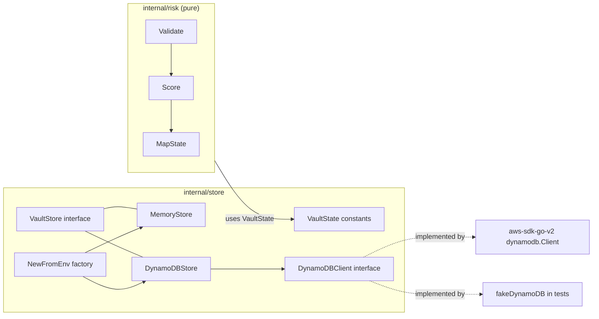

# Design Document

## Overview

The Behavioral Risk Engine adds two Go packages to the RukPay backend (module `github.com/<username>/rukpay/backend`):

- `backend/internal/risk` is a pure, deterministic scorer. It validates five Signals, sums per-signal points into a Risk_Score from 0 to 100, and maps the score to an Initial_State.
- `backend/internal/store` defines the `VaultState` constants, the `VaultRecord` type, the `VaultStore` interface, and two adapters: a `MemoryStore` guarded by `sync.RWMutex` and a `DynamoDBStore` that uses the single table `RukPayVaults`.

Scope stops at scoring and persistence. State transitions (`vault`), HTTP handlers, guardian flows and SSE belong to later specs.

Key design decisions:

| Decision | Choice | Reason |
|---|---|---|
| Scoring model | Additive integer points with a cap | Each signal's contribution is explainable and testable against an independent reference model. |
| Package dependency direction | `risk` imports `store` for `VaultState`; `store` never imports `risk` | Satisfies Requirement 6.2 and avoids an import cycle. |
| DynamoDB access | `DynamoDBClient` interface with `PutItem` and `GetItem` only | The store tests run offline with a fake client (Requirement 11). |
| `UpdateIf` on DynamoDB | `PutItem` with a ConditionExpression | Replaces the whole item atomically. A separate `UpdateItem` expression is unnecessary. |
| Expiry check on read | Both adapters compare `expires_at` to an injected clock | DynamoDB TTL deletion can lag, and the same contract tests must pass on both adapters. |
| Privacy | `VaultRecord` has only masked fields; stores validate mask formats | Requirement 12 is enforced by the type shape plus a check on write. |
| Logging | Neither package imports a logging package | Requirement 12.5 holds by construction. |

## Architecture



Later packages (`vault`, `guardian`) will call `risk.Evaluate`, build a `VaultRecord`, and persist it through `VaultStore`. This spec does not implement those callers.

## Components and Interfaces

### Package `risk`

```go
package risk

import "github.com/<username>/rukpay/backend/internal/store"

// Named thresholds (Requirement 3.4).
const (
    RealityCheckThreshold = 40 // score >= 40 -> REALITY_CHECK
    LockThreshold         = 75 // score >= 75 -> LOCKED_15M
    MaxScore              = 100
)

// Signals is the scoring input (Requirement 1.1).
type Signals struct {
    AmountINR          int64 `json:"amount_inr"`
    BeneficiaryAgeHrs  int64 `json:"beneficiary_age_hours"`
    IsLateNight        bool  `json:"is_late_night"`
    ActiveUnknownCall  bool  `json:"active_unknown_call"`
    RapidRetryCount    int   `json:"rapid_retry_count"`
}

// ValidationError names the offending field and nothing else.
type ValidationError struct{ Field string }

func (e *ValidationError) Error() string { return "invalid signal: " + e.Field }

// Result is the output of Evaluate.
type Result struct {
    Score int
    State store.VaultState
}

func Validate(s Signals) error          // Requirements 1.2-1.4
func Score(s Signals) int               // Requirement 2; assumes valid input
func MapState(score int) store.VaultState // Requirement 3
func Evaluate(s Signals) (Result, error)  // Validate, then Score, then MapState
```

Point tables (Requirement 2). Each helper is a pure function:

```go
func amountPoints(a int64) int {
    switch {
    case a >= 25000: return 35
    case a >= 10000: return 20
    case a >= 2000:  return 10
    default:         return 0
    }
}

func agePoints(h int64) int {
    switch {
    case h < 24: return 25
    case h < 72: return 10
    default:     return 0
    }
}

func retryPoints(n int) int {
    switch {
    case n >= 3: return 10
    case n == 2: return 5
    default:     return 0
    }
}

func Score(s Signals) int {
    total := amountPoints(s.AmountINR) + agePoints(s.BeneficiaryAgeHrs) + retryPoints(s.RapidRetryCount)
    if s.IsLateNight        { total += 10 }
    if s.ActiveUnknownCall  { total += 20 }
    if total > MaxScore     { total = MaxScore }
    return total
}

func MapState(score int) store.VaultState {
    switch {
    case score >= LockThreshold:         return store.StateLocked15M
    case score >= RealityCheckThreshold: return store.StateRealityCheck
    default:                             return store.StateInstantPass
    }
}
```

The maximum raw sum is 35 + 25 + 10 + 20 + 10 = 100, so the cap never changes a value with the current weights. It stays as a guard in case a weight changes.

The guarantees in Requirement 4 follow from the tables:

- Lock guarantee: 35 + 25 + 20 = 80, so at least 75 for any `is_late_night` and `rapid_retry_count`.
- Pass guarantee: 0 + 0 + 0 + 0 + at most 0 retry points (count 0 or 1) = 0, which is below 40.
- ₹450 known contact: 0 points, INSTANT_PASS. ₹18,000 new contact: 20 + 25 = 45, REALITY_CHECK. ₹85,000 new contact late night on a call: 35 + 25 + 10 + 20 = 90, LOCKED_15M.

Requirement 3.4 says "three threshold values 40 and 75". Only two thresholds exist. The design defines two named constants and treats the "three" as a typo for three states.

### Package `store`: types

```go
package store

type VaultState string

const (
    StateInstantPass      VaultState = "INSTANT_PASS"
    StateRealityCheck     VaultState = "REALITY_CHECK"
    StateLocked15M        VaultState = "LOCKED_15M"
    StateGuardianApproved VaultState = "GUARDIAN_APPROVED"
    StateVetoed           VaultState = "VETOED"
    StateExpired          VaultState = "EXPIRED"
)

// VaultRecord has masked identifiers only. There is no field for raw
// identifiers, OTPs, PINs or passwords (Requirement 12.1, 12.2).
type VaultRecord struct {
    ID                 string     `dynamodbav:"id"`
    State              VaultState `dynamodbav:"state"`
    RiskScore          int        `dynamodbav:"risk_score"`
    PayerAccountMasked string     `dynamodbav:"payer_account_masked,omitempty"`
    BeneficiaryMasked  string     `dynamodbav:"beneficiary_masked,omitempty"`
    UPIMasked          string     `dynamodbav:"upi_masked,omitempty"`
    PhoneMasked        string     `dynamodbav:"phone_masked,omitempty"`
    AmountINR          int64      `dynamodbav:"amount_inr"`
    CreatedAt          time.Time  `dynamodbav:"created_at,unixtime"`
    LockExpiresAt      time.Time  `dynamodbav:"lock_expires_at,unixtime"`
    Version            int        `dynamodbav:"version"`
    ExpiresAt          time.Time  `dynamodbav:"expires_at,unixtime"` // TTL attribute, epoch seconds
}
```

`Version` is owned by the caller. The store writes `newRecord` as given and never increments it.

### Package `store`: interface and errors

```go
type VaultStore interface {
    Create(ctx context.Context, rec VaultRecord) error
    Get(ctx context.Context, id string) (VaultRecord, error)
    UpdateIf(ctx context.Context, id string, expected VaultState, next VaultRecord) error
}

var (
    ErrAlreadyExists      = errors.New("vault already exists")
    ErrNotFound           = errors.New("vault not found")
    ErrConditionFailed    = errors.New("vault state condition failed")
    ErrUnmaskedIdentifier = errors.New("unmasked identifier")
)

// opError carries the operation and vault id only (Requirement 12.6).
type opError struct {
    Op  string
    ID  string
    Err error // sentinel or wrapped client error
}

func (e *opError) Error() string { return e.Op + " " + e.ID + ": " + e.Err.Error() }
func (e *opError) Unwrap() error { return e.Err }
```

Sentinel errors are returned wrapped in `opError`, so callers use `errors.Is`. Wrapped client errors from the AWS SDK are mapped to a fixed message (`"dynamodb request failed"`) while `Unwrap` still exposes the original for `errors.Is`/`errors.As`. This keeps record values out of the string. Callers must not format the unwrapped SDK error into logs.

### Mask validation

```go
var (
    reAccount = regexp.MustCompile(`^XXXX-XXXX-\d{4}$`)
    rePhone   = regexp.MustCompile(`^\+91-X{6}\d{4}$`)
    reUPI     = regexp.MustCompile(`^[A-Za-z0-9]\*\*\*@[A-Za-z0-9.\-]+$`)
)

// ValidateMasked returns ErrUnmaskedIdentifier when a non-empty
// identifier field does not match its mask format. Empty fields are allowed
// because Signals carry no identifiers (Requirement 12.4).
func ValidateMasked(rec VaultRecord) error
```

Both adapters call `ValidateMasked` at the top of `Create` and `UpdateIf`, before any write.

### MemoryStore

```go
type MemoryStore struct {
    mu   sync.RWMutex
    data map[string]VaultRecord
    now  func() time.Time // injectable clock, defaults to time.Now
}

func NewMemoryStore() *MemoryStore
```

Behavior:

- Every method first checks `ctx.Err()` and returns it when set (Requirement 7.10).
- `Create` takes the write lock, rejects an existing id with `ErrAlreadyExists`, and stores the record.
- `Get` takes the read lock, returns `ErrNotFound` for a missing id or when `ExpiresAt` is before `now()`, and returns a copy. `VaultRecord` holds only value types, so a struct copy is a deep copy.
- `UpdateIf` takes the write lock, returns `ErrNotFound` for a missing id, `ErrConditionFailed` when the stored state differs, and otherwise replaces the record. The check and the write happen under one lock, so exactly one concurrent caller wins.

### DynamoDBStore

```go
// DynamoDBClient is the narrow surface the store calls (Requirement 11.1, 11.2).
// *dynamodb.Client satisfies it.
type DynamoDBClient interface {
    PutItem(ctx context.Context, in *dynamodb.PutItemInput, opts ...func(*dynamodb.Options)) (*dynamodb.PutItemOutput, error)
    GetItem(ctx context.Context, in *dynamodb.GetItemInput, opts ...func(*dynamodb.Options)) (*dynamodb.GetItemOutput, error)
}

type DynamoDBStore struct {
    client DynamoDBClient
    table  string
    now    func() time.Time
}

func NewDynamoDBStore(c DynamoDBClient, table string) *DynamoDBStore
```

Item layout (single table `RukPayVaults`, TTL on `expires_at`):

| Attribute | Value |
|---|---|
| `PK` | `VAULT#<id>` |
| `SK` | `META` |
| `state` and other record fields | from `attributevalue.MarshalMap(rec)` |
| `expires_at` | Number, Unix epoch seconds |

Operations:

- `Create`: `PutItem` with `ConditionExpression: "attribute_not_exists(PK)"`. A `ConditionalCheckFailedException` maps to `ErrAlreadyExists`.
- `Get`: `GetItem` with `PK`, `SK`. An empty `Item` maps to `ErrNotFound`. A decoded record whose `ExpiresAt` is before `now()` also maps to `ErrNotFound`.
- `UpdateIf`: `PutItem` with `ConditionExpression: "attribute_exists(PK) AND #s = :expected"`, `#s` bound to `state`. On `ConditionalCheckFailedException`, a follow-up `GetItem` decides the error: no item gives `ErrNotFound`, otherwise `ErrConditionFailed`.
- Any other client error becomes an `opError` that wraps the original and has a fixed message.

Detecting the condition failure uses `errors.As(err, &*types.ConditionalCheckFailedException)`.

### Factory

```go
// NewFromEnv reads STORAGE_DRIVER ("memory" | "dynamodb"), DYNAMODB_TABLE_NAME
// (default "RukPayVaults") and DYNAMODB_ENDPOINT (optional).
func NewFromEnv(ctx context.Context) (VaultStore, error)
```

For `dynamodb`, it loads the default AWS config, applies `BaseEndpoint` when `DYNAMODB_ENDPOINT` is set, and wraps `dynamodb.NewFromConfig`. An unknown driver value returns an error naming the variable only. Only the AWS SDK for Go v2 is imported; no SQLite package appears anywhere.

## Data Models

Directory layout added by this feature:

```text
backend/
├── go.mod
└── internal/
    ├── risk/
    │   ├── risk.go           # Signals, Validate, Score, MapState, Evaluate
    │   ├── risk_test.go      # examples, boundaries, presets
    │   └── risk_pbt_test.go  # rapid properties
    └── store/
        ├── types.go          # VaultState, VaultRecord
        ├── store.go          # VaultStore, errors, opError
        ├── mask.go           # ValidateMasked
        ├── memory.go         # MemoryStore
        ├── dynamodb.go       # DynamoDBStore, DynamoDBClient
        ├── factory.go        # NewFromEnv
        ├── fake_dynamodb_test.go
        ├── contract_test.go  # shared behavioral suite
        └── store_pbt_test.go
infra/dynamodb-table.json     # table schema; unchanged by this spec if it already exists
```

The `RukPayVaults` table schema: partition key `PK` (S), sort key `SK` (S), on-demand billing, TTL attribute `expires_at`.

## Error Handling

| Condition | Result |
|---|---|
| `amount_inr <= 0`, `beneficiary_age_hours < 0`, `rapid_retry_count < 0` | `*risk.ValidationError{Field: ...}`; validation checks fields in the order amount, age, retry and returns the first failure. |
| Cancelled context | `ctx.Err()` returned before any work. |
| Duplicate `Create` | `ErrAlreadyExists`, stored record unchanged. |
| Missing or expired id | `ErrNotFound`. |
| `UpdateIf` state mismatch | `ErrConditionFailed`, stored record unchanged. |
| Non-masked identifier | `ErrUnmaskedIdentifier`, nothing persisted. |
| Other DynamoDB error | `opError` with fixed message, original error reachable through `Unwrap`. |
| Unknown `STORAGE_DRIVER` | Error from `NewFromEnv`. |

Error strings contain the operation name and vault id only. No amount, score or masked identifier appears in any message.

## Correctness Properties

Each entry below is a statement that should hold across all valid executions of the system. These statements connect the written requirements to automated checks.

Reflection on redundancy: Requirements 1.5, 2.1 to 2.7 collapse into one reference-model property (Property 2), because a model that computes the sum independently also proves the range and the nil error. Requirements 7.2, 7.4 and 9.6 collapse into the round trip (Property 8). Requirements 7.6, 7.7 and 7.9 collapse into one `UpdateIf` property (Property 10). Requirements 10.5 and 12.6 collapse into one error-content property (Property 15). Requirement 5 describes the test suite itself and is satisfied by Properties 2, 5, 6 and 7. Criteria about interface shape, locking mechanics, SQLite absence and logging are verified by compile checks, `go test -race`, and a grep smoke test.

### Property 1: Invalid signals are rejected with the offending field

For any Signals where exactly one of `amount_inr <= 0`, `beneficiary_age_hours < 0` or `rapid_retry_count < 0` holds, `Validate` returns a `*ValidationError` whose `Field` is the name of that field.

**Validates: Requirements 1.2, 1.3, 1.4**

### Property 2: Score equals the reference model and stays in range

For any valid Signals, `Evaluate` returns no error, and the Risk_Score equals `min(100, amountPts + agePts + nightPts + callPts + retryPts)` computed by an independent reference implementation written in the test from the tier tables, and lies between 0 and 100 inclusive. Generators cover every tier boundary (1999, 2000, 9999, 10000, 24999, 25000; 23, 24, 71, 72; retry 0, 1, 2, 3).

**Validates: Requirements 1.5, 2.1, 2.2, 2.3, 2.4, 2.5, 2.6, 2.7, 5.5**

### Property 3: Scoring is deterministic

For any valid Signals, two calls to `Evaluate` return identical results.

**Validates: Requirements 2.8**

### Property 4: State mapping follows the thresholds

For any integer score from 0 to 100, `MapState` returns INSTANT_PASS when the score is below 40, REALITY_CHECK when it is 40 to 74, and LOCKED_15M when it is 75 or higher.

**Validates: Requirements 3.1, 3.2, 3.3**

### Property 5: Lock guarantee

For any Signals with `amount_inr >= 25000`, `beneficiary_age_hours < 24` and `active_unknown_call = true`, and any `is_late_night` and `rapid_retry_count`, `Evaluate` returns a score of at least 75 and the state LOCKED_15M. The test runs at least 1000 generated inputs.

**Validates: Requirements 4.1, 5.1**

### Property 6: Pass guarantee

For any Signals with `amount_inr < 2000`, `beneficiary_age_hours >= 72`, `is_late_night = false`, `active_unknown_call = false` and `rapid_retry_count` of 0 or 1, `Evaluate` returns a score below 40 and the state INSTANT_PASS. The test runs at least 1000 generated inputs.

**Validates: Requirements 4.2, 5.2**

### Property 7: Unknown call never lowers the score

For any valid Signals, setting `active_unknown_call` from false to true with all other fields unchanged yields a score greater than or equal to the original. The test runs at least 1000 generated inputs.

**Validates: Requirements 5.4**

### Property 8: Create then Get round trip

For any valid VaultRecord with masked identifiers and a future `expires_at`, and for each of MemoryStore and DynamoDBStore (with the fake client), `Create` followed by `Get` returns a record equal to the original.

**Validates: Requirements 7.2, 7.4, 9.6**

### Property 9: Duplicate Create is rejected and leaves the record unchanged

For any two valid VaultRecords with the same id, creating the first and then the second returns `ErrAlreadyExists` for the second, and `Get` still returns the first record, on both adapters.

**Validates: Requirements 7.3, 10.3**

### Property 10: UpdateIf is a compare-and-swap on state

For any stored record, any `expectedState` and any `newRecord`: if `expectedState` equals the stored state, `UpdateIf` succeeds and `Get` returns `newRecord`, even when the state pair is not a legal transition; otherwise it returns `ErrConditionFailed` and `Get` returns the original record. This holds on both adapters.

**Validates: Requirements 7.6, 7.7, 7.9, 10.4**

### Property 11: Returned records are copies

For any stored record, mutating the record returned by `Get` does not change what a later `Get` returns, on both adapters.

**Validates: Requirements 8.3**

### Property 12: Expired records are not found

For any stored record whose `expires_at` is earlier than the store's current time, `Get` returns `ErrNotFound`, on both adapters.

**Validates: Requirements 7.4, 9.4**

### Property 13: DynamoDB item layout

For any valid VaultRecord, the item written by `DynamoDBStore.Create` has `PK` equal to `VAULT#<id>`, `SK` equal to `META`, and `expires_at` as a Number equal to the record's `ExpiresAt` in Unix epoch seconds.

**Validates: Requirements 9.2, 9.3**

### Property 14: Unmasked identifiers are never persisted

For any VaultRecord where at least one identifier field is non-empty and does not match its mask format, `Create` and `UpdateIf` return `ErrUnmaskedIdentifier` and the store contents are unchanged. For any record whose identifiers are empty or match their formats, the same calls do not return `ErrUnmaskedIdentifier`. This holds on both adapters.

**Validates: Requirements 12.3**

### Property 15: Errors wrap the cause and leak no record values

For any VaultRecord and any non-conditional error injected into the fake DynamoDB client, the error returned by each `DynamoDBStore` method satisfies `errors.Is(err, injected)`, and its `Error()` string contains the operation name and vault id and does not contain the amount, the score, or any masked identifier value.

**Validates: Requirements 10.5, 12.6**

## Testing Strategy

Two layers, both runnable with `go test ./...` and no Docker, DynamoDB Local or network (Requirement 11.5).

**Property-based tests** use `pgregory.net/rapid`. Each property runs with at least 1000 checks (`-rapid.checks=1000` or `rapid.T` configured in the test) and carries a tag comment of the form `// Feature: behavioral-risk-engine, Property N: <title>`. Properties 1 to 7 test `risk` and are pure. Properties 8 to 15 test `store` through a shared contract suite that is called once with a `MemoryStore` and once with a `DynamoDBStore` over `fakeDynamoDB`, so both adapters face identical tests (Requirement 11.6). Property 13 and the injected-error part of Property 15 apply to the DynamoDB adapter only.

**Fake client** (`fakeDynamoDB`) keeps items in a `map[string]map[string]types.AttributeValue`, evaluates the two condition expressions the store uses (`attribute_not_exists(PK)` and `attribute_exists(PK) AND #s = :expected`), and can be configured to fail a chosen call with `ConditionalCheckFailedException` or an arbitrary error. It records the last input so example tests can assert the ConditionExpression strings.

**Example and edge-case unit tests** cover:

- Demo presets: ₹450 known contact gives INSTANT_PASS, ₹18,000 new contact gives REALITY_CHECK, ₹85,000 new contact late night on a call gives LOCKED_15M (Requirements 4.3 to 4.5).
- `VaultState` constants hold their own names (Requirement 6.1).
- Get and UpdateIf on a missing id return `ErrNotFound` (Requirements 7.5, 7.8).
- A cancelled context returns the context error on every method (Requirement 7.10).
- Table name defaults to `RukPayVaults` and `NewFromEnv` selects the adapter from `STORAGE_DRIVER` (Requirements 8.5, 9.1, 9.5).
- ConditionExpression strings for `Create` and `UpdateIf` (Requirements 10.1, 10.2).
- Conditional failure on `UpdateIf` followed by an empty read gives `ErrNotFound` (Requirement 10.4).
- Concurrency: N goroutines (for example 50) call `UpdateIf` with the same expected state on one id under `go test -race`; exactly one succeeds and the rest get `ErrConditionFailed` (Requirement 8.4).

**Smoke checks**: `go list -deps ./... | grep -i sqlite` finds nothing (Requirement 8.6), and neither package imports `log`, `log/slog` or a third-party logger (Requirement 12.5).

Property-based testing is not used for the DynamoDB wiring itself or for AWS behavior. The adapter's logic is tested against the fake, and the real service is left to a manual or deployment-time check.
