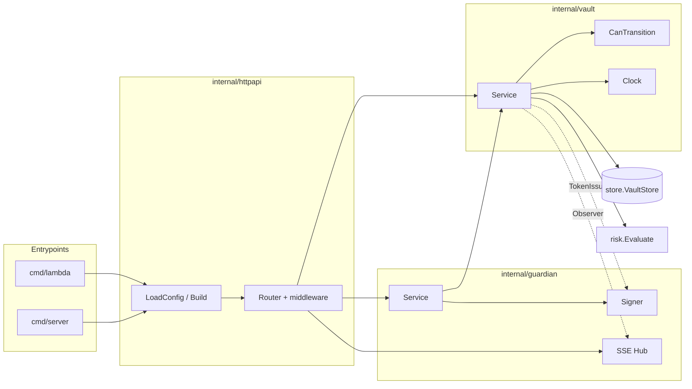
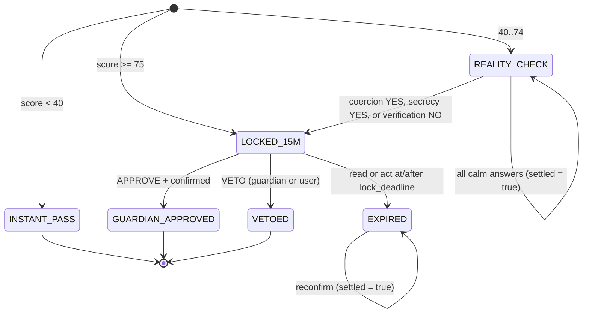

# Design Document

## Overview

The Cooling-Off Vault turns a Risk_Score into an enforced payment pause. It adds three Go packages and two entrypoints to the RukPay backend (module `github.com/<username>/rukpay/backend`):

- `internal/vault` owns the Vault_State rules, the 900-second Lock_Duration, lazy expiry, Reality_Check evaluation, Reconfirmation and demo fast-forward.
- `internal/guardian` owns Guardian_Token signing and verification, the approve and veto flow, the Evidence_Summary, and the SSE_Hub.
- `internal/httpapi` builds the one `net/http` Router, CORS, body limits, redaction and logging, and the startup configuration shared by `cmd/server` and `cmd/lambda`.

It builds on `behavioral-risk-engine` (`risk.Evaluate`, `store.VaultStore`, store errors, `store.ValidateMasked`, `store.NewFromEnv`).

Key design decisions:

| Decision | Choice | Reason |
|---|---|---|
| Guardian authorization | Stateless token `<id>.<expiry>.<hex tag>`, HMAC-SHA256 | No token table. The server recomputes the token on read, so the key and the stored `token_expiry` are the only inputs. |
| Expiry | Lazy, checked in one `load` function | No timer exists, so Lambda freezing cannot skip an expiry. |
| Concurrency | Every write is `UpdateIf` with the state last read | One caller wins each race; the others get 409. |
| Transition rules | One table in `vault`, `CanTransition(from, to)` | Handlers cannot reach an illegal state. |
| Dependency direction | `httpapi` → `guardian` → `vault` → `store`, `risk`. `vault` depends on two small interfaces (`TokenIssuer`, `Observer`) that `guardian` implements | Avoids an import cycle while letting `vault` publish every change, including lazy expiry. |
| EXPIRED re-confirmation route | **Extend `POST /api/v1/vault/{id}/reality-check` with a `reconfirm` payload** (decision below) | Keeps the contract at the six endpoints in the steering document. |
| Time | `vault.Clock` (`func() time.Time`), shared with the test `MemoryStore` | Tests control time everywhere. |
| Raw input | Request structs are typed and carry no OTP, PIN or password field | Unknown JSON fields are dropped at decode, so they cannot be stored, logged or published. |

### Decision: Reconfirmation route

The open question was which route accepts the final calm re-confirmation after a vault reaches EXPIRED. The endpoint contract fixes six routes and none is named for it. The design extends `POST /api/v1/vault/{id}/reality-check`. The body is exactly one of two shapes:

```json
{ "answers": { "coercion": "YES|NO", "secrecy": "YES|NO", "verification": "YES|NO" } }
```

```json
{ "reconfirm": true }
```

Rules:

- A body with both `answers` and `reconfirm`, or with neither, is HTTP 400 `invalid_request`.
- `answers` applies to a vault in REALITY_CHECK (Requirement 3). Any other state is HTTP 409 with the current state.
- `reconfirm: true` applies to a vault in EXPIRED (Requirement 4.5). Any other state is HTTP 409 with the current state. `reconfirm: false` is HTTP 400.
- On success the vault stays EXPIRED and `settled` becomes true.

Why this route: the user panel already posts to `reality-check` for the last calm confirmation step, so the client needs no new URL, no new CORS entry, and no change to the six-route list in the steering document. A seventh route would add surface for no gain. Reconfirmation is a user-only action. It needs no Guardian_Token because the vault id is the user's capability and the action only releases the user's own payment after the pause has fully run.

## Architecture



### Lock lifecycle



## Components and Interfaces

### Store changes (owned by `behavioral-risk-engine`, extended here)

`VaultRecord` gains the fields this feature needs. The old `LockExpiresAt time.Time` is replaced by `LockDeadline`. The new fields are `int64` epoch seconds so that a zero value round-trips cleanly through DynamoDB and compares with `==`.

```go
type VaultRecord struct {
    // ...existing fields (ID, State, RiskScore, masked identifiers, AmountINR, CreatedAt, Version, ExpiresAt)
    LockDeadline    int64  `dynamodbav:"lock_deadline"`    // 0 when never locked
    TokenExpiry     int64  `dynamodbav:"token_expiry"`     // original deadline; never changed by fast-forward
    Settled         bool   `dynamodbav:"settled"`
    Reason          string `dynamodbav:"reason"`           // plain-language, no identifiers
    EvidenceSummary string `dynamodbav:"evidence,omitempty"` // set on VETOED only
}
```

`NewMemoryStore` gains a clock option (`NewMemoryStoreWithClock(now func() time.Time)`) so the vault tests drive record expiry and lock expiry from one fake clock. No new store method is needed. The contract tests of the store package are updated for the new fields.

### Package `vault`

```go
package vault

const LockDuration = 900 // seconds
const fastForwardSeconds = 3
const ttlMargin = 3600

type Clock func() time.Time

var (
    ErrInvalidTransition = errors.New("invalid transition")
    ErrNotDemoMode       = errors.New("demo mode disabled")
)

// ConflictError is returned when the vault is not in the state an action needs,
// or when UpdateIf lost a race. It carries the current View for the 409 body.
type ConflictError struct{ Current View }

type Answer string // "YES" | "NO"
type Answers struct{ Coercion, Secrecy, Verification Answer }

// TokenIssuer is implemented by guardian.Signer.
type TokenIssuer interface{ Issue(vaultID string, expiry int64) string }

// Observer is implemented by guardian.Hub. Called after every successful change.
type Observer interface{ Publish(View) }

// View is the safe projection of a record. It is the HTTP body, the SSE
// payload and the Vault_Event. It holds masked metadata only.
type View struct {
    ID               string          `json:"vault_id"`
    State            store.VaultState `json:"state"`
    Settled          bool            `json:"settled"`
    RiskScore        int             `json:"risk_score"`
    RemainingSeconds int64           `json:"remaining_seconds"`
    ReconfirmNeeded  bool            `json:"reconfirm_required"`
    Reason           string          `json:"reason"`
    Metadata         Metadata        `json:"metadata"` // masked fields + amount_inr
    GuardianToken    string          `json:"guardian_token,omitempty"` // LOCKED_15M only
    Evidence         string          `json:"evidence_summary,omitempty"` // VETOED only
}

type Service struct { /* store, clock, demo bool, issuer, observer */ }

func New(s store.VaultStore, c Clock, demo bool, i TokenIssuer, o Observer) *Service

func (s *Service) Evaluate(ctx context.Context, req EvaluateRequest) (View, error)
func (s *Service) Get(ctx context.Context, id string) (View, error)
func (s *Service) RealityCheck(ctx context.Context, id string, a Answers) (View, error)
func (s *Service) Reconfirm(ctx context.Context, id string) (View, error)
func (s *Service) Approve(ctx context.Context, id string) (View, error)
func (s *Service) Veto(ctx context.Context, id string) (View, error)
func (s *Service) FastForward(ctx context.Context, id string) (View, error)

func CanTransition(from, to store.VaultState) bool
func CheckAnswers(a Answers) (lock bool, err error)
```

Transition table (Requirement 2.1 to 2.4):

```go
var allowed = map[store.VaultState][]store.VaultState{
    store.StateRealityCheck: {store.StateLocked15M},
    store.StateLocked15M:    {store.StateGuardianApproved, store.StateVetoed, store.StateExpired},
}

func CanTransition(from, to store.VaultState) bool {
    for _, t := range allowed[from] { if t == to { return true } }
    return false
}
```

Creation into INSTANT_PASS, REALITY_CHECK or LOCKED_15M happens only in `Evaluate`, which takes its state from `risk.Evaluate` and never from the caller.

Core helpers:

```go
// load reads a record and applies lazy expiry (Requirement 4.2, 7.5).
func (s *Service) load(ctx context.Context, id string) (store.VaultRecord, error) {
    rec, err := s.store.Get(ctx, id)
    if err != nil { return rec, err }
    now := s.clock().Unix()
    if rec.State == store.StateLocked15M && now >= rec.LockDeadline {
        next := rec
        next.State, next.Settled, next.Version = store.StateExpired, false, rec.Version+1
        next.Reason = msgExpired
        err := s.store.UpdateIf(ctx, id, store.StateLocked15M, next)
        switch {
        case err == nil:
            s.observer.Publish(s.view(next, now))
            return next, nil
        case errors.Is(err, store.ErrConditionFailed):
            return s.store.Get(ctx, id) // another caller changed it first
        default:
            return rec, err
        }
    }
    return rec, nil
}

// apply runs one guarded change: the record must be in `from`; if `to` differs,
// CanTransition must allow it; the write is UpdateIf(expected = from).
func (s *Service) apply(ctx context.Context, id string, from store.VaultState,
    to store.VaultState, mutate func(*store.VaultRecord)) (store.VaultRecord, error)
```

`apply` returns `*ConflictError` (with the current View) when the loaded state is not `from` or when `UpdateIf` returns `ErrConditionFailed` (after a re-read). It returns `ErrInvalidTransition` when `to != from` and `CanTransition(from, to)` is false, before any write. It bumps `Version`, calls the observer after a successful write, and never logs.

Operation details:

- **Evaluate.** Validates masked identifiers with `store.ValidateMasked` first, so a bad identifier gives HTTP 400 before `risk.Evaluate` and before `Create`. Calls `risk.Evaluate`. Generates the id with `crypto/rand` (16 bytes, hex, 128 bits). Builds the record: `Settled = state == INSTANT_PASS`. For LOCKED_15M, `LockDeadline = TokenExpiry = created + 900`, `ExpiresAt = LockDeadline + 3600`. For INSTANT_PASS and REALITY_CHECK, `ExpiresAt = created + 3600`. Reason comes from `reasonFor(state, signals)`.
- **RealityCheck.** `CheckAnswers` returns `lock = coercion == YES || secrecy == YES || verification == NO`, or `ErrInvalidAnswers` for any other value. On `lock`, `apply(RC → LOCKED)` sets `LockDeadline = TokenExpiry = now + 900`, `ExpiresAt = LockDeadline + 3600`, `Settled = false`, and the protective-pause reason. Otherwise `apply(RC → RC)` sets `Settled = true`. A vault in REALITY_CHECK with `Settled` already true gives a 409, so a passed check cannot be re-submitted with different answers.
- **Reconfirm.** `apply(EXPIRED → EXPIRED)` sets `Settled = true`. Wrong state gives `ConflictError`.
- **Approve.** `apply(LOCKED → GUARDIAN_APPROVED)` sets `Settled = true`.
- **Veto.** `apply(LOCKED → VETOED)` sets `Settled = false` and `EvidenceSummary` built by `guardian.BuildEvidence` (passed in through a function field to keep the dependency one-way).
- **FastForward.** Returns `ErrNotDemoMode` when demo is off. Otherwise `apply(LOCKED → LOCKED)` sets `LockDeadline = min(LockDeadline, now + 3)`. `TokenExpiry` is untouched. If `LockDeadline <= now + 3` already, the record is returned unchanged with no write.
- **Get.** `load`, then `view`.

`view` computes `RemainingSeconds = max(0, LockDeadline - now)` only while LOCKED. It recomputes the Guardian_Token with `issuer.Issue(id, rec.TokenExpiry)` for LOCKED_15M and leaves it empty otherwise. `ReconfirmNeeded = State == EXPIRED && !Settled`.

### Package `guardian`

```go
package guardian

type Signer struct{ key []byte }

func NewSigner(key []byte) *Signer
func (s *Signer) Issue(vaultID string, expiry int64) string   // "<id>.<expiry>.<hex(HMAC-SHA256(key, id+"."+expiry))>"
func (s *Signer) Verify(token, pathID string, now int64) error // single opaque ErrForbidden for every failure

var ErrForbidden = errors.New("forbidden")
```

`Verify` order, per Requirement 5.3 to 5.7: split into exactly three parts (otherwise `ErrForbidden`), recompute the tag over the id and expiry from the token, `hmac.Equal` against the decoded tag, then require `id == pathID`, then require `expiry > now`. Every failure returns the same `ErrForbidden`, so the HTTP body is identical for a bad tag, a malformed token, a wrong vault and an expired token. Vault ids are hex, so they contain no `.`.

```go
type Service struct { vault *vault.Service; signer *Signer; clock vault.Clock }

type Action struct {
    Action    string `json:"action"`     // "APPROVE" | "VETO"
    Token     string `json:"token"`
    Confirmed bool   `json:"confirmed"`
}

type Result struct {
    Status string      `json:"status"`            // "OK" | "CONFIRMATION_REQUIRED"
    View   vault.View  `json:"vault"`
}

func (s *Service) Act(ctx context.Context, id string, a Action) (Result, error)
```

`Act` runs `Verify` first, before it reads the action value or touches the store. Then: unknown `action` is `ErrInvalidAction` (400); APPROVE with `Confirmed == false` returns `CONFIRMATION_REQUIRED` with the current view and no write; APPROVE confirmed calls `vault.Approve`; VETO calls `vault.Veto`. The user panel vetoes through the same call with the token from its own `GET` response.

`BuildEvidence(rec, vetoedAt)` produces the Evidence_Summary text. It lists the vault id, the masked identifiers, amount, Risk_Score, creation time, veto time, and the lines `National Cybercrime Helpline: 1930` and `Report online: cybercrime.gov.in`. It reads only fields of `VaultRecord`, which holds masked values only, then passes the result through `httpapi.Redact`-equivalent `redact.Text` so an OTP, PIN or password pattern becomes `[REDACTED]`.

### SSE hub

```go
type Hub struct {
    mu   sync.Mutex
    subs map[string]map[chan []byte]struct{}
}

func (h *Hub) Subscribe(id string) (ch <-chan []byte, cancel func())
func (h *Hub) Publish(v vault.View)  // implements vault.Observer
```

- Each subscription owns a buffered channel (capacity 8).
- `Publish` marshals the View once without the Guardian_Token field (the event carries state, never the token; the panel already holds it from `GET`), then does a non-blocking send to each subscriber. A full channel drops that event (Requirement 8.8).
- `cancel` removes the channel under the lock and closes it, and deletes the map entry when it is empty (Requirement 8.3).
- The hub is per process. On Lambda each instance has its own hub, which is why the client polls (below).

### Package `httpapi`

```go
type Config struct {
    StorageDriver  string
    AllowedOrigin  string // default "http://localhost:5173"
    Port           string // default "8080"
    DemoMode       bool
    OnLambda       bool   // AWS_LAMBDA_FUNCTION_NAME != ""
    HMACKey        []byte
}

func LoadConfig(getenv func(string) string) (Config, error)
func Build(ctx context.Context, cfg Config) (http.Handler, error) // store.NewFromEnv, signer, hub, service, router
```

`LoadConfig` returns an error when `HMAC_SECRET_KEY` is empty and `DEMO_MODE != "true"`. In Demo_Mode with no key it fills `HMACKey` with 32 bytes from `crypto/rand` (Requirement 5.8). Entrypoints print the error text (it never contains the key) and exit non-zero.

Routes, registered with Go 1.22 patterns:

```go
mux.HandleFunc("POST /api/v1/transactions/evaluate",         h.evaluate)
mux.HandleFunc("POST /api/v1/vault/{id}/reality-check",      h.realityCheck)
mux.HandleFunc("POST /api/v1/vault/{id}/guardian-action",    h.guardianAction)
mux.HandleFunc("POST /api/v1/vault/{id}/demo-fast-forward",  h.fastForward)
mux.HandleFunc("GET /api/v1/vault/{id}",                     h.getVault)
mux.HandleFunc("GET /api/v1/events/stream",                  h.stream)
```

Middleware chain (outermost first): `logging` → `cors` (also answers `OPTIONS`) → `bodyLimit` (`http.MaxBytesReader`, 64 KiB, mapped to 413) → mux.

| Concern | Behavior |
|---|---|
| Logging | One line per request: method, route pattern, status, vault id. No body, signals, identifiers, amounts or tokens. |
| CORS | Echo `Access-Control-Allow-Origin` only when `Origin` equals `Config.AllowedOrigin`. Preflight returns allowed methods `GET, POST, OPTIONS` and headers `Content-Type`. |
| Decode | `json.NewDecoder` into typed structs. A syntax or type error is 400 `invalid_request`. |
| Fast-forward | Returns 404 `not_found` when `DemoMode` is false, before reading the vault. |

`realityCheck` decodes `{answers?, reconfirm?}` with pointer fields, then enforces the exactly-one rule from the Reconfirmation decision and dispatches to `RealityCheck` or `Reconfirm`.

`stream` (`GET /api/v1/events/stream?vault_id=`):

1. Missing `vault_id` is 400. Unknown id is 404. Neither opens a stream.
2. Sets `Content-Type: text/event-stream`, `Cache-Control: no-cache`, `X-Accel-Buffering: no`, and writes the current View as the first `data:` event, flushing with `http.Flusher`.
3. Subscribes to the hub. A `select` loop writes events, writes the comment `: keep-alive` every 15 seconds, exits on `r.Context().Done()`, and calls `cancel`.
4. When `Config.OnLambda`, a 25-second timer ends the loop. `httpadapter` returns a buffered response, so on Lambda the client receives the first event when the stream closes and then polls `GET /api/v1/vault/{id}`. Live fan-out is a local-server feature, matching the decisions in the requirements.

Error bodies use one shape and calm copy:

```json
{ "error": { "code": "invalid_field", "message": "Please check the amount and try again.", "field": "amount_inr" } }
```

| Condition | Status | Code |
|---|---|---|
| Invalid signal (`*risk.ValidationError`) | 400 | `invalid_field`, with `field` |
| Unmasked identifier | 400 | `invalid_identifier` |
| Bad JSON, bad answers, bad action, bad reconfirm shape | 400 | `invalid_request` |
| Bad, malformed, wrong-vault or expired token | 403 | `forbidden` (one identical body) |
| Unknown vault, or fast-forward with demo off | 404 | `not_found` |
| Wrong state or lost race | 409 | `state_conflict`, with the current View |
| Body over 64 KiB | 413 | `too_large` |
| Anything else | 500 | `internal`, fixed message; the store error is not formatted into the body |

### Entrypoints

```go
// cmd/server/main.go
func main() {
    cfg, err := httpapi.LoadConfig(os.Getenv)
    if err != nil { fmt.Fprintln(os.Stderr, err); os.Exit(1) }
    h, err := httpapi.Build(context.Background(), cfg)
    if err != nil { fmt.Fprintln(os.Stderr, err); os.Exit(1) }
    if cfg.OnLambda {
        lambda.Start(httpadapter.NewV2(h).ProxyWithContext) // Function URL, payload v2
        return
    }
    log.Fatal(http.ListenAndServe(":"+cfg.Port, h))
}
```

`cmd/lambda/main.go` is the same minus the `ListenAndServe` branch and is compiled with `-tags lambda.norpc`. `STORAGE_DRIVER` defaults to `memory` when unset. Both entrypoints call the same `Build`, so behavior matches locally and on Lambda.

### Redaction and calm copy

`redact.Text(s string) string` replaces matches of `(?i)\b(otp|pin|password|passcode)\b\s*[:=]?\s*\S+` with `[REDACTED]`. It runs on every `Reason`, `EvidenceSummary` and View string before it is stored, logged or published. Typed request structs already exclude those fields.

All user-facing strings live in one file `vault/messages.go` as constants. The locked message reads: "Take a breath. Because this is a large transfer to a new recipient while you're on a call, RukPay has placed a 15-minute safety pause on it." The reason clause is built from the true Signals only, using plain phrases such as "a large amount", "a brand-new recipient", "late at night", "an active unknown call". None of the banned phrases or technical terms appears in any constant.

## Data Models

```text
backend/
├── cmd/
│   ├── server/main.go
│   └── lambda/main.go
└── internal/
    ├── vault/
    │   ├── vault.go           # Service, load, apply, operations
    │   ├── transitions.go     # allowed table, CanTransition
    │   ├── answers.go         # Answers, CheckAnswers
    │   ├── view.go            # View, Metadata, view()
    │   ├── messages.go        # calm copy constants, reasonFor
    │   ├── vault_test.go
    │   └── vault_pbt_test.go
    ├── guardian/
    │   ├── token.go           # Signer, Issue, Verify
    │   ├── service.go         # Action, Act
    │   ├── evidence.go        # BuildEvidence
    │   ├── hub.go             # SSE Hub
    │   ├── guardian_test.go
    │   └── guardian_pbt_test.go
    └── httpapi/
        ├── config.go
        ├── router.go          # routes, handlers
        ├── middleware.go      # logging, cors, body limit
        ├── errors.go
        ├── redact.go
        └── httpapi_test.go
```

Stored vault item: the `behavioral-risk-engine` layout (`PK = VAULT#<id>`, `SK = META`, TTL `expires_at`) plus `lock_deadline`, `token_expiry`, `settled`, `reason`, `evidence`. `expires_at` is at least `lock_deadline + 3600` for any vault that has been locked.

## Error Handling

- Token failure paths all return the same 403 body, with no hint of which check failed.
- `ConflictError` always carries the current View, so a losing client can update its screen without another request.
- Store errors other than `ErrNotFound` and `ErrConditionFailed` become 500 `internal` with a fixed message. Error text from the store is never put in a response or log.
- A cancelled request context aborts the store call, returns the context error and writes nothing.
- A lazy-expiry write that loses a race re-reads and uses whatever state the winner wrote.
- A stale write cannot revive a terminal vault, because `UpdateIf` compares the expected state and every terminal state differs from the one a stale writer expects.
- Known accepted case: two reality-check submissions racing on one vault both pass the state check. If both pass, the result is the same. If one locks and one passes, the order decides, and the lock wins whenever it applies last. Neither outcome moves money.
- The vault id acts as the user's capability and, per Requirement 7.2, `GET` returns the Guardian_Token for a locked vault. The 128-bit id is therefore treated as a secret and is not written to logs beyond the route log line required by Requirement 11.1.

## Correctness Properties

*A property is a characteristic or behavior that should hold true across all valid executions of a system-essentially, a formal statement about what the system should do. Properties serve as the bridge between human-readable specifications and machine-verifiable correctness guarantees.*

Reflection on redundancy: Requirements 1.2 to 1.4 merge into one creation property (Property 1). Requirements 2.1 to 2.4 and 12.2 merge into the transition-table property (Property 3) and the reachable-state property (Property 4). Requirements 3.2 to 3.5 merge into one answers property (Property 6). Requirements 5.1 to 5.7 and 12.5, 12.6 merge into one token round-trip property (Property 12) plus a mutation property (Property 13). Requirements 6.3, 6.4 and 6.8 merge into the veto property (Property 15). Requirements 9.1 and 9.3 to 9.6 merge into the fast-forward property (Property 18). Criteria about route lists, entrypoint wiring, CORS, SSE timing, logging and SQLite absence are verified by example and smoke tests, not properties.

### Property 1: Creation matches the risk engine

For any valid Signals, `Evaluate` returns the state and Risk_Score that `risk.Evaluate` returns for those Signals, and the stored record has `Settled` true exactly when the state is INSTANT_PASS, `LockDeadline` and `TokenExpiry` both equal `created + 900` exactly when the state is LOCKED_15M, a Guardian_Token in the response exactly when the state is LOCKED_15M, and `ExpiresAt >= LockDeadline + 3600` whenever the state is LOCKED_15M.

**Validates: Requirements 1.1, 1.2, 1.3, 1.4, 1.8**

### Property 2: Invalid input never creates a vault

For any Signals that fail validation, or any request holding an identifier that fails `ValidateMasked`, the HTTP response is 400 (naming the field for a signal error) and the store holds no new record.

**Validates: Requirements 1.6, 1.7**

### Property 3: Transition table is exact

For any pair of Vault_States `(from, to)`, `CanTransition(from, to)` is true exactly when the pair is REALITY_CHECK to LOCKED_15M, LOCKED_15M to GUARDIAN_APPROVED, LOCKED_15M to VETOED, or LOCKED_15M to EXPIRED. For any pair outside that set, `apply` returns `ErrInvalidTransition` and the stored record is unchanged. For any `from` in INSTANT_PASS, GUARDIAN_APPROVED or VETOED, every `to` is rejected.

**Validates: Requirements 2.1, 2.2, 2.3, 2.4**

### Property 4: Operation sequences only make permitted state changes

For any generated sequence of operations (reality check, approve, veto, fast-forward, read, reconfirm, clock advance) on a vault of any initial state, every observed change of Vault_State is in the permitted set of Requirement 2.1 or is the EXPIRED transition, and once a vault is VETOED or GUARDIAN_APPROVED no later operation changes its state.

**Validates: Requirements 2.1, 2.4, 12.2, 12.3**

### Property 5: Concurrent callers produce exactly one winner

For any vault in LOCKED_15M and any mix of at least 50 goroutines issuing APPROVE and VETO at once against a MemoryStore, exactly one call succeeds, the others return `ConflictError`, and the final state equals the winner's target state.

**Validates: Requirements 2.5, 2.6, 2.7, 12.9**

### Property 6: Reality check outcome

For any combination of the three answers on a vault in REALITY_CHECK, the vault becomes LOCKED_15M exactly when Coercion is YES, Secrecy is YES or Verification is NO, with `LockDeadline = now + 900` and a Guardian_Token issued. In every other combination the state stays REALITY_CHECK and `Settled` becomes true.

**Validates: Requirements 3.1, 3.2, 3.3, 3.4, 3.5, 3.6, 12.7**

### Property 7: Bad reality-check requests change nothing

For any answers with a missing or non-YES/NO value, or any vault not in REALITY_CHECK, the call is rejected (400 or 409 with the current state) and the stored record is unchanged. For any REALITY_CHECK vault already settled, a second submission is rejected and the record is unchanged.

**Validates: Requirements 3.7, 3.8**

### Property 8: Lazy expiry follows the clock

For any LOCKED_15M vault and any clock time `t`, a read at `t` returns EXPIRED with `Settled` false exactly when `t >= lock_deadline`, and otherwise returns LOCKED_15M with `remaining_seconds = lock_deadline - t`. Repeating the read returns the same state.

**Validates: Requirements 4.1, 4.2, 7.5**

### Property 9: Reconfirmation settles only an expired vault

For any vault, `Reconfirm` succeeds exactly when the state is EXPIRED, leaves the state at EXPIRED and sets `Settled` true. In every other state it returns `ConflictError` and changes nothing. For any EXPIRED vault with `Settled` false the View reports `reconfirm_required` true.

**Validates: Requirements 4.4, 4.5, 4.6**

### Property 10: Settled only where permitted

For any generated operation sequence, `Settled` is true only in INSTANT_PASS, GUARDIAN_APPROVED, REALITY_CHECK after a passed check, or EXPIRED after Reconfirmation.

**Validates: Requirements 12.4**

### Property 11: Reconfirm payload shape

For any request body to the reality-check route, the handler accepts it only when exactly one of `answers` or `reconfirm: true` is present. A body with both, neither, or `reconfirm: false` yields 400 and leaves the vault unchanged.

**Validates: Requirements 3.7, 4.5**

### Property 12: Guardian token round trip

For any vault id and any future Token_Expiry, `Verify(Issue(id, expiry), id, now)` succeeds when `now < expiry`, and for any `now >= expiry` it fails with `ErrForbidden`.

**Validates: Requirements 5.1, 5.2, 5.3, 5.5, 12.5, 12.6**

### Property 13: Any tampering breaks the token

For any issued token, changing any single byte of the token, using a different path vault id, or verifying with a different key makes `Verify` return `ErrForbidden`, and the HTTP response body is identical for every failure cause. A token with fewer or more than three parts fails the same way. No call to `UpdateIf` happens on failure.

**Validates: Requirements 5.3, 5.4, 5.6, 5.7, 12.5**

### Property 14: Approval needs a confirmed second tap

For any LOCKED_15M vault before its deadline and a valid token, APPROVE with `confirmed` true gives GUARDIAN_APPROVED with `Settled` true. For any APPROVE with `confirmed` false or absent, the result status is `CONFIRMATION_REQUIRED` and the stored record is unchanged. For any `action` other than APPROVE or VETO the result is 400.

**Validates: Requirements 6.1, 6.2, 6.5**

### Property 15: Veto cancels and produces masked evidence

For any LOCKED_15M vault before its deadline and a valid token, VETO gives VETOED with `Settled` false and an Evidence_Summary that contains the vault id, the helpline text `1930` and `cybercrime.gov.in`, contains no string that matches an unmasked-identifier pattern, OTP, PIN or password text, and is returned unchanged by every later `Get`.

**Validates: Requirements 6.3, 6.4, 6.8**

### Property 16: Guardian actions on non-locked or expired vaults are refused

For any vault not in LOCKED_15M, a valid-token action returns 409 with the current state and changes nothing. For any action sent at or after `lock_deadline`, the vault never ends in GUARDIAN_APPROVED.

**Validates: Requirements 6.6, 12.10**

### Property 17: Read view is safe and complete

For any stored vault in any state, `Get` returns the vault id, state, `Settled`, Risk_Score, remaining seconds, a reason and masked metadata. It includes a Guardian_Token only in LOCKED_15M and an Evidence_Summary only in VETOED. No field of the View or of an SSE event contains the HMAC key, an OTP, a PIN or a password.

**Validates: Requirements 7.1, 7.2, 7.3, 8.9, 5.9**

### Property 18: Fast-forward only shortens the lock

For any LOCKED_15M vault and any clock time before its deadline, with Demo_Mode on, fast-forward sets `LockDeadline` to `min(old, now + 3)`, never increases it, and never changes `TokenExpiry`. When the deadline is already within 3 seconds, the record is unchanged. For any vault not in LOCKED_15M the result is 409, and with Demo_Mode off the route returns 404 for every vault.

**Validates: Requirements 9.1, 9.2, 9.3, 9.4, 9.5, 9.6, 12.8**

### Property 19: Hub never blocks and cleans up

For any number of subscribers on a vault id, including subscribers that never read, `Publish` returns without blocking, every reading subscriber receives each event for its own vault id and none for another, and after `cancel` the hub holds no channel for that subscriber.

**Validates: Requirements 8.2, 8.3, 8.8**

### Property 20: Messages are calm and redacted

For any state and any combination of Signals, the Reason and every message constant contain none of the banned phrases and none of the banned technical terms. For any string containing an OTP, PIN or password pattern, `redact.Text` returns a string with that value replaced by `[REDACTED]`.

**Validates: Requirements 11.3, 11.4, 11.5**

## Testing Strategy

Everything runs with `go test ./...` using `MemoryStore`, an injected `Clock` and `httptest`, with no network (Requirement 12.11).

**Property-based tests** use `pgregory.net/rapid` with at least 1000 checks per property. Each test carries the comment `// Feature: cooling-off-vault, Property N: <title>`. The generators cover valid and invalid Signals, all 8 answer combinations, clock offsets around `lock_deadline` (before, at, after), and random operation sequences built from a small op enum. Properties 4 and 10 run a model that tracks the expected state and `Settled` beside the real service. Property 5 uses at least 50 goroutines under `go test -race`. Property 11 and Property 13's body check run through `httptest` against the real Router.

**Example and integration tests** cover:

- Route registration for all six patterns, and one happy-path flow per demo preset: ₹450 gives INSTANT_PASS, ₹18,000 gives REALITY_CHECK, ₹85,000 gives LOCKED_15M with a token (Requirements 10.1, 1.1).
- The full end-to-end flows: locked → guardian approve with second tap; locked → veto with evidence; locked → fast-forward → EXPIRED → reconfirm through `reality-check`.
- Vault id format: 32 hex characters, and no collisions across 10,000 generated ids (Requirement 1.5).
- Missing or unknown id on GET and on stream returns 404 with no submitted values; missing `vault_id` returns 400 (Requirements 7.4, 8.5).
- SSE: first event is the current View, headers are correct, `: keep-alive` is written with a shortened interval injected for the test, a client disconnect removes the subscription, and the Lambda flag closes the stream at the injected limit (Requirements 8.1, 8.3, 8.4, 8.6, 8.7).
- Startup: empty `HMAC_SECRET_KEY` returns an error, and Demo_Mode with no key generates one (Requirement 5.8).
- CORS: allowed origin echoed, other origin gets no header, preflight answered, default origin `http://localhost:5173` (Requirements 10.7 to 10.9).
- Body over 64 KiB gives 413, invalid JSON gives 400 (Requirements 10.10, 10.11).
- Logging: a capture of the log output after a request with a distinctive amount and masked UPI contains only method, route, status and vault id (Requirements 11.1, 11.2).
- Error bodies carry a code and message and no stack text or store text (Requirement 11.6).

**Smoke checks**: `go list -deps ./... | grep -i sqlite` finds nothing (Requirement 11.7). A grep for `go func` and `time.AfterFunc` in `internal/vault` finds nothing (Requirement 4.3). The `internal/vault` package has no import of `log`.

PBT is not used for HTTP wiring, CORS, SSE timing, or the DynamoDB adapter. Those are covered by the example tests above and by the store contract suite from `behavioral-risk-engine`.
