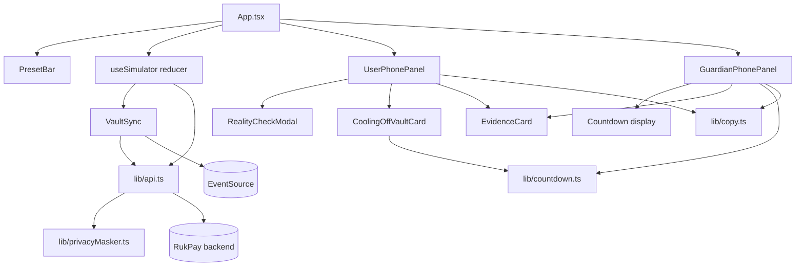
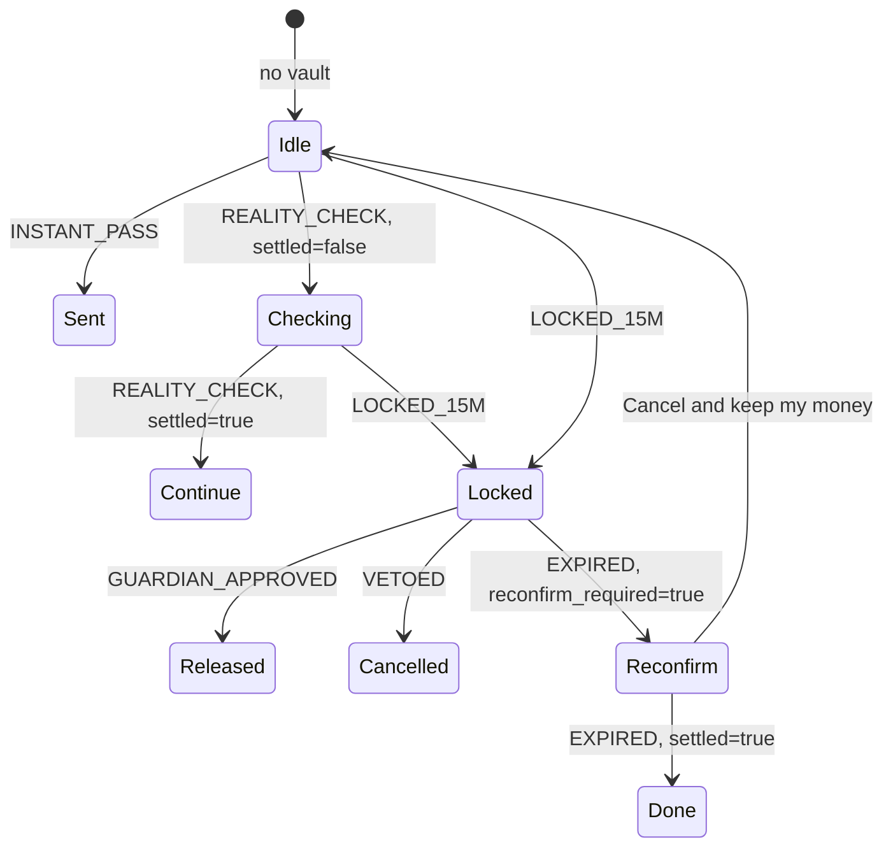

# Design Document

## Overview

The Dual-Screen Simulator is a single-page React 18 and TypeScript (strict) application in `frontend/`, built with Vite and styled with Tailwind CSS and `lucide-react`. It shows the User Phone on the left and the Family Guardian Phone on the right in one viewport (Requirement 1), and drives the real RukPay backend through one typed client. There is no mock data source (Requirement 9.6).

The design keeps almost all behavior in pure functions and one reducer, so that it can be tested without a browser:

| Decision | Choice | Reason |
|---|---|---|
| State | One `useReducer` in `useSimulator`, no state library | Requirement 14.5. A reducer is a pure function, so vault selection, token retention and stale-view rules get property tests. |
| Screen selection | Pure functions `deriveUserScreen(view)` and `deriveGuardianScreen(view)` | Each panel renders exactly one screen per Vault_View. The mapping is testable over every state combination. |
| Real-time | `EventSource` first, then 2-second polling, inside `VaultSync` (a plain class, no React) | Requirement 8. Timers and connections live in one object with one `dispose()`. |
| Countdown | Pure helpers `endTimeFrom`, `secondsLeft`, `formatCountdown`, plus a thin `useCountdown` hook | Requirements 5.2 to 5.4 and 15.4 are arithmetic. |
| Copy | Every user-facing string lives in `src/lib/copy.ts` | One file to check against Banned_Terms (Requirement 13.1). |
| Identifiers | Presets hold masked identifiers only. `api.ts` runs every outbound body through `redactObject` | Requirements 10.8, 12.1, 12.2. |
| Guardian token | Held in the reducer state only | Requirement 6.14. Never written to storage, cookies or the URL. |
| Tests | Vitest, Testing Library, fast-check, stubbed `fetch` and `EventSource` in test files only | Requirement 15.12. |

### Confirmed backend contract

This section is the contract the client implements. It was checked against `cooling-off-vault/design.md` (read in full) and `behavioral-risk-engine/design.md`.

**What the vault design defines exactly**

- `View` (the body of evaluate, GET vault, reality-check, fast-forward, SSE events and the 409 body) has these JSON field names: `vault_id`, `state`, `settled`, `risk_score`, `remaining_seconds`, `reconfirm_required`, `reason`, `metadata`, `guardian_token` (omitted unless LOCKED_15M), `evidence_summary` (omitted unless VETOED).
- Signals (from `risk.Signals`): `amount_inr` (int64), `beneficiary_age_hours` (int64), `is_late_night` (bool), `active_unknown_call` (bool), `rapid_retry_count` (int).
- Guardian action request: `{ "action": "APPROVE" | "VETO", "token": string, "confirmed": boolean }`. Result: `{ "status": "OK" | "CONFIRMATION_REQUIRED", "vault": View }`.
- Reality-check request: exactly one of `{ "answers": { "coercion", "secrecy", "verification" } }` (each `"YES"` or `"NO"`) or `{ "reconfirm": true }`.
- Error body: `{ "error": { "code", "message", "field"? } }`. A 409 carries the current View. Codes: `invalid_field`, `invalid_identifier`, `invalid_request`, `forbidden`, `not_found`, `state_conflict`, `too_large`, `internal`.

**What the vault design leaves open, and how this design handles it**

The vault design names `EvaluateRequest` and `Metadata` in Go signatures (`Evaluate(ctx, req EvaluateRequest) (View, error)`, `Metadata \`json:"metadata"\``) but never declares their fields. Evaluate returns a `View`, so the evaluate response is the flat View above, not a wrapper. The rest is inferred:

1. **Evaluate request body.** The five Signals are the required fields. The vault design says the request may carry masked identifiers that pass `store.ValidateMasked`. The only field names in the stack are the `VaultRecord` names, so the client uses the same snake-case names as optional fields: `payer_account_masked`, `beneficiary_masked`, `upi_masked`, `phone_masked`. The vault design says unknown JSON fields are dropped at decode, so if the backend names them differently the request still succeeds and nothing leaks.
2. **Metadata.** Described as "masked fields + amount_inr". The client types every key as optional: `amount_inr`, `payer_account_masked`, `beneficiary_masked`, `upi_masked`, `phone_masked`.
3. **No payee label on the backend.** The backend stores no payee name. "Local store", "New contact" and "New account" come from the preset definition, as Requirement 2.9 describes. Panels show the preset's Masked_Identifier and amount, and use `metadata` values only when present.
4. **`message` versus `reason`.** Vault Requirement 1.1 says evaluate returns "a plain-language message". The View field for that is `reason`. The client reads `reason` and has no `message` field on a View.

Resolved: the backend now declares `EvaluateRequest` and `Metadata` with these JSON names in `backend/internal/vault/types.go`, and `cooling-off-vault/design.md` records them. `types_test.go` pins the key names. `api.ts` is still the single place on the client that holds them, and everything in the client reads them through the `EvaluateRequest` and `VaultMetadata` types.

## Architecture



### Screen derivation



### Layout

The App root is `flex flex-col gap-6 lg:flex-row`. The Preset_Bar sits above in its own row. Each panel is wrapped in `<section aria-label="Your phone">` or `<section aria-label="Family guardian's phone">` with phone-frame styling (rounded border, fixed max width, notch bar).

## Components and Interfaces

### Directory layout

```text
frontend/
├── .env.example                      # VITE_API_BASE_URL=http://localhost:8080
├── index.html
├── package.json                      # scripts: dev, build, preview, test (vitest run), typecheck
├── tsconfig.json                     # "strict": true
├── vite.config.ts                    # includes vitest config (jsdom, setupFiles)
├── tailwind.config.ts
└── src/
    ├── main.tsx
    ├── App.tsx
    ├── index.css
    ├── components/
    │   ├── PresetBar.tsx
    │   ├── UserPhonePanel.tsx
    │   ├── RealityCheckModal.tsx
    │   ├── CoolingOffVaultCard.tsx
    │   ├── GuardianPhonePanel.tsx
    │   ├── EvidenceCard.tsx
    │   ├── PhoneFrame.tsx
    │   └── UnreachableNotice.tsx
    ├── lib/
    │   ├── api.ts
    │   ├── privacyMasker.ts
    │   ├── presets.ts
    │   ├── copy.ts
    │   ├── countdown.ts
    │   ├── screens.ts                # deriveUserScreen, deriveGuardianScreen, isTerminal
    │   ├── vaultSync.ts
    │   ├── simulatorReducer.ts
    │   └── useSimulator.ts
    └── test/
        ├── setup.ts
        └── stubs.ts                  # fetch and EventSource stubs, test only
```

### `lib/api.ts`

```ts
export type VaultState =
  | "INSTANT_PASS" | "REALITY_CHECK" | "LOCKED_15M"
  | "GUARDIAN_APPROVED" | "VETOED" | "EXPIRED";

export interface Signals {
  amount_inr: number;
  beneficiary_age_hours: number;
  is_late_night: boolean;
  active_unknown_call: boolean;
  rapid_retry_count: number;
}

export interface EvaluateRequest extends Signals {
  payer_account_masked?: string;
  beneficiary_masked?: string;
  upi_masked?: string;
  phone_masked?: string;
}

export interface VaultMetadata {
  amount_inr?: number;
  payer_account_masked?: string;
  beneficiary_masked?: string;
  upi_masked?: string;
  phone_masked?: string;
}

export interface VaultView {
  vault_id: string;
  state: VaultState;
  settled: boolean;
  risk_score: number;
  remaining_seconds: number;
  reconfirm_required: boolean;
  reason: string;
  metadata: VaultMetadata;
  guardian_token?: string;
  evidence_summary?: string;
}

export type Answer = "YES" | "NO";
export interface Answers { coercion: Answer; secrecy: Answer; verification: Answer }
export type RealityCheckRequest = { answers: Answers } | { reconfirm: true };

export interface GuardianActionRequest {
  action: "APPROVE" | "VETO";
  token: string;
  confirmed: boolean;
}
export interface GuardianActionResult {
  status: "OK" | "CONFIRMATION_REQUIRED";
  vault: VaultView;
}

export interface ErrorBody { error: { code: string; message: string; field?: string } }

export class ApiError extends Error {
  constructor(
    readonly status: number,
    readonly code: string,
    message: string,
    readonly field?: string,
    readonly vault?: VaultView, // set for HTTP 409
  ) { super(message); }
}
export class NetworkError extends Error {}

export const API_BASE: string; // import.meta.env.VITE_API_BASE_URL || "http://localhost:8080"
export const REQUEST_TIMEOUT_MS = 10_000;

export function evaluate(req: EvaluateRequest, signal?: AbortSignal): Promise<VaultView>;
export function getVault(id: string, signal?: AbortSignal): Promise<VaultView>;
export function submitAnswers(id: string, a: Answers, signal?: AbortSignal): Promise<VaultView>;
export function reconfirm(id: string, signal?: AbortSignal): Promise<VaultView>;
export function guardianAction(id: string, a: GuardianActionRequest, signal?: AbortSignal): Promise<GuardianActionResult>;
export function demoFastForward(id: string, signal?: AbortSignal): Promise<VaultView>;
export function eventStreamUrl(id: string): string; // `${API_BASE}/api/v1/events/stream?vault_id=${encodeURIComponent(id)}`
```

One private `request<T>(method, path, body, signal)` does the work:

1. Serializes `redactObject(body)` as JSON with `Content-Type: application/json` (Requirements 10.4, 10.8).
2. Combines the caller's `AbortSignal` with a 10-second timeout signal (`AbortSignal.any` where available, otherwise a manual controller).
3. A `fetch` rejection, a timeout abort, or an unparseable body on a 5xx throws `NetworkError`. A caller abort rethrows as `AbortError` so callers can tell it from a failure.
4. A non-2xx status with a parseable error body throws `ApiError(status, code, message, field, status === 409 ? body.vault ?? body : undefined)`. A 5xx or unreadable body throws `NetworkError`, which the UI shows as the Unreachable_Notice (Requirement 9.5).
5. Error messages are built from the server's `message` field and the status only. Neither the token nor any identifier is formatted into an error (Requirement 10.9). `api.ts` never calls `console`.

The 409 body shape is `{ error, vault }` in effect: the vault design says the conflict body carries the current View. The client accepts either a top-level `vault` property or a View-shaped body, and takes the first one that has a `vault_id`.

The `reconfirm` function sends `{ "reconfirm": true }` and `submitAnswers` sends `{ "answers": {...} }`. The `RealityCheckRequest` union makes a body with both or neither a compile error.

### `lib/privacyMasker.ts`

```ts
export function maskAccount(raw: string): string;   // XXXX-XXXX-1234 or [REDACTED]
export function maskPhone(raw: string): string;     // +91-XXXXXX3210 or [REDACTED]
export function maskUpi(raw: string): string;       // r***@okaxis or [REDACTED]
export function redactSecret(_raw: string): string; // "[REDACTED]"
export function hashIdentifier(value: string): Promise<string>; // SHA-256 hex via crypto.subtle
export function redactObject<T>(value: T): T;       // deep copy
```

Rules:

- `maskAccount` and `maskPhone` strip non-digits, require at least four digits, and use the last four. Otherwise `[REDACTED]`.
- `maskUpi` splits on the last `@`. It needs a non-empty name and handle. The first character of the name must be `[A-Za-z0-9]` and the handle must match `[A-Za-z0-9.\-]+`, so the output always matches the backend regex `^[A-Za-z0-9]\*\*\*@[A-Za-z0-9.\-]+$`. Otherwise `[REDACTED]`.
- `hashIdentifier` hashes `value.trim().toLowerCase()` with `crypto.subtle.digest("SHA-256", ...)` and returns 64 lowercase hex characters.
- `redactObject` walks arrays and plain objects. A key matching `/^(otp|pin|password|passcode|cvv)$/i` gets `[REDACTED]`. A string value is tested against these patterns in this order, and the first match is replaced by its masked form:
  - already masked (matches one of the three backend regexes): left unchanged, so the function is idempotent;
  - UPI: `^[^\s@]+@[A-Za-z0-9.\-]+$`;
  - phone: `^(\+91)?[6-9]\d{9}$` after removing spaces and hyphens;
  - account: `^\d{9,18}$`, also after removing spaces and hyphens, so `1234 5678 9012` is caught.
- Numbers, booleans and null pass through. `amount_inr`, `beneficiary_age_hours` and `rapid_retry_count` are numbers, so they are never altered. The module touches no console, storage, network or DOM except `crypto.subtle` in `hashIdentifier` (Requirement 11.11).

Free text such as `reason` or `evidence_summary` is never run through the account and phone patterns because those patterns anchor on the whole string. The `evidence_summary` is displayed as received, since the backend has already redacted it.

### `lib/presets.ts`

```ts
export interface Preset {
  id: "safe" | "medium" | "high";
  buttonLabel: string;
  payeeLabel: string;          // "Local store" | "New contact" | "New account"
  payeeMasked: string;         // a Masked_Identifier
  timeLabel: string;           // e.g. "11:45 PM" shown on the panel
  request: EvaluateRequest;
}
export const PRESETS: readonly [Preset, Preset, Preset];
```

| id | buttonLabel | payee | masked identifier | request signals |
|---|---|---|---|---|
| safe | Safe daily payment | Local store | `s***@okaxis` | 450, 720, false, false, 0 |
| medium | Medium-risk unusual transfer | New contact | `XXXX-XXXX-3307` | 18000, 6, false, false, 0 |
| high | High-risk panic transfer | New account | `XXXX-XXXX-4821` | 85000, 1, true, true, 0 |

The request also carries the preset's masked identifier in `upi_masked` (for the UPI preset) or `beneficiary_masked` (for account presets). The module holds no raw identifiers, and a unit test asserts every identifier in `PRESETS` matches one of the three mask regexes (Requirement 12.2).

### `lib/screens.ts`

```ts
export type UserScreen =
  | "PROMPT" | "SENT" | "CHECKING" | "CONTINUE" | "LOCKED"
  | "RELEASED" | "CANCELLED" | "RECONFIRM" | "DONE";
export type GuardianScreen = "IDLE" | "ALERT" | "APPROVED" | "VETOED";

export function deriveUserScreen(v: VaultView | null): UserScreen;
export function deriveGuardianScreen(v: VaultView | null): GuardianScreen;
export function isTerminal(v: VaultView): boolean;
```

Mapping:

| View | UserScreen | GuardianScreen |
|---|---|---|
| `null` | PROMPT | IDLE |
| INSTANT_PASS | SENT | IDLE |
| REALITY_CHECK, `settled` false | CHECKING | IDLE |
| REALITY_CHECK, `settled` true | CONTINUE | IDLE |
| LOCKED_15M | LOCKED | ALERT |
| GUARDIAN_APPROVED | RELEASED | APPROVED |
| VETOED | CANCELLED | VETOED |
| EXPIRED, `reconfirm_required` true | RECONFIRM | IDLE |
| EXPIRED, `reconfirm_required` false | DONE | IDLE |

`isTerminal(v)` is true for INSTANT_PASS, GUARDIAN_APPROVED, VETOED, and EXPIRED with `reconfirm_required` false (Requirement 8.7). The Reality_Check_Modal is open exactly when `deriveUserScreen` returns `CHECKING` (Requirement 4.1).

### `lib/countdown.ts`

```ts
export function endTimeFrom(nowMs: number, remainingSeconds: number): number; // nowMs + remainingSeconds * 1000
export function secondsLeft(endMs: number, nowMs: number): number;            // max(0, ceil((endMs - nowMs) / 1000))
export function formatCountdown(totalSeconds: number): string;                // "mm:ss", clamped at "00:00"
export function parseCountdown(text: string): number;                         // inverse, for tests
export function spokenCountdown(totalSeconds: number): string;                // "14 minutes and 5 seconds"
export function useCountdown(view: VaultView | null, onZero: () => void): { text: string; spoken: string };
```

`useCountdown` stores `endMs` in a ref, recomputed whenever a View with state LOCKED_15M arrives (Requirements 5.2, 5.4). A `setInterval` at 1000 ms recomputes `secondsLeft` from `Date.now()`. When `secondsLeft` first reaches 0 for a given `vault_id` and end time, it calls `onZero` once (Requirement 5.5). The caller's `onZero` runs one `getVault`. The `spoken` text used for `aria-label` is refreshed only when the number of seconds, floored to a 10-second step, changes (Requirement 5.6). The interval is cleared on unmount and when the state leaves LOCKED_15M.

Both phones call `useCountdown`, and each has its own interval. The Guardian panel's `onZero` is a no-op, because the User panel already makes the single fetch.

### `lib/vaultSync.ts`

```ts
export interface SyncHandlers {
  onView(v: VaultView): void;      // every parsed, accepted View
  onUnreachable(on: boolean): void; // poll lost or recovered
}

export class VaultSync {
  constructor(vaultId: string, handlers: SyncHandlers, deps?: { EventSourceCtor?: typeof EventSource; setIntervalFn?: ...; });
  start(): void;
  dispose(): void;  // closes EventSource, clears timers, aborts in-flight poll
}
```

Behavior:

- `start()` opens `new EventSource(eventStreamUrl(id))`. A `message` event parses `event.data` as a VaultView and passes it to `onView` (Requirements 8.1, 8.2). A parse failure is ignored for that event.
- On `error`, or when `readyState === EventSource.CLOSED`, it closes the stream and starts polling (Requirement 8.4). A stream that closes after the last View was terminal does not start polling.
- Polling uses a `setTimeout` chain, not `setInterval`, so a new request is scheduled 2000 ms after the previous one finishes. That gives the "wait for the previous poll" guarantee by construction (Requirements 8.5, 8.6). The chain uses an `AbortController` aborted in `dispose()`.
- A failed poll calls `onUnreachable(true)` and keeps the chain going. The next success calls `onUnreachable(false)` (Requirement 9.7).
- After `onView` receives a terminal View, the sync object stops itself (Requirement 8.7). `dispose()` is idempotent (Requirement 8.8).

On Lambda the backend closes the stream after about 25 seconds and delivers the first event at close, so the client sees `error` or close and falls back to polling. This is the intended path in cloud mode and needs no special client logic.

### `lib/simulatorReducer.ts`

```ts
export interface SimState {
  preset: Preset | null;
  vault: VaultView | null;
  guardianToken: string | null;   // memory only
  requestSeq: number;             // arrival counter
  lastActionSeq: number;          // seq of the last accepted action response
  busy: boolean;                  // evaluate in flight
  unreachable: { retry: () => void } | null;
  notice: Notice | null;          // calm message for 400, 403, 409, clipboard
  fastForwardHidden: boolean;
  reconfirmCancelled: boolean;
}

export type SimAction =
  | { type: "START"; preset: Preset }                       // discards everything
  | { type: "EVALUATED"; view: VaultView }
  | { type: "VIEW"; view: VaultView; source: "stream" | "poll" | "action"; startedAtSeq?: number }
  | { type: "BUSY"; busy: boolean }
  | { type: "UNREACHABLE"; retry: (() => void) | null }
  | { type: "NOTICE"; notice: Notice | null }
  | { type: "FAST_FORWARD_UNAVAILABLE" }
  | { type: "CANCEL_RECONFIRM" };

export function reduce(s: SimState, a: SimAction): SimState;
export const initialState: SimState;
```

Rules inside `reduce` for `VIEW`:

1. If `state.vault` is non-null and `view.vault_id !== state.vault.vault_id`, return `s` unchanged (Requirement 8.9).
2. If `source === "poll"` and `startedAtSeq < lastActionSeq`, the poll started before an action response was applied, so return `s` unchanged. This keeps an old poll result from undoing a newer action result. Otherwise arrival order decides: the view that arrives last replaces the earlier one (Requirement 8.10).
3. Token retention: `guardianToken` becomes `view.guardian_token` when present. When absent and the new state is LOCKED_15M, it keeps the old value (Requirement 8.3). When the new state is not LOCKED_15M, the token is cleared, since the backend stops issuing it.
4. `source === "action"` sets `lastActionSeq` to the current counter.
5. `reconfirmCancelled` resets to false on any View that changes the state.

`START` returns `initialState` with `preset` set and `busy` true. It never keeps the old `vault`, `guardianToken` or `notice` (Requirement 2.5).

### `lib/useSimulator.ts`

The hook owns the reducer, one `VaultSync` instance and one `AbortController` per in-flight action. It exposes the commands the components call:

```ts
interface Simulator {
  state: SimState;
  startPreset(p: Preset): Promise<void>;
  submitAnswers(a: Answers): Promise<void>;
  reconfirm(): Promise<void>;
  cancelReconfirm(): void;
  veto(): Promise<void>;                 // user "Block & Report (1930)"
  guardianApprove(confirmed: boolean): Promise<void>;
  guardianVeto(): Promise<void>;
  fastForward(): Promise<void>;
  refresh(): Promise<void>;
  retry(): void;                         // repeats the stored failed request
}
```

Each command wraps an API call in `run(fn)`, which:

- on `NetworkError`, dispatches `UNREACHABLE` with a `retry` closure that repeats the same call with the same arguments (Requirements 9.1, 9.2). The reality-check retry resubmits the three kept answers (Requirement 4.10);
- on `ApiError` 409, dispatches `VIEW` with the View in the error and a `NOTICE` "Someone already acted on this payment." (Requirements 4.9, 6.12);
- on `ApiError` 403 from a guardian action, dispatches a `NOTICE` of kind `LINK_INVALID`, and `refresh()` is what the "Refresh" button calls (Requirement 6.11);
- on `ApiError` 404 from fast-forward, dispatches `FAST_FORWARD_UNAVAILABLE` (Requirement 5.9);
- on `ApiError` 400, dispatches a `NOTICE` with the server `message` (Requirement 9.4);
- on success, dispatches `VIEW` with `source: "action"`, and starts a `VaultSync` when the View is the first for a new vault and not terminal.

`startPreset` first calls `dispose()` on the old sync and aborts in-flight requests, then dispatches `START`, then `evaluate(preset.request)` (Requirements 2.5, 2.10, 8.8). When the first View is a non-terminal state it creates `new VaultSync(view.vault_id, ...)` and starts it. An unmount effect calls `dispose()`.

### Components

**`PresetBar`** renders three buttons from `PRESETS`. All three are `disabled` while `busy`, and a visible "Checking this payment…" status line appears (Requirement 2.10). Buttons are at least 48 px high with 12 px gaps.

**`UserPhonePanel`** switches on `deriveUserScreen(state.vault)`:

| UserScreen | Content |
|---|---|
| PROMPT | "Choose a payment above to see how RukPay keeps it safe." |
| SENT | Payment-sent confirmation |
| CHECKING | Status line plus `RealityCheckModal` |
| CONTINUE | "Your checks look fine." and a "Continue payment" button |
| LOCKED | `CoolingOffVaultCard` and the red "Block & Report (1930)" button |
| RELEASED | "Your family guardian approved this payment. It is on its way." |
| CANCELLED | `EvidenceCard` |
| RECONFIRM | "Yes, this is my payment" and "Cancel and keep my money" |
| DONE | Calm confirmation that the payment was confirmed |

Above the screen it always shows the payee label, the preset's Masked_Identifier, the amount with `₹` (from `metadata.amount_inr` when present, otherwise the preset amount), and a status line with a lucide icon. The `reason` text from the View is shown as the explanation (Requirement 3.11). "Continue payment" has no backend call, because the vault design settles a passed check on the server side. It moves the display to the SENT confirmation through local `acknowledged` state in the panel. "Cancel and keep my money" dispatches `CANCEL_RECONFIRM`, which returns the panel to PROMPT without a request (Requirement 3.8).

**`RealityCheckModal`** props: `{ open: boolean; onSubmit(a: Answers): Promise<void>; unreachable: boolean; onRetry(): void }`.

- Internal state: `step` (0 to 2) and `answers` (array of up to three). Questions come from `copy.ts` and use the exact steering wording.
- `role="dialog"`, `aria-modal="true"`, `aria-labelledby` pointing at the title. A small focus-trap routine (Tab and Shift+Tab loop over the focusable elements inside) is implemented in the component with no library. On each step change, focus moves to the "Yes" button.
- "Back" decrements `step` and keeps `answers`. After the third answer it calls `onSubmit` with `{ coercion, secrecy, verification }`.
- On a network failure, the modal shows the `UnreachableNotice` and keeps `answers`. The retry button calls `onRetry`, which the hook backs with the same three answers.
- Background and text use the amber surface (`#FEF3C7` / `#92400E`) at 18 px or larger. There is no red.

**`CoolingOffVaultCard`** props: `{ view: VaultView; onExpire(): void; onFastForward(): void; fastForwardHidden: boolean }`.

- Shows the vault icon (`Vault` or `ShieldCheck`), the protective-pause message, and the countdown in `<div role="timer" aria-label={spoken}>` at 20 px or larger.
- Deep teal surface `#0F766E` with white text (contrast above 7:1).
- The "Demo: skip the wait" button is hidden when `fastForwardHidden` is true.

**`GuardianPhonePanel`** switches on `deriveGuardianScreen`:

| GuardianScreen | Content |
|---|---|
| IDLE | "Nothing needs your attention right now." |
| ALERT | `reason`, amount, payee Masked_Identifier, countdown, and two buttons. Local `confirming` state shows "Are you sure you spoke with them directly?" with "Yes, approve" and "Go back". |
| APPROVED | "Payment approved" |
| VETOED | `EvidenceCard` |

"I Spoke With Them — Safe to Approve" sets `confirming` true and sends nothing. "Yes, approve" calls `guardianApprove(true)`. "Go back" sets `confirming` false. "Block & Report Scam (1930)" calls `guardianVeto()`, which sends `{ action: "VETO", token, confirmed: true }`. If the result status is `CONFIRMATION_REQUIRED`, `confirming` stays true (Requirement 6.8). The token comes from `state.guardianToken`.

The panel renders `reason`, amount and Masked_Identifiers only (Requirement 6.13).

**`EvidenceCard`** props: `{ summary: string }`. It shows the summary in a selectable `<pre className="select-text whitespace-pre-wrap">`, the statement that the transfer is permanently cancelled and no money has left the account, `<a href="tel:1930">1930</a>`, and `<a href="https://cybercrime.gov.in" target="_blank" rel="noopener noreferrer">cybercrime.gov.in</a>`. "Copy summary" calls `navigator.clipboard.writeText`. On success it shows persistent text "Summary copied." On a missing API or a rejection, it shows "Please select the text above and copy it by hand." The summary is never written anywhere but the DOM.

**`UnreachableNotice`** shows "We can't reach RukPay right now. Your money has not moved. Please try again." and a "Try again" button wired to `retry`. It stays until the retry succeeds or `START` runs (Requirement 9.3).

### `lib/copy.ts`

All strings are constants in one `COPY` object, grouped by screen (`app`, `presetBar`, `userPanel`, `realityCheck`, `vaultCard`, `guardianPanel`, `evidence`, `unreachable`, `notices`, `common`). `ALL_COPY: string[]` is built by walking `COPY`, so a string added to a group is covered by the banned-term test without a second edit. `questionProgress(n)` returns "Question n of 3" and its three outputs are in `ALL_COPY`. The reality-check questions are copied from the steering document:

1. "Are you currently on a phone or video call with someone claiming to be from Police, CBI, Customs, RBI, or your Bank?"
2. "Did the caller ask you NOT to tell your family or bank staff about this transfer?"
3. "Have you independently verified this person or bill without using a phone number they just sent you?"

The protective-pause message reads: "We're holding this safely for 15 minutes so you have space to verify."

### Visual rules

- Tailwind theme extends colors: `amber-surface #FEF3C7`, `amber-ink #92400E`, `slate-surface #1E293B`, `slate-ink #F8FAFC`, `vault-teal #0F766E`, `veto-red #DC2626`. `#FF0000` appears nowhere.
- `veto-red` with white text is used only by the two "Block & Report" buttons.
- Base font size 16 px. Question text, state status lines and the countdown use `text-lg` (18 px) or `text-xl`.
- Every button and link uses `min-h-12 min-w-12`, with `gap-3` (12 px) between neighbors, and a `focus-visible:ring-4` ring.
- Every status line pairs a lucide icon (`CheckCircle2`, `ShieldCheck`, `Vault`, `HelpCircle`, `Ban`, `Clock`) with text, so state is not conveyed by color alone. Icon-only controls carry `aria-label`.
- `@media (prefers-reduced-motion: reduce)` sets `animation: none; transition: none` for all elements.
- No toast or snackbar component exists. Notices are inline blocks that stay until the state changes or the user acts.

## Data Models

```ts
// Reducer state, as above (SimState).
interface Notice {
  kind: "BAD_REQUEST" | "LINK_INVALID" | "ALREADY_ACTED" | "COPY_FAILED";
  message: string;   // from copy.ts or the server's calm `message` for 400
}
```

Persisted data: none. There is no use of `localStorage`, `sessionStorage`, cookies, IndexedDB or URL parameters (Requirements 6.14, 12.3, 12.6). The vault id appears only in request paths.

Environment: `VITE_API_BASE_URL` read at build time. `frontend/.env.example` contains `VITE_API_BASE_URL=http://localhost:8080`.

## Error Handling

| Condition | Source | UI result |
|---|---|---|
| Network failure, timeout (10 s), HTTP 5xx, unreadable body | `NetworkError` | `UnreachableNotice` with "Try again". Retry repeats the failed call. |
| HTTP 400 | `ApiError` | Inline notice with the server `message`. |
| HTTP 403 on guardian action | `ApiError` | "This approval link is no longer valid." plus "Refresh" (calls `getVault`). |
| HTTP 404 on fast-forward | `ApiError` | Hide the fast-forward button for the session. |
| HTTP 404 on stream or GET | `ApiError` | `UnreachableNotice`. The vault is gone, so "Try again" returns to the preset prompt after a failed second attempt. |
| HTTP 409 | `ApiError` with View | Apply the View, show "Someone already acted on this payment." |
| Poll failure | `NetworkError` in `VaultSync` | `UnreachableNotice` until the next poll succeeds. Polling continues. |
| SSE message that is not valid JSON | `JSON.parse` error | Event ignored, stream stays open. |
| Clipboard unavailable | `navigator.clipboard` missing or rejects | Persistent "select and copy by hand" text. |

No error path logs to the console. No error message includes the token or a Masked_Identifier.

## Correctness Properties

*A property is a characteristic or behavior that should hold true across all valid executions of a system-essentially, a formal statement about what the system should do. Properties serve as the bridge between human-readable specifications and machine-verifiable correctness guarantees.*

Reflection on redundancy: Requirements 11.1 to 11.3 and 11.6 merge into one masking-format property (Property 1). Requirements 3.3 to 3.6, 4.1, 6.1, 6.2 and 6.9 to 6.10 merge into one screen-derivation property (Property 6). Requirements 5.2 to 5.4 merge into one countdown arithmetic property (Property 8). Requirements 10.8 and 12.5 merge into one outbound-body property (Property 12). Requirements 12.3, 12.4 and 6.14 are verified by example and smoke tests, not properties.

### Property 1: Masked output matches the backend formats

For any string with at least four digits, `maskAccount` returns a string matching `^XXXX-XXXX-\d{4}$` whose last four digits equal the last four digits of the input, and `maskPhone` returns a string matching `^\+91-X{6}\d{4}$` with the same last four digits. For any string of the form `name@handle` where `name` starts with an alphanumeric character and `handle` matches `[A-Za-z0-9.\-]+`, `maskUpi` returns a string matching `^[A-Za-z0-9]\*\*\*@[A-Za-z0-9.\-]+$` that starts with the first character of `name` and ends with `@handle`.

**Validates: Requirements 11.1, 11.2, 11.3, 11.6**

### Property 2: No long digit run survives masking

For any input string, the output of `maskAccount` and `maskPhone` contains no run of more than four consecutive digits.

**Validates: Requirements 11.10**

### Property 3: Malformed identifiers are redacted

For any string with fewer than four digits, `maskAccount` and `maskPhone` return `[REDACTED]`. For any string with no `@`, an empty name or an empty handle, `maskUpi` returns `[REDACTED]`. For any string, `redactSecret` returns `[REDACTED]`.

**Validates: Requirements 11.4, 11.5**

### Property 4: Hashing is deterministic and discriminating

For any string `v`, `hashIdentifier(v)` is 64 lowercase hexadecimal characters and equals `hashIdentifier(v)` computed again, and equals the hash of `v` with added surrounding whitespace and changed letter case. For any two strings that differ after trimming and lowercasing, the digests differ.

**Validates: Requirements 11.7, 11.8**

### Property 5: Object redaction is deep, total and idempotent

For any nested object or array, `redactObject` returns a deep copy in which every property named `otp`, `pin`, `password`, `passcode` or `cvv` (any letter case, at any depth) holds `[REDACTED]`, every string that is an unmasked account, phone or UPI value is replaced by its masked form, and numbers and booleans are unchanged. Applying `redactObject` twice gives a result equal to applying it once. The input object is not modified.

**Validates: Requirements 11.9, 15.2**

### Property 6: Exactly one screen per view

For any VaultView (any state, any `settled`, any `reconfirm_required`) or `null`, `deriveUserScreen` returns exactly one screen and `deriveGuardianScreen` returns exactly one screen, matching the mapping table. The Reality_Check_Modal is open exactly when the user screen is CHECKING. The Guardian alert shows exactly when the state is LOCKED_15M. The re-confirmation step shows exactly when the state is EXPIRED and `reconfirm_required` is true.

**Validates: Requirements 3.3, 3.4, 3.5, 3.6, 4.1, 6.1, 6.2, 6.9, 6.10**

### Property 7: Terminal states stop the sync

For any VaultView, `isTerminal` is true exactly when the state is INSTANT_PASS, GUARDIAN_APPROVED or VETOED, or the state is EXPIRED and `reconfirm_required` is false. For any sequence of Views fed to a `VaultSync`, after the first terminal View no stream is open and no poll is scheduled.

**Validates: Requirements 8.7**

### Property 8: Countdown arithmetic

For any current time, any `remaining_seconds` from 0 to 900 and any elapsed time `e` in milliseconds, the displayed seconds equal `max(0, ceil(remaining_seconds - e / 1000))`. The formatted text never contains a negative value. For any `remaining_seconds` from 0 to 900, `formatCountdown` matches `^\d{2}:\d{2}$` and `parseCountdown(formatCountdown(n)) === n`. When a new View arrives with a different `remaining_seconds`, the displayed seconds are computed from the new value and the arrival time, not from the earlier view.

**Validates: Requirements 5.2, 5.3, 5.4, 15.4**

### Property 9: Token retention

For any sequence of Views for one vault applied to the reducer, after each View the held token equals the most recent non-empty `guardian_token` seen while the vault was in LOCKED_15M, provided the latest View is also LOCKED_15M. When a View with any other state arrives, the held token is cleared. A View with no `guardian_token` and state LOCKED_15M never clears the token.

**Validates: Requirements 8.3, 6.14**

### Property 10: Foreign views are discarded

For any reducer state with a current vault and any View whose `vault_id` differs from the current one, applying the View leaves the state unchanged.

**Validates: Requirements 8.9**

### Property 11: Newest arrival wins, and stale polls are dropped

For any sequence of accepted Views for one vault arriving in order, the reducer's vault after the sequence equals the last View in the sequence. For any poll result whose request started before the latest applied action response, the reducer state is unchanged.

**Validates: Requirements 8.10, 8.2**

### Property 12: Outbound bodies carry no sensitive values

For any request body the client builds (evaluate, reality-check, guardian action) with arbitrary extra properties or string values, the JSON handed to `fetch` contains no key named `otp`, `pin`, `password`, `passcode` or `cvv` with a value other than `[REDACTED]`, and no string that is an unmasked account, phone or UPI value.

**Validates: Requirements 10.8, 12.4, 12.5**

### Property 13: Reality-check body reflects the answers

For any triple of answers, each `YES` or `NO`, submitting the three answers to the modal produces a request body exactly equal to `{ "answers": { "coercion": a1, "secrecy": a2, "verification": a3 } }`, with no other property.

**Validates: Requirements 4.4**

### Property 14: Errors carry the server fields and no secrets

For any non-2xx status and any well-formed error body, the thrown `ApiError` has the same status, `code`, `message` and `field`, and for status 409 it carries the View from the body. For any token string and any identifier placed in a request, no thrown error's `message` contains that token or identifier.

**Validates: Requirements 10.5, 10.9**

### Property 15: Copy is calm

For any string in `ALL_COPY`, and for any rendered screen across every Vault_State, the visible text, every `aria-label` and every `title` contain none of the Banned_Terms (`FATAL ERROR`, `SECURITY BREACH`, `ILLEGAL TRANSACTION`, `YOUR ACCOUNT WILL BE BLOCKED`, `FRAUDSTER DETECTED`, `heuristic mismatch`, `anomaly score`, `velocity threshold`, `cryptographic hash`, `HMAC`, `SSL/TLS`, `payload`, `telemetry`, `IP reputation`, `rule engine`), compared case-insensitively.

**Validates: Requirements 13.1, 13.2**

### Property 16: New preset leaves no residue

For any reducer state, applying `START` with any preset yields a state with no vault, no guardian token, no notice, no unreachable marker, and `busy` true.

**Validates: Requirements 2.5**

## Testing Strategy

All tests run with `npm test` (`vitest run`) against a stubbed `fetch` and a stubbed `EventSource` defined in `src/test/stubs.ts`, with no network (Requirements 15.12, 15.13). No mock data source exists in `src/` outside `src/test/`.

**Property-based tests** use `fast-check` with `numRuns` of at least 100. Each test carries the comment `// Feature: dual-screen-simulator, Property N: <title>`.

| Property | File | Generators |
|---|---|---|
| 1, 2, 3 | `privacyMasker.pbt.test.ts` | `fc.stringMatching` digit strings of length 4 to 20 with separators, strings with fewer than four digits, `name@handle` strings, malformed UPI strings |
| 4 | `privacyMasker.pbt.test.ts` | `fc.string`, whitespace and case variants (async property) |
| 5 | `privacyMasker.pbt.test.ts` | `fc.object` with injected secret keys in mixed case, nested arrays |
| 6, 7 | `screens.pbt.test.ts` | `fc.record` of state (all six), `settled`, `reconfirm_required` |
| 8 | `countdown.pbt.test.ts` | `fc.integer(0, 900)`, elapsed milliseconds |
| 9, 10, 11, 16 | `simulatorReducer.pbt.test.ts` | Sequences of Views from a `fc.array` of `fc.record`, with optional tokens and foreign ids |
| 12, 14 | `api.pbt.test.ts` | Arbitrary bodies and error bodies through the stubbed `fetch` |
| 13 | `RealityCheckModal.test.tsx` | `fc.tuple` of three `YES`/`NO` values driving the modal |
| 15 | `copy.pbt.test.ts` | Exhaustive over `ALL_COPY`, plus rendered DOM for every state fixture |

**Unit and example tests**

- `privacyMasker.test.ts`: each Masking_Format, the fewer-than-four-digit and malformed cases, a known SHA-256 vector for `hashIdentifier`, and `redactObject` on a sample body (Requirement 15.1).
- `countdown.test.tsx` with fake timers: `mm:ss` format, never below `00:00`, recompute on a new `remaining_seconds`, exactly one `getVault` call at `00:00` (Requirement 15.3).
- `App.presets.test.tsx`: for each preset, the request body sent and the panel shown for INSTANT_PASS, REALITY_CHECK and LOCKED_15M (Requirements 2.2 to 2.8, 15.5). Also checks that all three buttons are disabled with the "Checking this payment…" status while evaluate is in flight (2.10) and that `PRESETS` holds only masked identifiers (12.2).
- `RealityCheckModal.test.tsx`: one question at a time in order, Back keeps answers, the submitted body, close on a LOCKED_15M result, 409 handling, unreachable retry resubmits the kept answers, `role="dialog"`, `aria-modal`, focus trap and focus move (Requirements 4.x, 15.6).
- `lockState.test.tsx`: the vault card shows the countdown, a `role="timer"` element and the fast-forward button, the Guardian panel shows the alert, a 404 hides the button for the session (Requirements 5.x, 15.7).
- `guardianApprove.test.tsx`: no request after the first tap, the second tap sends `{ action: "APPROVE", token, confirmed: true }`, Go back sends nothing, `CONFIRMATION_REQUIRED` keeps the second step, 403 and 409 messages (Requirements 6.4 to 6.12, 15.8).
- `veto.test.tsx`: the VETO request from both phones, the Evidence_Card, the `tel:1930` link, the `cybercrime.gov.in` link with `rel="noopener noreferrer"`, copy success and clipboard-unavailable messages (Requirements 3.10, 6.7, 7.x, 15.9).
- `vaultSync.test.ts` with fake timers and a stub `EventSource`: stream open URL, message parsing, fall back to polling on error, 2-second spacing with no overlap while a poll is pending, stop on a terminal View, `dispose()` on unmount and on a new preset (Requirements 8.x, 15.10).
- `unreachable.test.tsx`: the exact notice text, "Try again" repeats the same request (Requirements 9.1 to 9.3, 15.11).
- `api.test.ts`: base URL fallback, JSON content type, `AbortSignal` forwarded, 10-second timeout produces `NetworkError`, 409 carries the View.

**Smoke checks** (one script or test each, run once)

- `npm run build` finishes with no TypeScript error and writes `frontend/dist/` (Requirement 14.3). `npm run typecheck` passes with `"strict": true`.
- A grep of `src/` outside `src/test/` finds no `localStorage`, `sessionStorage`, `document.cookie`, `console.` or `FF0000` (Requirements 12.3, 13.6).
- A spy on `Storage.prototype.setItem` and `document.cookie` stays untouched through a full locked-to-approved flow (Requirements 6.14, 12.3).
- The palette contrast check computes the WCAG ratio for each text and background pair in the Tailwind theme and requires at least 7:1 for alert text and the countdown (Requirement 13.5).
- Every `button` and `a` in the rendered App has a class matching `min-h-12` (Requirement 13.4).
- `package.json` has no dependency on Redux, Angular or another state library (Requirement 14.5).

PBT is not used for layout, color, focus behavior, `EventSource` timing or the build. Those use the example and smoke tests above.
