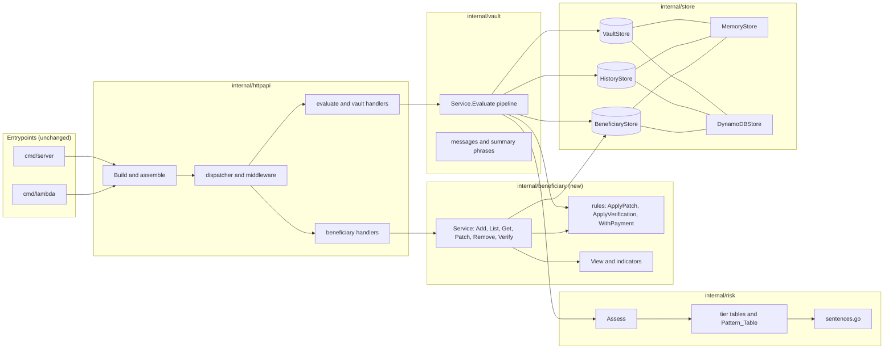
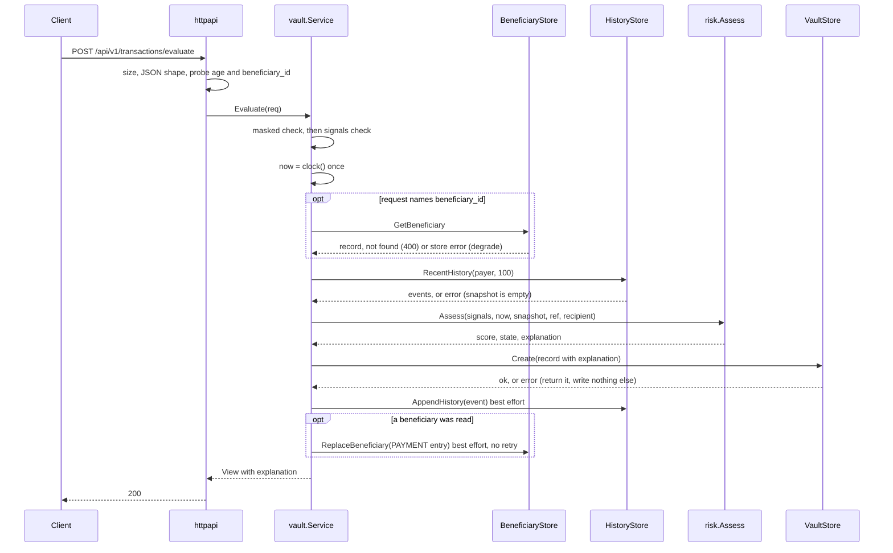
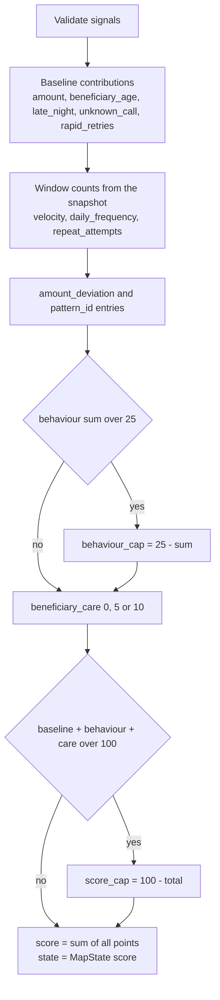
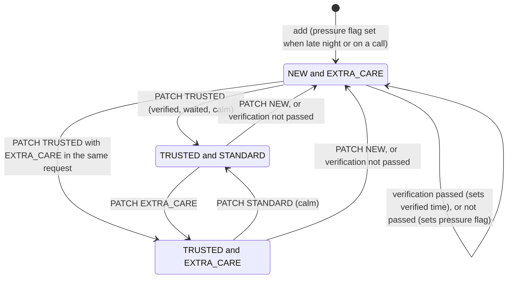
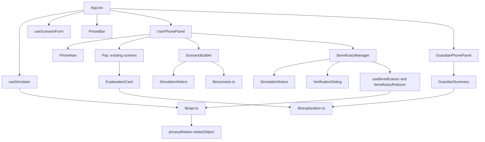

# Design Document

## Overview

Risk Intelligence is Phase 1 of the RukPay roadmap (GitHub issue #1). One spec ships four roadmap issues that share one data path, the payment evaluation:

- **#2 Explainable risk scores.** Every vault stores and returns a list of Contributions that add up to its score.
- **#3 Custom transaction input and scenario builder.** A Custom payment screen on the payer's phone, with three named fraud stories.
- **#4 Behavioural risk detection.** Capped, deterministic extra points from the payer's last seven days of payments.
- **#5 Trusted beneficiary management.** A shared list of recipients, a slow trust lifecycle, three calm verification questions and extra care points.

The design extends shipped code. It adds no new language feature, no new runtime dependency and no new Lambda entrypoint. Go stays at 1.21.1 (no `ServeMux` method patterns, no `PathValue`, no range-over-int). The frontend runtime dependencies stay `react`, `react-dom` and `lucide-react`.

What exists today and is reused as is: `risk.Evaluate`, `Score`, `MapState` and `Validate`; `store.VaultStore` with its three methods; `MemoryStore`, `DynamoDBStore` and the in-process `fakeDynamoDB`; `store.ValidateMasked`; `vault.Service` with its clock, observer and state machine; the method-and-path dispatcher in `httpapi/route.go`; `redact.Text`; the dual-screen simulator with its reducer, `useSimulator`, `copy.ts`, `privacyMasker.ts` and smoke tests.

### Design decisions

| Decision | Choice | Reason |
|---|---|---|
| Payer identity (Phase 1) | One server constant, `store.PayerKey`, names the Demo_Payer. The browser holds no identifier. **Settled in the requirements; recorded here, not reopened.** | Nothing in the browser can be stolen or lost, request bodies stay as they are, and #6 replaces the one constant with an account id. |
| Where the engine takes its inputs | `risk.Assess(Input)` takes the signals, the evaluation time, the History_Snapshot, the Beneficiary_Ref and an optional `Recipient`. It reads no clock and does no I/O. | The engine stays a pure function of its arguments (Requirement 9.5, 9.10). |
| Shipped engine functions | `Evaluate`, `Score`, `MapState`, `Validate` stay unchanged. `Assess` is new and reuses their tier helpers. | Existing tests and the frozen-reference property (27.4) keep a fixed target. |
| Contribution type | Defined once as `store.Contribution`. `risk.Contribution` is a type alias. | `store` cannot import `risk` (risk imports store). One type means one JSON shape and one DynamoDB shape. |
| Explanation on the record | `VaultRecord.Explanation []Contribution` with `dynamodbav:"explanation,omitempty"`. A nil slice is "absent". A non-nil empty slice is "present, empty". | In the pinned SDK (`attributevalue` v1.14.3) `omitempty` drops only a nil slice, so an empty slice is stored as an empty list and reads back as an empty slice. A canary test pins this. |
| Explanation in JSON | `View.Explanation *[]risk.Contribution` with `omitempty`. | A pointer is the only way to tell `[]` (present) from a missing key with `encoding/json`. |
| Beneficiary logic | New package `internal/beneficiary` (rules, service, view, messages). `vault` imports only its pure helpers. | Keeps the trust lifecycle out of the vault state machine. The requirements say "Vault_Service" for these duties; the package is the same layer. |
| New storage interfaces | `store.HistoryStore` and `store.BeneficiaryStore`, separate from `VaultStore`. `MemoryStore` and `DynamoDBStore` implement all three. | Requirements 13.1 and 20.1. `VaultStore` keeps exactly three methods. |
| Wiring | Optional setters (`SetHistory`, `SetBeneficiaries`) on `vault.Service` and explicit `Deps` fields in `httpapi`. `Build` fills them. `New` does not guess them from `Deps.Store`. | Same pattern as `SetEvidenceBuilder`. Every existing test builds its service without them, so it sees no history and keeps its scores. |
| Table layout | Same table `RukPayVaults`. Partitions `VAULT#<id>`, `HIST#<payer>` and `BENE#<payer>`. No new index. | Requirements 13.3, 13.5, 13.6 and 20.2. A Query on one partition, never a Scan. |
| Optimistic locking | `version` attribute and a conditional `PutItem` or `DeleteItem`. The store writes `expected + 1`. | One scheme for PATCH, verification, DELETE and the PAYMENT entry. No retries, one winner. |
| Degrade path | Every history or recipient read failure falls back to today's scoring. Every after-write failure is ignored. | Requirements 12.7, 12.8, 18.10, 18.12. The vault is created in every case that does not fail validation or the vault write itself. |
| Phone navigation | One field, `phoneScreen`, in the simulator reducer. `EVALUATED` sets it to `pay`. | Requirement 8.5 needs the switch at the moment the evaluate answer is applied. A reducer field has no flash of the old screen. |
| Form state | `useScenarioForm` in `App`, passed down. Memory only. | Values survive a trip to another phone screen, so a person can change one field and simulate again. |
| Recipient chooser | Two radio groups with visible headings, not a native `select`. | Requirements 6.2, 6.6 and 6.10 put messages directly under the second group heading. |

Everything this design could not do as the requirements are written is listed in **Requirement conflicts and interpretations** near the end. Nothing was changed in the requirements.

## Architecture

### Backend packages



Dependency direction: `httpapi` → `guardian` → `vault` → `beneficiary` (pure helpers only) → `risk` → `store`. `risk` and `beneficiary` import `store` for types and constants. `store` imports no other RukPay package. `beneficiary` does not import `vault`, so there is no cycle.

### Evaluate sequence



### Score pipeline



### Trust lifecycle



Three states are reachable. `NEW and STANDARD` is not, because `STANDARD` implies `TRUSTED`.

### Frontend



The phone keeps its current layout: payer on the left, guardian on the right at 1024 px and wider, stacked below that. The Phone_Navigation sits at the top of the payer's phone, above the screen it chooses.

### DynamoDB key layout (single table)

| Item | `PK` | `SK` | Other attributes | TTL `expires_at` |
|---|---|---|---|---|
| Vault (unchanged) | `VAULT#<vault id>` | `META` | record fields, now with `explanation` | lock deadline + 3600 s |
| History_Event | `HIST#<payer key>` | `E#<20-digit sortable time>#<event id>` | `event_id`, `at`, `amount_inr`, `beneficiary_ref` (omitted when empty) | `at` + 604,800 s, set by the service |
| Beneficiary_Record | `BENE#<payer key>` | `B#<beneficiary id>` | record fields and `history` list | latest write + 2,592,000 s, set by the store |

`HIST#` and `BENE#` cannot collide with `VAULT#`, whatever the payer key or id holds, because the prefix decides the family. The sortable time is `fmt.Sprintf("%020d", uint64(at)^(1<<63))`. Flipping the sign bit makes string order equal numeric order for every `int64`, including negative times.

## Components and Interfaces

### Package `risk`

New files: `explain.go` (types, `Assess`, ordering), `behaviour.go` (windows, tiers, deviation), `patterns.go` (Pattern_Table), `care.go` (Care_Points), `sentences.go` (sentence constants and nothing else). `risk.go` is not edited.

```go
// explain.go
type Contribution = store.Contribution // {Signal, Points, Reason}

const ( // Signal_Id values. They live here, not in sentences.go.
    SignalAmount          = "amount"
    SignalBeneficiaryAge  = "beneficiary_age"
    SignalLateNight       = "late_night"
    SignalUnknownCall     = "unknown_call"
    SignalRapidRetries    = "rapid_retries"
    SignalVelocity        = "velocity"
    SignalDailyFrequency  = "daily_frequency"
    SignalRepeatAttempts  = "repeat_attempts"
    SignalAmountDeviation = "amount_deviation"
    SignalPatternPrefix   = "pattern_" // + FraudPattern.ID
    SignalBehaviourCap    = "behaviour_cap"
    SignalBeneficiaryCare = "beneficiary_care"
    SignalScoreCap        = "score_cap"
)

const (
    BehaviourCap          = 25
    CareCap               = 10
    LargePaymentThreshold = 10_000 // rupees; also read by package beneficiary
    VelocityWindow        = 600    // seconds
    FrequencyWindow       = 86_400
    RepeatWindow          = 3_600
    DeviationMinEvents    = 5
    DeviationMinAmount    = 2_000
)

// HistoryEvent is the part of a stored event that scoring reads.
type HistoryEvent struct {
    At             int64  // epoch seconds
    AmountINR      int64
    BeneficiaryRef string // masked identifier, or "" when the payment named none
}

// Recipient is what scoring reads from a Beneficiary_Record. A nil *Recipient
// means the payment names no Beneficiary.
type Recipient struct {
    Protection store.ProtectionLevel
    Verified   bool // the record has a verified time
    Pressure   bool // the record has the Pressure_Flag
}

type Input struct {
    Signals        Signals
    Now            int64          // evaluation time, epoch seconds
    History        []HistoryEvent // the History_Snapshot, ascending
    BeneficiaryRef string
    Recipient      *Recipient
}

type Assessment struct {
    Score       int
    State       store.VaultState
    Baseline    int
    Behaviour   int            // after the cap
    Care        int
    Explanation []Contribution // never nil on success
}

func Assess(in Input) (Assessment, error) // returns *ValidationError for invalid signals
```

`Assess` reads nothing but `in`. It has no clock, no randomness, no map iteration that affects output, and no package-level mutable state. The import test (27.12) lists the I/O packages it must not import. `math/big` is not needed.

**Tier tables carry their sentence.** A tier row holds the threshold, the points and the sentence together, so a Contribution can never have points without a matching sentence.

```go
type tier struct {
    min      int64  // first count or amount that earns this tier
    points   int
    sentence string // a constant from sentences.go
}

// Highest tier first. The first row whose min is reached wins.
var amountTiers = []tier{{25_000, 35, sentAmountTop}, {10_000, 20, sentAmountHigh}, {2_000, 10, sentAmountMid}}
var velocityTiers  = []tier{{8, 15, sentVelocityHigh}, {5, 10, sentVelocityMid}, {3, 5, sentVelocityLow}}
var dailyTiers     = []tier{{20, 10, sentDailyHigh}, {10, 5, sentDailyLow}}
var repeatTiers    = []tier{{4, 10, sentRepeatHigh}, {2, 5, sentRepeatLow}}
```

The baseline age and retry rules are not count tiers, so they keep their shipped helpers (`agePoints`, `retryPoints`) and map the points they return to a sentence through a two-row lookup next to them. Late night (10) and unknown call (20) use fixed constants.

#### Pipeline and exact order

`Assess` builds the list in one pass. A Contribution is appended only when its points are above 0. The order is fixed by the code path, not by sorting.

| Step | Signal_Id | Points |
|---|---|---|
| 1 | `amount` | 0, 10, 20, 35 by `amountTiers` |
| 2 | `beneficiary_age` | 25 when age below 24 h, 10 below 72 h, else 0 |
| 3 | `late_night` | 10 |
| 4 | `unknown_call` | 20 |
| 5 | `rapid_retries` | 10 for 3 or more, 5 for exactly 2 |
| 6 | `velocity` | `velocityTiers` on the count of events Within_Window(600 s) |
| 7 | `daily_frequency` | `dailyTiers` on the count within 86,400 s |
| 8 | `repeat_attempts` | `repeatTiers` on the count within 3,600 s with the same non-empty Beneficiary_Ref |
| 9 | `amount_deviation` | 0, 10 or 15, see below |
| 10 | `pattern_<id>` | the entry's points, once, in table order |
| 11 | `behaviour_cap` | `25 - sum(steps 6 to 10)`, only when that sum is above 25 |
| 12 | `beneficiary_care` | 0, 5 or 10 |
| 13 | `score_cap` | `100 - total`, only when baseline + behaviour + care is above 100 |

`Score = min(100, baseline + min(25, behaviourSum) + care)`. The points of all Contributions, caps included as negative numbers, add up to the score by construction. A sum of exactly 25 or exactly 100 adds no cap line (1.12).

#### Window rule, safe for any `int64`

```go
// within reports whether an event at time `at` is inside a window of w seconds
// that ends at now. An event later than now counts as inside every window.
func within(at, now, w int64) bool {
    if at > now {
        return true
    }
    return uint64(now)-uint64(at) < uint64(w) // at <= now, so the difference fits in uint64
}
```

An event exactly `w` seconds old is outside; `w - 1` seconds old is inside. The subtraction cannot overflow because it runs in `uint64` after the `at > now` test.

#### Amount deviation, without overflow

```go
func deviationPoints(amount int64, hist []HistoryEvent) int {
    if len(hist) < DeviationMinEvents || amount < DeviationMinAmount {
        return 0
    }
    var largest int64
    for _, e := range hist {
        if e.AmountINR > largest {
            largest = e.AmountINR
        }
    }
    switch {
    case largest <= 0:
        return 0
    case amount/10 >= largest: // amount >= 10*largest, with no multiplication
        return 15
    case amount/3 >= largest:
        return 10
    }
    return 0
}
```

For positive integers, `amount >= k*L` is equivalent to `amount/k >= L` with integer division. Floor division loses nothing here: if `amount >= kL` then `amount/k >= L`; if `amount/k >= L` then `amount >= k*(amount/k) >= kL`. With a largest amount of 1000: 2999 gives 0, 3000 and 9999 give 10, 10000 gives 15. The test oracle (27.3) uses `math/big` and shares no code with this function.

#### Pattern_Table

```go
// patterns.go
type FraudPattern struct {
    ID            string // lower-case snake case, unique
    WindowSeconds int64
    MinSmallCount int
    SmallMax      int64 // rupees, inclusive
    LargeMin      int64 // rupees, inclusive
    Points        int
    Reason        string // one calm sentence, kept here and not in sentences.go
}

var patternTable = []FraudPattern{{
    ID: "test_then_large", WindowSeconds: 3_600, MinSmallCount: 3,
    SmallMax: 1_000, LargeMin: 10_000, Points: 15,
    Reason: "Several small payments to this recipient were followed by a large one.",
}}

func Patterns() []FraudPattern // returns a copy, for tests and for callers that list patterns
```

One generic function scores every entry: the Beneficiary_Ref must be non-empty, `amount >= LargeMin`, and the number of snapshot events with the same Beneficiary_Ref, within the window and with `AmountINR <= SmallMax` must reach `MinSmallCount`. An entry scores at most once, with its own points. Adding a row to `patternTable` needs no scoring change.

#### Care_Points

```go
func carePoints(r *Recipient) int {
    if r == nil || r.Protection != store.ProtectionExtraCare {
        return 0
    }
    if !r.Verified || r.Pressure {
        return 10
    }
    return 5
}
```

Trust never subtracts. A `STANDARD` recipient and a payment with no recipient both add 0, so moving from `EXTRA_CARE` to `STANDARD` lowers the score by at most 10 and never below the baseline (18.9).

#### `sentences.go`

The file declares only `const` string sentences, one per tier, plus one each for the two caps. A test parses the file with `go/parser`, checks every string constant, and fails if it finds none (3.7, 27.7). Signal_Id names are in `explain.go`, so this file stays sentence-only. Each sentence is one sentence of 1 to 20 words, starts with a capital letter, ends with one `.`, has no digit, no rupee figure and none of the Avoid_Words. I checked the draft below against those rules with a script.

| Constant | Sentence |
|---|---|
| `sentAmountMid` | This payment is bigger than a small everyday purchase. |
| `sentAmountHigh` | This is a large payment. |
| `sentAmountTop` | This is a very large payment. |
| `sentAgeNew` | The recipient was added less than a day ago. |
| `sentAgeRecent` | The recipient was added in the last few days. |
| `sentLateNight` | The payment is being made late at night. |
| `sentUnknownCall` | A call from someone you do not know is going on. |
| `sentRetriesMid` | The payment has been tried a couple of times in a row. |
| `sentRetriesHigh` | The payment has been tried several times in a row. |
| `sentVelocityLow` / `Mid` / `High` | Several payments were made in the last few minutes. / Many payments were made in the last few minutes. / A lot of payments were made in the last few minutes. |
| `sentDailyLow` / `High` | There have been quite a few payments in the last day. / There have been a lot of payments in the last day. |
| `sentRepeatLow` / `High` | A few payments went to this same recipient in the last hour. / Many payments went to this same recipient in the last hour. |
| `sentDeviationMid` / `High` | This payment is much larger than your recent ones. / This payment is far larger than your recent ones. |
| `sentCareList` (5 points) | This recipient is on your extra-care list. |
| `sentCareNew` (10 points) | This recipient is new or has not been checked yet. |
| `sentBehaviourCap` | The extra points from recent activity have an upper limit. |
| `sentScoreCap` | The total cannot go above its upper limit. |

The sentence for a Contribution is chosen only by its Signal_Id and tier (3.1). The amount, counts, times and recipient never reach it, so the same Signal_Id and tier always give identical bytes.

### Package `store`

#### Types and constants

```go
// types.go (additions)
type Contribution struct {
    Signal string `json:"signal" dynamodbav:"signal"`
    Points int    `json:"points" dynamodbav:"points"`
    Reason string `json:"reason" dynamodbav:"reason"`
}
// VaultRecord gains one field, last in the struct:
//   Explanation []Contribution `dynamodbav:"explanation,omitempty"`

// history.go
const PayerKey = "demo-payer"          // the Demo_Payer. #6 replaces it with an account id.
const HistoryRetentionSeconds = 604_800 // 7 days
const SnapshotLimit = 100

type HistoryEvent struct {
    ID             string `dynamodbav:"event_id"`
    At             int64  `dynamodbav:"at"`
    AmountINR      int64  `dynamodbav:"amount_inr"`
    BeneficiaryRef string `dynamodbav:"beneficiary_ref,omitempty"`
    ExpiresAt      int64  `dynamodbav:"expires_at"` // epoch seconds; 0 never expires
}
func HistoryExpiry(at int64) int64 // at + HistoryRetentionSeconds, saturating

type HistoryStore interface {
    // AppendHistory writes ev under payer with createCondition. ErrAlreadyExists
    // when (payer, ev.At, ev.ID) is stored. ErrUnmaskedIdentifier when
    // ev.BeneficiaryRef is non-empty and not a masked format. Nothing is written
    // on any error.
    AppendHistory(ctx context.Context, payer string, ev HistoryEvent) error
    // RecentHistory examines the `limit` events of payer with the greatest
    // (At, ID), drops the expired ones and returns the rest in ascending
    // (At, ID) order. A limit below 1 returns an empty list and sends no request.
    RecentHistory(ctx context.Context, payer string, limit int) ([]HistoryEvent, error)
}

// beneficiary.go
type TrustLevel string       // TrustNew "NEW", TrustTrusted "TRUSTED"
type ProtectionLevel string  // ProtectionExtraCare "EXTRA_CARE", ProtectionStandard "STANDARD"

type HistoryEntry struct {
    At        int64  `dynamodbav:"at" json:"at"`
    Kind      string `dynamodbav:"kind" json:"kind"` // one of nine codes, see Data Models
    AmountINR int64  `dynamodbav:"amount_inr,omitempty" json:"amount_inr,omitempty"` // PAYMENT only
}

type BeneficiaryRecord struct {
    ID               string          `dynamodbav:"beneficiary_id"`
    Label            string          `dynamodbav:"label"`
    IdentifierMasked string          `dynamodbav:"identifier_masked"`
    AddedAt          int64           `dynamodbav:"added_at"`
    VerifiedAt       *int64          `dynamodbav:"verified_at,omitempty"`
    Trust            TrustLevel      `dynamodbav:"trust_level"`
    Protection       ProtectionLevel `dynamodbav:"protection_level"`
    PressureFlag     bool            `dynamodbav:"pressure_flag"`
    Version          int             `dynamodbav:"version"`
    PaymentCount     int             `dynamodbav:"payment_count"`
    FirstPaymentINR  *int64          `dynamodbav:"first_payment_amount,omitempty"`
    History          []HistoryEntry  `dynamodbav:"history,omitempty"` // appended order, at most 50
    ExpiresAt        int64           `dynamodbav:"expires_at"`
}
const BeneficiaryTTLSeconds = 2_592_000 // 30 days

type BeneficiaryStore interface {
    CreateBeneficiary(ctx context.Context, payer string, rec BeneficiaryRecord) error
    GetBeneficiary(ctx context.Context, payer, id string) (BeneficiaryRecord, error)
    ListBeneficiaries(ctx context.Context, payer string) ([]BeneficiaryRecord, error) // ascending ID
    ReplaceBeneficiary(ctx context.Context, payer, id string, expectedVersion int, next BeneficiaryRecord) error
    DeleteBeneficiary(ctx context.Context, payer, id string, expectedVersion int) error
}
```

`VerifiedAt` and `FirstPaymentINR` are pointers so "absent" survives every round trip (20.5). `History` keeps nil and empty distinct the same way `Explanation` does.

**Delete takes the expected version.** Requirement 15.10 says that when a PATCH and a DELETE read the same version, exactly one is applied. A delete that ignores the version would remove a record that a PATCH had just changed. The extra argument is the smallest change that makes 15.10 true. It does not conflict with 20.1, which only names the five operations.

#### Mask helpers (`mask.go` additions)

```go
type MaskFormat int
const (MaskNone MaskFormat = iota; MaskAccount; MaskPhone; MaskUPI)

// MaskedFormat reports which masked format v matches, using the same three
// patterns as ValidateMasked. MaskNone for anything else, including "".
func MaskedFormat(v string) MaskFormat

// ValidateMaskedIdentifier returns ErrUnmaskedIdentifier unless v matches one
// of the three formats. An empty v is rejected. History_Event checks emptiness
// itself, because an empty Beneficiary_Ref is allowed there.
func ValidateMaskedIdentifier(v string) error
```

`ValidateMasked(VaultRecord)` is unchanged.

#### Shared rules for the two new interfaces

- Sentinels are the existing ones: `ErrAlreadyExists`, `ErrNotFound`, `ErrConditionFailed`, `ErrUnmaskedIdentifier`. Errors are `*opError{Op, ID, Err}` with a fixed operation name (`append_history`, `recent_history`, `create_beneficiary`, `get_beneficiary`, `list_beneficiaries`, `replace_beneficiary`, `delete_beneficiary`). `ID` is the event id or the Beneficiary_Id, and `-` for `recent_history` and `list_beneficiaries`. No label, identifier, amount, time or entry reaches an error string (20.7, 24.5). The existing sentinel texts still say "vault ..."; they are internal and never shown to users, and `errors.Is` is what callers use.
- A cancelled context returns `ctx.Err()` before any work and sends no request.
- A client failure is wrapped with `redactedError` and a fixed message, as `clientError` does today.
- `ErrUnmaskedIdentifier` is checked before any other check and before any request (20.6, 13.9).

#### MemoryStore additions

The existing mutex and clock cover the new maps.

```go
type MemoryStore struct {
    mu      sync.RWMutex
    data    map[string]VaultRecord
    history map[string]map[historyKey]HistoryEvent    // payer -> (at, id) -> event
    bene    map[string]map[string]BeneficiaryRecord   // payer -> id -> record
    now     func() time.Time
}
type historyKey struct{ at int64; id string }
```

- **Copies.** `VaultRecord` now holds a slice, so a struct copy is no longer a deep copy. `Create`, `Get` and `UpdateIf` call `rec.clone()`, which copies `Explanation` (nil stays nil, empty stays empty). `BeneficiaryRecord.clone()` copies `History` and both pointers. The shipped `TestReturnedRecordsAreCopies` keeps passing, and new cases mutate a returned `Explanation`, `History` and pointer values and check the stored record is unchanged.
- **`RecentHistory`.** Collect the payer's events, sort by `(At, ID)` descending, keep the first `limit`, drop events with `ExpiresAt != 0 && ExpiresAt < now`, reverse to ascending.
- **`AppendHistory`.** Duplicate key returns `ErrAlreadyExists`. Expired events still count as present, as for vaults.
- **`ReplaceBeneficiary`.** Under the write lock: missing or expired is `ErrNotFound`; version mismatch is `ErrConditionFailed`; otherwise store `next` with `Version = expected + 1` and `ExpiresAt = now + 2,592,000`.
- **`DeleteBeneficiary`.** Same checks, then remove.
- **`CreateBeneficiary`.** Existing id (expired or not) returns `ErrAlreadyExists`. Stores with `ExpiresAt = now + 2,592,000`.
- **`ListBeneficiaries`.** Unexpired records, ascending by id, as copies.

#### DynamoDBStore additions

`DynamoDBClient` grows from two methods to four: it adds `Query` and `DeleteItem`. `*dynamodb.Client` already has them. `fakeDynamoDB` is the only other implementer. `Scan` is not in the interface, so "no Scan" (13.5) is enforced by the compiler.

New expression constants, next to `createCondition` and `updateCondition`:

```go
const (
    queryByPartition = "PK = :pk"
    // The same condition guards PutItem (replace) and DeleteItem. It also
    // refuses an expired record, so a record DynamoDB has not yet deleted
    // cannot be changed after its TTL has passed.
    replaceCondition = "attribute_exists(PK) AND #v = :expected AND #e >= :now"
)
```

| Operation | Request |
|---|---|
| `AppendHistory` | `PutItem`, item = marshalled event + `PK`, `SK`, `ConditionExpression: createCondition`. A condition failure becomes `ErrAlreadyExists`. `attribute_not_exists(PK)` is evaluated on the item with the same full key, so it works for the `(PK, SK)` pair. |
| `RecentHistory` | One `Query`: `KeyConditionExpression: queryByPartition`, `:pk = HIST#<payer>`, `ScanIndexForward: false`, `Limit: limit`, `ConsistentRead: true`. No `IndexName`. Items are decoded, expired ones dropped, and the list reversed. |
| `CreateBeneficiary` | `PutItem` with `createCondition`. `ExpiresAt` is set by the store first. |
| `GetBeneficiary` | `GetItem` with `ConsistentRead`. Absent or expired is `ErrNotFound`. |
| `ListBeneficiaries` | `Query` on `BENE#<payer>`, ascending, no `Limit`. It follows `LastEvaluatedKey` until there is none. Expired records are dropped. |
| `ReplaceBeneficiary` | `PutItem` with `replaceCondition`, names `#v = version` and `#e = expires_at`, values `:expected` (N) and `:now` (N). The item carries `version = expected + 1` and a fresh `expires_at`. On a failed condition, a follow-up `GetItem` chooses `ErrNotFound` or `ErrConditionFailed`, as `UpdateIf` does. |
| `DeleteBeneficiary` | `DeleteItem` with the same condition and values, and the same follow-up read. |

`RecentHistory` examines the newest `limit` stored events and then drops the expired ones. `MemoryStore` does exactly the same, so both adapters agree on every input. For events written by the service, expiry grows with time, so the dropped events are the oldest and the result is also "the newest `limit` unexpired events" (see interpretation I-2).

**`infra/dynamodb-table.json`** needs no new key attribute and no index. Only its `Description` changes, to name the two new partitions. The function's IAM policy must allow `dynamodb:Query` and `dynamodb:DeleteItem` in addition to `PutItem` and `GetItem`. The repository has no SAM template yet, so this is recorded in the README deployment notes for whoever adds one.

#### Factory

`NewFromEnv` is unchanged, because tests assert it returns `*MemoryStore` or `*DynamoDBStore`. One helper is added:

```go
// Extensions returns the history and beneficiary stores that vs also
// implements. Each result is nil when vs does not implement it.
func Extensions(vs VaultStore) (HistoryStore, BeneficiaryStore)
```

#### What `fakeDynamoDB` must newly support (test code)

- **Item keys.** Items are keyed by `PK + "\x00" + SK`. `fakeDynamoDBKeyOf` checks the pair by family: `VAULT#` with `META`, `HIST#` with an `E#` prefix, `BENE#` with a `B#` prefix. Any other pair panics with `fakeDynamoDB: unsupported ...`. The existing self-test that writes SK `OTHER` under a `VAULT#` key still panics, and `rawItem(id)` and `itemCount()` keep their meaning.
- **`PutItem`.** `replaceCondition` is parsed exactly like `updateCondition`: names `#v` and `#e`, values `:expected` and `:now`, both numeric. It succeeds when the item exists, `#v` equals `:expected` and `#e >= :now`. Any other expression still panics.
- **`Query`.** Exactly `queryByPartition` with one value `:pk`. It supports `ScanIndexForward`, `Limit`, `ConsistentRead` and `ExclusiveStartKey`, sorts by `SK`, and returns `LastEvaluatedKey` when it stops at a limit. `IndexName`, `FilterExpression`, `ProjectionExpression`, `Select` or any other expression panics. A `pageSize` knob forces pagination so the list loop is exercised.
- **`DeleteItem`.** `replaceCondition` or none. Failure injection for `DeleteItem` is deliberately not offered by `failNext` and `failOn`: an existing self-test uses the name `DeleteItem` as its example of an unknown operation and expects a panic, and requirement 23.7 forbids editing it. The delete failure paths are tested with a small wrapper client type in the new test file that overrides `DeleteItem`.
- **Recording.** `queryCalls`, `lastQuery`, `deleteCalls`, `lastDelete`, beside the existing `putCalls`, `lastPut`, `getCalls`, `lastGet`. `failNext(Query, err)` and `failOn(Query, n, err)` work like the existing ones.

### Package `beneficiary` (new)

Files: `rules.go` (pure transitions), `service.go` (store calls), `view.go` (JSON projection and indicators), `errors.go`, `messages.go`.

#### Constants

```go
const (
    WaitNormal   = 72 * 3600   // 259,200 s
    WaitPressure = 168 * 3600  // 604,800 s
    MaxBeneficiaries = 50
    MaxHistory       = 50
    MaxLabelRunes    = 40
)
type Clock func() time.Time // same shape as vault.Clock; assemble passes the same function
```

#### Pure rules (`rules.go`)

Everything that decides a result is a pure function of `(record, request, now)`. The service only reads, calls these, and writes.

```go
type PatchRequest struct {
    Label      *string
    Trust      *store.TrustLevel
    Protection *store.ProtectionLevel
    Pressure   bool // is_late_night || active_unknown_call, already validated
}

// ApplyPatch applies label, trust, protection in that order, each judged
// against the record the earlier changes left. It returns the next record with
// its new history entries, or a *Refusal for the first refused change.
func ApplyPatch(rec store.BeneficiaryRecord, req PatchRequest, now int64) (store.BeneficiaryRecord, *Refusal)

type Answer string // "YES" or "NO"
type Answers struct{ Coercion, Acquaintance, Secrecy Answer }
type Outcome string // "PASSED", "NOT_PASSED"

func Classify(a Answers) Outcome
func ApplyVerification(rec store.BeneficiaryRecord, out Outcome, now int64) store.BeneficiaryRecord
func WithPayment(rec store.BeneficiaryRecord, now, amount int64) store.BeneficiaryRecord
func AgeHours(rec store.BeneficiaryRecord, now int64) int64 // floor((now-added)/3600), never below 0
func EligibleAt(rec store.BeneficiaryRecord) int64          // added + 259,200 or 604,800
func Check(rec store.BeneficiaryRecord) error               // STANDARD implies TRUSTED; TRUSTED implies verified
```

#### Transition table

Pressure_Context means `is_late_night` or `active_unknown_call` is true in the PATCH. `now` is read once per request.

| Request | Condition, checked in this order | Result |
|---|---|---|
| `label` | none (validated before) | label set. `RENAMED` entry if the label differs. Trust, protection, flag and times untouched (16.11). |
| `trust_level: NEW` | none, any context | Trust `NEW`, protection `EXTRA_CARE`. `TRUST_REMOVED` if it was `TRUSTED`, `PROTECTION_RAISED` if it was `STANDARD`. Added time, verified time and flag untouched (16.7). |
| `trust_level: TRUSTED` | 1. no verified time → refuse `not_verified` | |
| | 2. `now < EligibleAt` → refuse `waiting` (the period uses the stored flag) | |
| | 3. Pressure_Context → refuse `pressure` | |
| | all pass, was `NEW` | Trust `TRUSTED`, protection `STANDARD` unless the same request asks `EXTRA_CARE` (16.6). `TRUSTED` entry, and `PROTECTION_LOWERED` if protection changed. |
| | all pass, was `TRUSTED` | No change, no entry. |
| `protection_level: EXTRA_CARE` | none, any trust, any context | Protection `EXTRA_CARE`. `PROTECTION_RAISED` if it was `STANDARD`. |
| `protection_level: STANDARD` | 1. Pressure_Context → refuse `pressure` | |
| | 2. trust after the earlier changes is `NEW` → refuse `standard_needs_trust` | |
| | both pass | Protection `STANDARD`. `PROTECTION_LOWERED` if it changed. |
| Verification `PASSED` | none | Verified time = now. `VERIFIED` entry. Nothing else changes (17.2). |
| Verification `NOT_PASSED` | none | Flag set, trust `NEW`, protection `EXTRA_CARE`, verified time unchanged. `VERIFICATION_NOT_PASSED`, then `TRUST_REMOVED` and `PROTECTION_RAISED` if those values changed (17.3, 19.1). |
| Payment | none | Count + 1, first payment amount set when count was 0, `PAYMENT` entry with the amount. |

- A grant is allowed exactly at `EligibleAt`; one second earlier is refused (16.3).
- A PATCH that asks `TRUSTED` for an already trusted record runs the same three checks. If they pass it changes nothing. This keeps the rule one function. If any check fails, the refusal stands even though the record is already trusted.
- A refusal returns no record, so nothing in the request is applied (15.6, 16.2).
- History entries from one request are emitted in the fixed order `ADDED, VERIFIED, VERIFICATION_NOT_PASSED, TRUSTED, TRUST_REMOVED, PROTECTION_RAISED, PROTECTION_LOWERED, RENAMED, PAYMENT` whatever order the changes ran in (19.1). The list keeps the last 50 appended entries (19.2). An entry holds only `at`, `kind` and, for `PAYMENT`, `amount_inr` (19.7).
- `Check` is called after every rule in tests and before every write in the service.

`Refusal` carries a cause and the refused property:

| Cause | `field` | HTTP code | Message constant |
|---|---|---|---|
| `not_verified` | `trust_level` | `not_ready` | `msgNotReadyNotVerified` |
| `waiting` | `trust_level` | `not_ready` | `msgNotReadyWaiting` |
| `pressure` | `trust_level` or `protection_level` | `not_ready` | `msgNotReadyPressure` |
| `standard_needs_trust` | `protection_level` | `not_ready` | `msgNotReadyStandard` |

#### Service (`service.go`)

```go
type Service struct {
    store store.BeneficiaryStore
    payer string // store.PayerKey
    clock Clock
}

func New(s store.BeneficiaryStore, payer string, c Clock) *Service
func (s *Service) Add(ctx context.Context, in AddInput) (View, error)
func (s *Service) List(ctx context.Context) ([]View, error)          // added time, then id
func (s *Service) Get(ctx context.Context, id string) (View, error)  // with history, newest first
func (s *Service) Patch(ctx context.Context, id string, req PatchRequest) (View, error)
func (s *Service) Remove(ctx context.Context, id string) error
func (s *Service) Verify(ctx context.Context, id string, a Answers) (VerifyResult, error)
func ValidID(id string) bool // 32 lower-case hex characters
```

Each method reads `now` once. `Patch`, `Verify` and `Remove` follow one pattern: `GetBeneficiary`, a pure rule, `ReplaceBeneficiary` or `DeleteBeneficiary` with the version that was read. On `ErrConditionFailed` they re-read once and return `*ConflictError{Current: view}`, or `ErrNotFound` when the record is gone. They never retry (15.10). `Add` lists the Demo_Payer's records, rejects a duplicate masked identifier (case-sensitive) or a list of 50 unexpired records, then creates with a new id from `crypto/rand` and a `version` of 1. If the conditional create reports that the id exists (a 128-bit collision), `Add` draws a new id, up to three times.

`Add` is two steps (list, then create), so two simultaneous adds can pass the same check. This is an accepted case, written under Error Handling.

**Validation**

- Label: `strings.TrimSpace`, 1 to 40 runes (`utf8.RuneCountInString`), no run of five or more ASCII digits, no `@`, and `redact.Text(label) == label`. The trimmed label is stored.
- Identifier: `store.ValidateMaskedIdentifier`, no trimming.
- Add flags: booleans only. Verification answers: exact strings `YES` or `NO`.

#### View (`view.go`)

```go
type View struct {
    ID           string               `json:"beneficiary_id"`
    Label        string               `json:"label"`
    Identifier   string               `json:"identifier_masked"`
    AddedAt      int64                `json:"added_at"`
    AgeHours     int64                `json:"age_hours"`
    Trust        store.TrustLevel     `json:"trust_level"`
    Protection   store.ProtectionLevel `json:"protection_level"`
    Pressure     bool                 `json:"pressure_flag"`
    EligibleAt   int64                `json:"trust_eligible_at"`
    Indicators   []string             `json:"indicators"`           // never null
    VerifiedAt   *int64               `json:"verified_at,omitempty"`
    History      []store.HistoryEntry `json:"history,omitempty"`    // Get only, newest first
}
```

Indicators are computed from the record and `now` alone, in this fixed order: `ADDED_RECENTLY` (age below 24 h), `ADDED_UNDER_PRESSURE` (flag), `NOT_VERIFIED` (no verified time), `WAITING_PERIOD` (`now < EligibleAt`), `FIRST_PAYMENT_LARGE` (first payment amount at or above `risk.LargePaymentThreshold`), `EXTRA_CARE_ON`. The view never carries the payment count or the first payment amount.

#### Fixed messages (`messages.go`)

Every user-facing string is a `msg...` constant, scanned by a test like `vault/messages.go` is. Each is one calm sentence of 1 to 160 characters, with no Avoid_Word and no submitted value.

| Constant | Text |
|---|---|
| `msgNotPassed` | Thank you for being careful. RukPay will keep extra care on this recipient and wait longer before it can be trusted. |
| `msgNotReadyNotVerified` | Please check this recipient first. Answer the three short questions before trusting them. |
| `msgNotReadyWaiting` | Trust is earned slowly. Please wait a little longer before trusting this recipient. |
| `msgNotReadyPressure` | Please make this change when you are calm and nobody is rushing you. |
| `msgNotReadyStandard` | Extra care stays on until this recipient is trusted. |

### Package `vault`

#### Request and view changes

```go
type EvaluateRequest struct {
    risk.Signals
    PayerAccountMasked string  `json:"payer_account_masked,omitempty"`
    BeneficiaryMasked  string  `json:"beneficiary_masked,omitempty"`
    UPIMasked          string  `json:"upi_masked,omitempty"`
    PhoneMasked        string  `json:"phone_masked,omitempty"`
    BeneficiaryID      *string `json:"beneficiary_id,omitempty"` // nil: absent or null
    // BeneficiaryAgeOmitted is set by httpapi when the body had no
    // beneficiary_age_hours key or it was null. It is not part of the JSON.
    BeneficiaryAgeOmitted bool `json:"-"`
}
```

The struct stays comparable, so the shipped `got != want` round-trip tests compile and pass. Every shipped test leaves both new fields zero. `beneficiary_age_hours` must stay a plain `int64` inside the embedded `risk.Signals`, so omitted and `0` cannot be told apart by the decoder. The handler probes the raw body once (see `httpapi`).

```go
type View struct {
    // ...every existing field unchanged...
    Explanation *[]risk.Contribution `json:"explanation,omitempty"`
}
```

`view()` sets `Explanation` from `rec.Explanation`: nil record slice gives a nil pointer (key omitted), a non-nil slice gives a pointer to a copy that is never nil, so an empty explanation is written as `[]` and never `null`. `apply`, `load` and the lazy-expiry write copy the whole record, so the Explanation and the score never change after creation (2.7).

#### Service additions

```go
func (s *Service) SetHistory(h store.HistoryStore)
func (s *Service) SetBeneficiaries(b store.BeneficiaryStore)
var ErrInvalidBeneficiary = errors.New("invalid beneficiary")
```

Both setters are called once before the service handles requests. A nil store means "feature off": no snapshot is read, no event is written, and a request that names `beneficiary_id` is answered as if the id were not stored. `vault` starts no goroutine, so the history and payment writes run in line, after `Create` and before the function returns. A background write could be lost when Lambda freezes the instance, and `TestVaultSourceStartsNoGoroutineAndNoTimer` forbids it.

#### Evaluate pipeline

`Evaluate` is split into small functions in a new file `evaluate.go`. The exported signature is unchanged.

1. `store.ValidateMasked` on the four request identifiers (unchanged order and error).
2. `risk.Validate(req.Signals)` on the values as sent (unchanged error).
3. `now := s.nowUnix()`. It is read once and used for the History_Event time, the snapshot window checks, the beneficiary age, `CreatedAt` and the lock deadline.
4. `resolveRecipient`:
   - `BeneficiaryID == nil`: nothing is read. The Beneficiary_Ref is the first non-empty of `beneficiary_masked`, `upi_masked`, `phone_masked` (12.5). The request age is used as sent (18.3).
   - A given id that is not `beneficiary.ValidID`, or not stored, or when no beneficiary store is set: return `ErrInvalidBeneficiary`. Nothing is created or recorded (18.5). One message covers both causes.
   - The record is read: the Beneficiary_Ref is its `IdentifierMasked`. The request's recipient identifiers are ignored. The effective age is `AgeHours(rec, now)` when `BeneficiaryAgeOmitted`, else `min(request age, AgeHours(rec, now))` (18.1, 18.2). The `Recipient` for scoring comes from the record.
   - A store error other than not found: degrade. Score from the request values as for no id, care 0, no PAYMENT entry (18.10, 12.11).
5. `snapshot`: `RecentHistory(ctx, store.PayerKey, 100)`, then keep events with `at > now || now-at < 604,800`, mapped to `risk.HistoryEvent`. Any error gives an empty snapshot (12.7). The current evaluation is not in it, because its event is written later (12.3).
6. `risk.Assess`. The score, state and Explanation come from here, not from `risk.Evaluate`.
7. Build the record: the shipped fields, `Explanation = a.Explanation`, `Reason = reasonForExplained(state, signals, explanation)`. The identifier fields come from the request, except that for a named Beneficiary the recipient field of the matching format holds its identifier and the other recipient fields stay empty. `PayerAccountMasked` always comes from the request.
8. `store.Create(rec)`. This one write carries the Explanation (2.3). On error return it and do nothing else (12.2).
9. After the create succeeds, two best-effort writes:
   - `AppendHistory(ctx, PayerKey, HistoryEvent{ID: newID(), At: now, AmountINR: req.AmountINR, BeneficiaryRef: ref, ExpiresAt: store.HistoryExpiry(now)})`. The event id is its own 128-bit random id, not the vault id, because the vault id is a capability. The event holds the request amount unchanged. Any error is ignored (12.8). One `PutItem` leaves no partial event.
   - If a record was read in step 4: `ReplaceBeneficiary` with `beneficiary.WithPayment(rec, now, amount)`. Any error, including a version conflict or an expired record, is ignored, with no retry (18.12). The returned View is built from the already stored vault, so it is identical either way.

| Failure | Result |
|---|---|
| Invalid identifier or signals | Same errors as today. No read, no write. |
| Bad or unknown `beneficiary_id` | 400 `invalid_field`, field `beneficiary_id`. No vault, no event, no PAYMENT. |
| Beneficiary read fails (other error) | Vault created from the request values. No care points. No PAYMENT. |
| History read fails | Vault created with an empty snapshot. |
| Vault write fails | The error as today. No event, no PAYMENT. |
| Event write fails | Vault returned unchanged. |
| PAYMENT write fails or conflicts | Vault returned unchanged. Record left as it was. |

#### Summary phrases (`messages.go`)

`reasonFor(state, signals)` keeps its signature and output. The new function is:

```go
func reasonForExplained(state store.VaultState, s risk.Signals, ex []risk.Contribution) string
```

It builds the same sentence as before from `signalReasons(s)` without the fallback, appends one phrase per behavioural or care Contribution with points above 0 in Explanation order, and uses the fallback phrase only when the combined list is empty. When no behavioural or care Contribution exists the result is byte for byte what `reasonFor` returns (3.9). INSTANT_PASS and every reason written after creation are untouched (3.11). Phrases are chosen by Signal_Id alone, each at most 8 words.

| Constant | Phrase | Signal_Id |
|---|---|---|
| `msgPhraseVelocity` | several payments in a short time | `velocity` |
| `msgPhraseDaily` | many payments in one day | `daily_frequency` |
| `msgPhraseRepeat` | repeated payments to the same recipient | `repeat_attempts` |
| `msgPhraseDeviation` | an amount well above your recent payments | `amount_deviation` |
| `msgPhrasePattern` | small payments followed by a large one | any `pattern_<id>` |
| `msgPhraseCare` | a recipient who needs extra care | `beneficiary_care` |

The shipped test `TestEveryMessageConstantIsCalm` already reads every `msg` constant in this file, so the new phrases are checked by it too. A new test reads the constants whose name starts `msgPhrase` and applies Requirement 3.10.

### Package `httpapi`

#### Deps, Build and routes

```go
type Deps struct {
    Store         store.VaultStore
    History       store.HistoryStore       // nil: history off
    Beneficiaries store.BeneficiaryStore   // nil: beneficiary routes answer 500 internal
    // ...existing fields...
}
```

- `assemble` calls `vs.SetHistory(deps.History)` and `vs.SetBeneficiaries(deps.Beneficiaries)` and builds `beneficiary.New(deps.Beneficiaries, store.PayerKey, deps.Clock)`.
- When `deps.Store` is nil, `assemble` creates one `MemoryStore` and uses it for all three fields.
- `Build` fills the fields: for the memory driver one `*MemoryStore` for all three; for `dynamodb` the store from `NewFromEnv` through `store.Extensions`.
- Existing tests pass `Deps{Store: countingStore}` and leave the new fields nil, so their scores and their store call counts do not change.

Six routes are added with the existing dispatcher, through a new `handleQuiet` method:

```go
d.handleQuiet(http.MethodGet,    "/api/v1/beneficiaries",                    s.listBeneficiaries)
d.handleQuiet(http.MethodPost,   "/api/v1/beneficiaries",                    s.addBeneficiary)
d.handleQuiet(http.MethodGet,    "/api/v1/beneficiaries/{id}",               s.getBeneficiary)
d.handleQuiet(http.MethodPatch,  "/api/v1/beneficiaries/{id}",               s.patchBeneficiary)
d.handleQuiet(http.MethodDelete, "/api/v1/beneficiaries/{id}",               s.deleteBeneficiary)
d.handleQuiet(http.MethodPost,   "/api/v1/beneficiaries/{id}/verification",  s.verifyBeneficiary)
```

`handleQuiet` registers a route whose `{id}` is **not** passed to `setVaultID`. The shipped dispatcher records any 32-hex id as the vault id in the log line, so without this a Beneficiary_Id would be logged (15.13). The log line stays `route="PATCH /api/v1/beneficiaries/{id}" status=200 vault=-`, which holds only the method, the pattern and the status. `handle` is unchanged.

CORS: `Access-Control-Allow-Methods` becomes `GET, POST, PATCH, DELETE, OPTIONS`. The shipped test checks it with `Contains`. Allowed headers and the origin rule are unchanged. The 64 KiB `bodyLimit` already covers the new routes (413 `too_large`).

#### Decoding

`decodeJSON` is split into `readBody` and `decodeBytes`; `decodeJSON` is their composition and behaves as before.

- **Evaluate.** `decodeEvaluate` reads the body once, decodes into `vault.EvaluateRequest` (unknown fields dropped as today), then probes the same bytes with `struct{ Age json.RawMessage \`json:"beneficiary_age_hours"\` }`. `BeneficiaryAgeOmitted` is true when the raw value is empty or `null`. `beneficiary_id` decodes natively into `*string`, so absent and `null` are nil, and `""` is a pointer to an empty string (invalid, 18.5).
- **Add.** A struct with `Label`, `IdentifierMasked` (strings) and `IsLateNight`, `ActiveUnknownCall` (bools). A wrong type is `errBadJSON`. A missing string is `""`, which fails the field rule.
- **Patch.** `Label`, `TrustLevel`, `ProtectionLevel` as `*string` (absent and `null` mean "not held"). `IsLateNight` and `ActiveUnknownCall` as `json.RawMessage`: empty means false; the bytes `true` or `false` are accepted; anything else (including `null`) is `invalid_field` naming that flag (16.15, see conflict C-4).
- **Verification.** `Answers json.RawMessage`. It must start with `{`; each of `coercion`, `acquaintance`, `secrecy` is decoded as a string and must equal `YES` or `NO` exactly. Other keys are ignored.

#### Check order

The order is the same for every Beneficiary route that has the check (15.16).

1. Body over 64 KiB: 413 `too_large`.
2. Body empty, not valid JSON, not one object, trailing content, or a field of the route with the wrong JSON type: 400 `invalid_request`.
3. Field values, in the order of the request's fields: 400 `invalid_field` with `field`. For PATCH the order is `label`, `trust_level`, `protection_level`, `is_late_night`, `active_unknown_call`; a PATCH holding none of the first three is then 400 `invalid_request`.
4. Id not stored (including an id of the wrong shape, an expired record): 404 `not_found`.
5. Refusals and conflicts: 409.

#### Routes in detail

| Route | Success | Errors |
|---|---|---|
| `GET /api/v1/beneficiaries` | 200, a bare JSON array of Views without history, ordered by `added_at`, then id. `[]` when empty. | 500 |
| `POST /api/v1/beneficiaries` body `{label, identifier_masked, is_late_night?, active_unknown_call?}` | 201, the new View | 400 `invalid_request`; 400 `invalid_field` (`label` when both fields are at fault, else the one at fault); 409 `duplicate_beneficiary`; 409 `beneficiary_limit`; 500 |
| `GET /api/v1/beneficiaries/{id}` | 200, View with `history`, newest first, at most 50 | 404; 500 |
| `PATCH /api/v1/beneficiaries/{id}` body `{label?, trust_level?, protection_level?, is_late_night?, active_unknown_call?}` | 200, the updated View without history | 400; 404; 409 `not_ready` with `field`; 409 `state_conflict` with the current View; 500 |
| `DELETE /api/v1/beneficiaries/{id}` | 200, `{"removed": true}` | 404; 409 `state_conflict` with the current View; 500 |
| `POST /api/v1/beneficiaries/{id}/verification` body `{answers: {coercion, acquaintance, secrecy}}` | 200, `{"outcome": "PASSED"}` or `{"outcome": "NOT_PASSED", "message": "..."}`, each with `"beneficiary": View` | 400 (`invalid_request`, or `invalid_field` with `answers` or the first offending answer); 404; 409 `state_conflict`; 500 |

Error body: the shipped `{"error": {"code", "message", "field"?}}`. `errorBody` gains `Beneficiary *beneficiary.View \`json:"beneficiary,omitempty"\`` next to the existing `Vault` pointer, used only by `state_conflict`. A new `classifyBeneficiary(err)` maps errors for these routes. The shipped `classify` gets one new case, `vault.ErrInvalidBeneficiary` to 400 `invalid_field` with field `beneficiary_id`, so the evaluate route shares it. Every message is a fixed constant. None is built from the request, the path or a store error, so no submitted value, id, label or error text reaches a response (24.4).

| Code | Status | Fixed message |
|---|---|---|
| `invalid_field`, `label` | 400 | Please use a short nickname of up to 40 characters, with no long number and no @ sign. |
| `invalid_field`, `identifier_masked` | 400 | Please send the recipient in the protected format only. |
| `invalid_field`, `trust_level` | 400 | Please choose a valid trust setting. |
| `invalid_field`, `protection_level` | 400 | Please choose a valid care setting. |
| `invalid_field`, `is_late_night` or `active_unknown_call` | 400 | Please answer yes or no for the two switches. |
| `invalid_field`, `answers`, `coercion`, `acquaintance` or `secrecy` | 400 | Please answer each question with Yes or No. |
| `invalid_field`, `beneficiary_id` | 400 | That saved recipient could not be found. Please choose another one. |
| `invalid_request` | 400 | The shipped `msgInvalidRequest` |
| `not_found` | 404 | We could not find that recipient. |
| `duplicate_beneficiary` | 409 | That recipient is already on your list. |
| `beneficiary_limit` | 409 | Your list is full. Please remove a recipient before adding another. |
| `not_ready` | 409 | One of the four `msgNotReady...` texts, by cause |
| `state_conflict` | 409 | This recipient was just changed. Here is how it looks now. |
| `too_large` | 413 | The shipped `msgTooLarge` |
| `internal` | 500 | The shipped `msgInternal` |

Handlers set no `vault` id for the log. Read and write failures that are not "not found" or "conflict" become 500 `internal` with the fixed message (14.10, 17.11).

The shipped `msgNotFound` says "payment". The beneficiary routes write their own 404 body with the recipient message above, so the shipped message is not changed.

### Entrypoints and docs

`cmd/server` and `cmd/lambda` are unchanged. They call `httpapi.Build`, which now wires the extra stores. No new environment variable is added. The README gains a section for these features. It states first that RukPay simulates payment decisions and makes, holds or cancels no real payment, and every sentence about a score, an approval, a hold or a cancellation uses a word that starts with "simulat" (25.7).

### Frontend

New and changed files:

```text
frontend/src/
├── App.tsx                       changed: useScenarioForm; PresetBar clears form messages
├── lib/
│   ├── api.ts                    changed: types, PATCH and DELETE, six beneficiary calls
│   ├── copy.ts                   changed: new groups, NEW_COPY_GROUPS, new helpers in ALL_COPY
│   ├── presets.ts                changed: Preset extends PaymentScenario (no value changes)
│   ├── simulatorReducer.ts       changed: phoneScreen, START takes a PaymentScenario
│   ├── useSimulator.ts           changed: startScenario, showScreen
│   ├── scenario.ts               new: parsing, validation, request building, contacts, stories
│   ├── useScenarioForm.ts        new: form values, messages and the story note, memory only
│   ├── explanation.ts            new: read and validate `explanation`, points text, top three
│   ├── beneficiaries.ts          new: masking by kind, age and history text
│   ├── beneficiaryReducer.ts     new: pure state for the manager screen
│   └── useBeneficiaries.ts       new: requests for the manager and the chooser
└── components/
    ├── PhoneNav.tsx              new
    ├── ScenarioBuilder.tsx       new
    ├── BeneficiaryManager.tsx    new (rows, add form, notes)
    ├── VerificationDialog.tsx    new
    ├── ExplanationCard.tsx       new
    ├── GuardianSummary.tsx       new
    ├── SimulationNotice.tsx      new
    ├── useFocusTrap.ts           new (the same loop as RealityCheckModal, as a hook)
    ├── UserPhonePanel.tsx        changed: nav, three screens, the card
    ├── GuardianPhonePanel.tsx    changed: the summary
    └── ui.ts                     changed: new class constants
```

`RealityCheckModal.tsx` is not edited. `useFocusTrap` repeats its Tab loop for the new dialog so the shipped modal and its tests stay as they are.

#### `lib/api.ts`

```ts
export interface ExplanationItem { signal: string; points: number; reason: string }
// VaultView gains: explanation?: ExplanationItem[]   (absent when the server omits it)
// EvaluateRequest gains: beneficiary_id?: string

export type TrustLevel = "NEW" | "TRUSTED";
export type ProtectionLevel = "EXTRA_CARE" | "STANDARD";
export type RiskIndicator =
  | "ADDED_RECENTLY" | "ADDED_UNDER_PRESSURE" | "NOT_VERIFIED"
  | "WAITING_PERIOD" | "FIRST_PAYMENT_LARGE" | "EXTRA_CARE_ON";
export type HistoryKind =
  | "ADDED" | "VERIFIED" | "VERIFICATION_NOT_PASSED" | "TRUSTED" | "TRUST_REMOVED"
  | "PROTECTION_RAISED" | "PROTECTION_LOWERED" | "RENAMED" | "PAYMENT";
export interface HistoryEntry { at: number; kind: HistoryKind; amount_inr?: number }

export interface BeneficiaryView {               // no field for a raw identifier
  beneficiary_id: string; label: string; identifier_masked: string;
  added_at: number; age_hours: number;
  trust_level: TrustLevel; protection_level: ProtectionLevel;
  pressure_flag: boolean; trust_eligible_at: number;
  indicators: RiskIndicator[]; verified_at?: number;
  history?: HistoryEntry[];                       // GET one only
}
export interface AddBeneficiaryRequest { label: string; identifier_masked: string; is_late_night?: boolean; active_unknown_call?: boolean }
export interface PatchBeneficiaryRequest {
  label?: string; trust_level?: TrustLevel; protection_level?: ProtectionLevel;
  is_late_night?: boolean; active_unknown_call?: boolean;   // see conflict C-5
}
export interface VerificationAnswers { coercion: Answer; acquaintance: Answer; secrecy: Answer }
export interface VerificationResult { outcome: "PASSED" | "NOT_PASSED"; message?: string; beneficiary: BeneficiaryView }
export interface RemoveResult { removed: true }
```

- `ErrorBody` gains `beneficiary?: BeneficiaryView`. `ApiError` gains `readonly beneficiary?: BeneficiaryView`, filled for a 409 whose body holds a valid View.
- `request()` accepts `"GET" | "POST" | "PATCH" | "DELETE"`. A body is still run through `redactObject` before `JSON.stringify`, and no body is sent when the caller gives none. Nothing is written to `console` on any path. A 2xx body that is not JSON, a 5xx answer, a timeout (10 s) and an unreachable server still throw `NetworkError`. Any other non-2xx answer with a readable error body throws `ApiError`. A cancelled call rejects with an `AbortError`.
- New exports: `listBeneficiaries(signal?)`, `addBeneficiary(body, signal?)`, `getBeneficiary(id, signal?)`, `patchBeneficiary(id, body, signal?)`, `deleteBeneficiary(id, signal?)`, `verifyBeneficiary(id, answers, signal?)`. The id goes through `encodeURIComponent`. `verifyBeneficiary` sends `{ answers }` and nothing else.
- No request or response type declares a field named `otp`, `pin`, `password`, `passcode` or `cvv` (22.5). A test scans the compiled type names and every body the client sends.

#### `lib/scenario.ts` (pure)

In this design a *story* is a Fraud_Scenario, the one-click fill for a named scam. A *Preset* is one of the three shipped buttons.

```ts
export const MAX_SAFE = 9_007_199_254_740_991n;

/** Whole decimal digits only, after removing leading and trailing U+0020. */
export function parseWholeNumber(text: string, min: bigint): number | null;
export interface ScenarioValues { amount: string; hours: string; retries: string; lateNight: boolean; unknownCall: boolean }
export type FieldName = "amount" | "hours" | "retries";
export function checkValues(v: ScenarioValues): Partial<Record<FieldName, true>>;

export interface DemoContact { id: string; label: string; masked: string; defaultHours: number }
export const DEMO_CONTACTS: readonly DemoContact[];          // 4 entries, fixed order

export type RecipientChoice =
  | { kind: "none" }
  | { kind: "demo"; id: string }
  | { kind: "saved"; id: string; label: string; masked: string; ageHours: number };

export interface FraudScenario { id: "digital" | "courier" | "kyc"; label: string; description: string; amount: string; hours: string; retries: string; lateNight: boolean; unknownCall: boolean }
export const FRAUD_SCENARIOS: readonly [FraudScenario, FraudScenario, FraudScenario];

export interface ScenarioForm extends ScenarioValues { recipient: RecipientChoice }
export function maskedField(masked: string): "beneficiary_masked" | "upi_masked" | "phone_masked";
export function buildRequest(v: ScenarioValues, r: RecipientChoice): EvaluateRequest;
export function toPaymentScenario(v: ScenarioValues, r: RecipientChoice): PaymentScenario;
export function applyFraudScenario(form: ScenarioForm, s: FraudScenario): ScenarioForm;
```

**Parsing (5.11).** `parseWholeNumber` removes only leading and trailing `" "` characters, then requires `/^[0-9]+$/`. Anything else (empty, sign, decimal point, exponent letter, thousands separator, inner space, any letter) returns `null`. It converts with `BigInt(text)`, which reads decimal and ignores leading zeros, compares `n >= min && n <= MAX_SAFE` as `bigint`, and returns `Number(n)`. Because the range check uses the exact value, a string of 400 digits is out of range and never loses precision. Paste is never intercepted: the fields have no `onPaste`, no `maxLength` and no input filter, so text is kept exactly as typed or pasted (5.13).

**Minimums.** Amount 1, hours 0, retries 0. The upper bound is `MAX_SAFE` for all three. No other client rule exists (5.6).

**Demo_Contacts.** Four built-in entries in this order. Masked values differ from the three presets, so presets and contacts do not feed each other's repeat counts.

| id | Label | Masked identifier | Format | Default hours |
|---|---|---|---|---|
| `shop` | Neighbourhood shop | `n***@okaxis` | UPI | 720 |
| `friend` | Family friend | `+91-XXXXXX5521` | phone | 2400 |
| `new` | New contact | `XXXX-XXXX-5518` | account | 6 |
| `fresh` | Just added contact | `XXXX-XXXX-7743` | account | 1 |

Two have a default of 72 hours or more and two have under 24. Labels hold 1 to 40 characters, no run of five digits, no `@` and no Avoid_Word. A test checks each masked value with the same three regular expressions as `store.ValidateMasked`.

**Request body (6.3 to 6.5, 8.1).** The five Signals come from the values, converted with `parseWholeNumber`. Recipient fields: a Demo_Contact adds exactly one of `beneficiary_masked`, `upi_masked`, `phone_masked`, by `maskedField(masked)`. A saved recipient adds `beneficiary_id` and sends none of the three. No recipient adds none of the four. Nothing else is ever added, so the Presets' bodies are unaffected and `redactObject(body)` equals `body` (numbers, booleans and masked strings pass through unchanged).

**Fraud scenarios (7.2 to 7.4).**

| id | Label | Amount | Hours | Late night | Unknown call | Retries | Baseline |
|---|---|---|---|---|---|---|---|
| `digital` | Digital arrest call | 60000 | 2 | on | on | 0 | 90 |
| `courier` | Courier and customs demand | 12500 | 5 | off | on | 1 | 65 |
| `kyc` | KYC expiry notice | 4999 | 3 | off | off | 2 | 40 |

Each button replaces all five values at once, written as plain digits. `applyFraudScenario` clears a selected saved recipient, because its hours field is read-only, and leaves a selected Demo_Contact in place (7.8). See conflict C-2 for the contradiction with 6.9. One constant, `FRAUD_SCENARIO_KEEPS_DEMO_CONTACT = true`, holds the choice. A press clears every message, sets the note to that scenario's description, and sends no request.

#### `lib/explanation.ts` (pure)

```ts
export type ExplanationRead =
  | { kind: "absent" }                       // no key, or items that fail the shape check
  | { kind: "empty" }                        // present and []
  | { kind: "items"; items: ExplanationItem[] };

export function readExplanation(view: VaultView): ExplanationRead;
export function pointsText(points: number): string;          // "+20 points", "-5 points", "+1 point"
export function guardianTop(items: ExplanationItem[]): ExplanationItem[]; // at most 3
```

- `readExplanation`: a missing key, a non-array, or any item without a string `signal`, an integer `points` and a non-empty string `reason` gives `absent`. The card and the summary then render nothing and no error (4.3). An empty array gives `empty`.
- `pointsText(n)` returns the sign (`+` for 0 or more, `-` below 0), the absolute whole number, and `point` when the absolute value is 1, else `points`. The words come from `COPY.explanation`.
- `guardianTop`: items with `points > 0`, stable-sorted by points descending, first three. The input arrives in the order of Requirement 1.3, and `Array.prototype.sort` is stable, so ties keep that order (4.7).
- The browser never sums, rounds or changes a `points` integer. The total line prints `view.risk_score`.

#### Simulator state

`simulatorReducer.ts`:

```ts
export type PhoneScreen = "pay" | "custom" | "saved";
export interface PaymentScenario { payeeLabel: string; payeeMasked: string; timeLabel: string; request: EvaluateRequest }
// SimState: preset: PaymentScenario | null   (holds the scenario of the last start, preset or custom)
//           phoneScreen: PhoneScreen         (initial "pay")
// SimAction gains: { type: "SHOW_SCREEN"; screen: PhoneScreen }
//                  START takes preset: PaymentScenario (a Preset still fits)
```

- `START` keeps `phoneScreen` and `fastForwardHidden` and resets everything else, as today. Keeping the screen leaves the Scenario_Builder visible while the request is in flight. The shipped start property compares `START` to `{...initialState, preset, busy: true}`, and with `phoneScreen: "pay"` in both it still holds.
- `EVALUATED` sets `phoneScreen: "pay"` (8.5).
- `SHOW_SCREEN` changes only `phoneScreen`. The vault, token, sync, countdown and guardian state are untouched (22.7).
- Nothing here writes to storage, the URL or a cookie.

`useSimulator.ts`: `startPreset(preset)` keeps its behaviour and result type. A shared inner `runScenario(scenario, mode)` does the work. A new command:

```ts
type ScenarioOutcome =
  | { kind: "started" }
  | { kind: "rejected"; field?: string; message: string }   // HTTP 400 with an error body
  | { kind: "unreachable" }                                  // the Unreachable_Notice is already set
startScenario(scenario: PaymentScenario): Promise<ScenarioOutcome>
showScreen(screen: PhoneScreen): void
```

For a Preset, a 400 still becomes the shipped `BAD_REQUEST` notice. For `startScenario`, a 400 sets `busy: false`, returns `rejected` with the server's `field` and `message`, and dispatches no notice, so the form can place the message beside its field (5.7, 8.11). A network failure dispatches `UNREACHABLE` with a retry that repeats `startScenario` with the same scenario. Both paths start with `START`, which discards the previous vault from both phones and closes the stream and the poll before the request is sent (8.2). A press on a disabled button sends nothing, because the buttons are `disabled` while `busy`.

#### Form state (`lib/useScenarioForm.ts`)

```ts
interface FieldMessage { text: string; source: "client" | "server" }
interface Messages { amount?: FieldMessage; hours?: FieldMessage; retries?: FieldMessage; form?: FieldMessage }
```

The hook returns the form, the messages, the story note and these functions: `setField`, `selectRecipient`, `applyScenario`, `submit()`, `reject(field, message)`, `clearMessages()`, `leave()`.

- **Select a Demo_Contact:** hours becomes `String(defaultHours)` and stays editable. **Select a saved recipient:** hours becomes `String(ageHours)`, shown read-only.
- **`submit()`** runs `checkValues`. On problems it sets a `client` message for each bad field using the wording of 5.12, sends nothing, keeps all values and returns the first bad field so the component can focus it. On success it clears messages and returns the `PaymentScenario`.
- **Removal rules (5.4).** A `client` message is removed when its field is edited to a value that passes. A `server` message at a field is removed on any edit of that field. A `form` message is removed on any change to a field, a switch or the recipient. Any message is removed when a Preset, a story button or a valid Simulate is pressed. `App` calls `form.clearMessages()` from the PresetBar callback.
- **`leave()`** clears the messages and the note. It runs when the Scenario_Builder unmounts, which is when the person leaves the screen. The values stay.
- **`reject(field, message)`** maps `amount_inr`, `beneficiary_age_hours` and `rapid_retry_count` to `amount`, `hours` and `retries`, and any other or absent `field` to `form` (above the button), as `source: "server"`.

#### Beneficiary state

`lib/beneficiaryReducer.ts` is a pure reducer. `lib/useBeneficiaries.ts` binds it to the six API calls.

```ts
interface BeneficiaryState {
  status: "loading" | "ready";
  items: BeneficiaryView[];                      // server order
  rowNotes: Record<string, RowNote>;             // keyed by beneficiary id
  formNote: { kind: "error" | "mask"; text: string } | null;
  unreachable: { retry: () => void } | null;
  openHistory: Record<string, HistoryEntry[]>;
  renaming: string | null;
  confirmingRemove: string | null;
  verifying: string | null;
}
type RowNote = { kind: "not_ready" | "not_passed" | "pressure" | "error"; text: string };
```

| Action | Effect |
|---|---|
| `LOADED(items)` | Replace the list. Drop notes, open history and open controls for ids that are gone. |
| `UPSERT(view)` | Replace one row in place, or append it. |
| `REMOVED(id)` | Drop the row and everything keyed by its id. |
| `ROW_PRESS(id)` | Clear the row's note and close its confirm and rename controls. Every button of a row dispatches it first. |
| `ROW_NOTE(id, note)` | Set the note. It stays until `ROW_PRESS(id)` or the row is gone (21.7, 21.9, 21.16). No timer. |
| `FORM_NOTE(note)` | Set or clear the add form's message. It stays until the next add press. |
| `UNREACHABLE(retry)` / `REACHABLE` | Mark or clear the notice. |
| `CONFIRM_REMOVE(id)` / `CANCEL_REMOVE` | Show or hide the confirm and Cancel buttons (21.10). |

`useBeneficiaries` keeps the last failed request as a closure, so the retry button repeats the same request with the same values. For an add, the closure holds the already masked body, so no raw identifier is needed or kept (21.13). It aborts in-flight calls on unmount. It reads no clock and uses no timer.

#### Components

**`PhoneNav`.** `<nav aria-label>` with three buttons in a `grid grid-cols-3 gap-3`: Pay, Custom payment, Saved recipients (22.6). The selected one has `aria-current="page"`, a filled `bg-slate-surface text-slate-ink` style, bold text and a `Check` icon, so selection is never colour alone. Each button has `min-h-12 min-w-12`, `px-2` and wrapping text at `text-base` (16 px), because "Saved recipients" does not fit one line in the 100 px column of a phone. Selecting a button calls `sim.showScreen`.

**`UserPhonePanel`.**

```text
PhoneFrame
├─ PhoneNav
├─ phoneScreen "pay"    → existing content, then ExplanationCard, then RealityCheckModal
├─ phoneScreen "custom" → UnreachableNotice (when set) and ScenarioBuilder
└─ phoneScreen "saved"  → BeneficiaryManager
```

The Pay content is the shipped JSX. Two small changes: the payee card hides its masked line when `payeeMasked` is empty, and `ExplanationCard` is added after the state-specific block. The card shows whenever the panel holds a vault whose `readExplanation` is not `absent`, whatever the derived screen, so it stays through every state change and goes only when `START` discards the vault (4.6). The reality-check modal is a full-sheet overlay inside the phone, as shipped. While it is open it covers the card, and it also covers the nav, so the three questions get the whole screen (see interpretation I-5).

**`ScenarioBuilder`** (controlled by `useScenarioForm`). Top to bottom:

1. Heading, one-line intro, `SimulationNotice` (always visible, 8.8, 25.5).
2. "Try a well-known story" and three story buttons in order, each with its description visible under it. The note of the last pressed story stays until another story is pressed or the person leaves.
3. Amount, hours and retries: `<label>` plus `<input type="text" inputMode="numeric" autoComplete="off" spellCheck={false} name=...>`. `aria-invalid` and `aria-describedby` are set only while a message exists, and removed in the same update. The message sits in a persistent `aria-live="polite"` container, so it is announced. On a failed submit the first bad field is focused.
4. Two switches: `<label class="flex min-h-12 ..."><input type="checkbox" role="switch" class="h-6 w-6">…</label>`. The label is the hit area (48 px high) and the accessible name.
5. Recipient chooser: a `<fieldset>` with a legend and one `name="recipient"` radio set in two groups. The first group has a visible heading and the four Demo_Contacts. The second has its own heading, then the saved recipients (at most 50, each with its label and masked identifier), or one message under the heading: loading, a calm failure sentence (shown until a load succeeds or the person leaves), or "No recipients are saved yet". No radio is checked on first display (6.8). Radios cannot be typed into, so no free-text identifier exists (6.7).
6. "Simulate" and, while busy, the `role="status"` line "Checking this payment…". When busy, Simulate and the story buttons are disabled with the contrast-safe disabled style, and the PresetBar disables its three buttons.

The chooser loads once when the screen mounts (`listBeneficiaries`). A failure never blocks Demo_Contacts or Simulate.

**`BeneficiaryManager`.** Shows the shared-data note, the nickname prompt, `SimulationNotice`, the add form and the list.

- **Add form.** Kind choice (account, UPI, phone, account selected first), nickname field (`maxLength={40}`), one identifier field, two switches, Add button. The identifier field is **uncontrolled** (`ref`, no `value`, no `onChange`, `autoComplete="off"`, `spellCheck={false}`, `inputMode` numeric for account and phone). On Add the handler reads `ref.current.value` into a local `const`, sets the field to `""` before anything else, masks the local value with `maskAccount`, `maskUpi` or `maskPhone`, and drops it. If the result is `[REDACTED]`, it sets the form note and sends nothing. Otherwise it sends `{label, identifier_masked, is_late_night, active_unknown_call}`. The raw text never enters state, context, props, a hook, a closure that outlives the handler, the network, storage or the console (21.3 to 21.5).
- **Rows.** Label, masked identifier, trust words, protection words, age ("2 hours ago" under 48 h, "3 days ago" from 48 h, whole numbers rounded down), then one sentence per indicator in server order. `ADDED_RECENTLY` reads "Added 2 hours ago" and, for age 0, "Added less than 1 hour ago".
- **Actions** (all seven on every row, each a button with `min-h-12 min-w-12`, in a `flex flex-wrap gap-3` container): Check this recipient (opens the dialog), Trust this recipient (PATCH `TRUSTED` with the add form's switches as the flags), Remove trust (PATCH `NEW`), Keep extra care (PATCH `EXTRA_CARE`), Rename (inline field and Save and Cancel; Save sends the label only), Remove (replaced by a sentence, "Yes, remove" and Cancel; one `DELETE` only after the second tap), Show history (GET one, then entries newest first as plain sentences with how long ago and, for a payment, its amount).
- **Notes.** After an add with the flag set: "RukPay will wait longer before it can trust this recipient." A `not_ready` message, a `NOT_PASSED` message and any other error message sit beside the row (the form for an add). A `state_conflict` also replaces the row with the View from the error. All stay until a button of that row is pressed or the row leaves the list.
- **Unreachable.** `UnreachableNotice` with a retry that repeats the last failed request. The list stays as it was.

**`VerificationDialog`.** `role="dialog"`, `aria-modal="true"`, `aria-labelledby` pointing at the visible heading, `useFocusTrap`, an `absolute inset-0` amber sheet in the phone. It shows "Question n of 3", the question at 20 px, Yes and No buttons side by side with `gap-3`, and a Back button that keeps earlier answers and is rendered `disabled` on question 1. Focus goes to Yes on every new question, including after Back. It has no timer. After the third answer it sends one request with `coercion`, `acquaintance`, `secrecy` as `YES` or `NO`. Yes is `YES` for every question, with no inversion, including the second. While waiting it shows "Checking your answers…". On the response it closes. For `NOT_PASSED` the row gets the server `message`. A network failure keeps the dialog open with the Unreachable notice and the same answers. An `ApiError` closes it and shows the server message beside the row.

**`ExplanationCard`.** A `<section aria-labelledby>` with a heading, then `<ul>`: one `<li>` per Contribution with the `reason` as plain text (React escapes it) and the points text in a bold chip. A `behaviour_cap` or `score_cap` item is an ordinary line in the received position, with its negative points text. Last, a total line: `Total: 90 points`, from `risk_score`, at 20 px. For an empty list it shows the one calm sentence and no lines and no total. No `signal` value is rendered. It has no timer, toggle or dismiss control.

**`GuardianSummary`.** Inside the guardian alert box, under the reason and amount, only while the vault is `LOCKED_15M`. Up to three `reason` and points-text lines from `guardianTop`. It renders nothing when the explanation is absent. The two action buttons keep their labels, order and behaviour.

**`SimulationNotice`.** A bordered amber block (`NOTICE_BOX`) with an `Info` icon and the one sentence from `COPY.simulationNotice`. No close control, no timer.

#### `copy.ts` additions

Every new string is in `COPY`. `ALL_COPY` already walks `COPY`, so new groups are covered with no second edit. Two additions:

- `NEW_COPY_GROUPS` lists the groups this feature added (`phoneNav`, `simulationNotice`, `scenario`, `explanation`, `beneficiary`, `verification`). The rules of Requirement 25 apply to these only, because older strings contain phrases such as "your bank" and "Your money is safe in the vault".
- Helper functions that build text (`pointsText`, `verificationProgress`, `agoText`, `addedText`) take their words from `COPY` fragments. Like `questionProgress`, a few sample outputs are pushed into `ALL_COPY`.

I checked every string below with a script: no Avoid_Word, no banned phrase, no sentence over 20 words, the Flesch-Kincaid grade of each string of 8 words or more at or below 6.9 (the highest is 6.3, for the second verification question, whose wording is fixed by 17.8), the word "simulat" in the notice and the three stories, and none of the words OTP, PIN, password, CVV, "account number", "UPI id" or "phone number" in the Scenario_Builder group.

| Group | Key | Text |
|---|---|---|
| `phoneNav` | `groupLabel` | Phone screens |
| | `pay`, `custom`, `saved` | Pay, Custom payment, Saved recipients |
| root | `simulationNotice` | This is a simulation of how RukPay treats payments. No real payment is made, held or cancelled. |
| `scenario` | `intro` | Fill in a payment and see how RukPay would treat it. |
| | `amountLabel`, `hoursLabel`, `retriesLabel` | Amount in rupees, Hours since the recipient was added, Quick retries so far |
| | placeholders | For example 18000…, For example 6…, For example 0… |
| | `lateNightLabel`, `unknownCallLabel` | It is late at night, I am on a call with someone I do not know |
| | `recipientLegend`, `demoGroup`, `savedGroup` | Who is the payment for?, Demo contacts, Saved recipients |
| | `loadingSaved` | Loading saved recipients… |
| | `savedLoadFailed` | Saved recipients cannot be shown right now. You can still use the demo contacts above. |
| | `savedEmpty`, `savedAge`, `noRecipient` | No recipients are saved yet., This age comes from the saved recipient., No recipient chosen |
| | `timeNight`, `timeDay` | Late at night, During the day |
| | `simulate`, `checking`, `fraudHeading` | Simulate, Checking this payment…, Try a well-known story |
| | `amountError` | Please enter a whole number of 1 or more. |
| | `hoursError`, `retriesError` | Please enter a whole number of 0 or more. |
| | story labels | Digital arrest call, Courier and customs demand, KYC expiry notice |
| | `digitalText` | A caller says they are from the police and wants a payment right now. This simulation shows how RukPay treats it. |
| | `courierText` | A message says a parcel is stuck at customs until a fee is paid. This simulation shows how RukPay treats it. |
| | `kycText` | A message says your KYC check has expired and asks for a small fee. This simulation shows how RukPay treats it. |
| `explanation` | `heading`, `guardianHeading` | Why RukPay looked closer, What RukPay noticed |
| | `empty` | Nothing about this payment asked for extra care. |
| | `total`, `point`, `points` | Total, point, points |
| `beneficiary` | `heading`, `sharedNote` | Saved recipients, This list is shared demo data. Anyone using this demo can see it. |
| | `nicknamePrompt` | Please use a nickname, not a full name. |
| | `addHeading`, `labelLabel`, `kindLegend` | Add a recipient, Nickname, What do you have for them? |
| | kinds and identifier labels | Account, UPI, Phone and Account number, UPI id, Phone number |
| | `idHint` | RukPay hides most of it before sending, and does not keep what you type. |
| | switches | It is late at night right now, I am on a call with someone I do not know |
| | `switchesHint` | These switches also apply when you choose Trust this recipient. |
| | `add`, `notMasked` | Add recipient, That detail could not be hidden. Please check it and try again. |
| | `pressureAdded` | RukPay will wait longer before it can trust this recipient. |
| | `empty`, `loading` | No recipients yet. Add one above., Loading saved recipients… |
| | trust and care words | Not trusted yet, Trusted, Extra care is on, Standard care |
| | actions | Check this recipient, Trust this recipient, Remove trust, Keep extra care, Rename, Remove, Show history, Hide history, Save, Cancel, Yes, remove |
| | `removeNote` | The recipient and its history will be removed from the shared list. |
| | indicators | Added less than 1 hour ago (or `Added n hours ago`), It was added in a hurry, or the checks were not passed., It has not been checked yet., RukPay is still waiting before it can be trusted., The first payment was large., Extra care is on. |
| | history kinds | Added to your list, Checked and passed, Checked, and extra care kept, Marked as trusted, Trust removed, Extra care turned on, Extra care turned down, Renamed, Payment simulated |
| `verification` | `title`, `intro` | Check this recipient, Take your time. There is no rush. |
| | questions | The three sentences of Requirement 17.8, character for character |
| | `yes`, `no`, `back`, `sending` | Yes, No, Back, Checking your answers… |

Tests for Requirement 25 treat three groups of string explicitly. Strings that describe a payment being approved, held or cancelled must contain a word starting with "simulat". The test finds them with the words `approv`, `held`, `hold`, `block` and `cancel`, and exempts the exact button label "Cancel", which closes a form and says nothing about a payment. The phrases "money saved", "fraud prevented", "your bank", "the bank", "real money", "money is safe", "money was returned", "freeze", "frozen", "restrict" and "suspected" are checked against `NEW_COPY_GROUPS`. "pause" may appear only inside "protective pause".

#### Visual, hit-area and motion rules

New class constants in `ui.ts`, built only from tokens the smoke test already knows (`white`, `slate-50`, `slate-100`, `slate-surface`, `slate-ink`, `amber-surface`, `amber-text`, `amber-ink` for icons and borders, `vault-deep`). The contrast check throws on any unknown plain `text-*` or `bg-*` class, so no new palette colour is added.

```ts
const CORE = "inline-flex min-h-12 min-w-12 touch-manipulation items-center justify-center gap-2 rounded-xl px-5 py-3 text-lg font-semibold transition-colors disabled:cursor-not-allowed";
// A disabled button keeps dark text on white with a dashed border. The shipped buttons fade with opacity-60,
// which drops below 7:1, so the new screens do not use that style.
const DISABLED_CLEAR = "disabled:border-2 disabled:border-dashed disabled:border-slate-surface disabled:bg-white disabled:text-slate-surface";
export const BUTTON_ACTION = `${CORE} bg-slate-surface text-slate-ink hover:bg-slate-700 active:bg-slate-900 ${DISABLED_CLEAR}`;
export const BUTTON_QUIET  = `${CORE} border-2 border-slate-surface bg-white text-slate-surface hover:bg-slate-100 active:bg-slate-200 ${DISABLED_CLEAR}`;
export const FIELD = "block min-h-12 w-full rounded-xl border-2 border-slate-surface bg-white px-4 py-2 text-lg text-slate-surface read-only:bg-slate-100";
export const CHOICE_ROW = "flex min-h-12 w-full cursor-pointer items-center gap-3 rounded-xl border-2 border-slate-surface bg-white px-4 py-2 text-lg text-slate-surface";
```

- **Hit area.** Buttons carry `min-h-12 min-w-12`. Fields use `FIELD` (`min-h-12`). A switch or radio sits inside a `CHOICE_ROW` label, so the whole 48 px row is the target and the label is the accessible name. The shipped smoke test checks `button, a[href]` by class. It is extended to `input` fields and `label` rows too (28.8).
- **Spacing.** Every container that holds two or more controls has `gap-3` (12 px) or more, which the shipped smoke rule already checks for buttons.
- **Type.** Body and labels 16 px or more (`text-base` and up). Amounts, the total line, the status lines and the "Checking…" line use `text-lg` or `text-xl` (18 and 20 px). Fields and buttons use `text-lg`.
- **Contrast.** All text uses `text-slate-surface` on white or `slate-100`, `text-slate-ink` on `slate-surface`, or `text-amber-text` on `amber-surface`, each 7:1 or better. Hover and active states use `slate-700`, `slate-900`, `slate-100` and `slate-200` backgrounds, which also stay above 7:1 with their text colours.
- **Colour.** Nothing new uses `veto-red`, any `red-*` class, or pure red. The shipped smoke rule that confines red to the two Block & Report buttons keeps passing.
- **Focus.** The global `:focus-visible` rule in `index.css` (2 px inner and 5 px outer ring on all controls) already satisfies the 2 px and 3:1 rule. New controls add no `outline-none`.
- **Motion.** `index.css` already sets `animation: none` and `transition: none` under `prefers-reduced-motion: reduce`. The only spinner (`Loader2`) is paired with the words "Checking this payment…" and carries `motion-reduce:animate-none`.
- **Icons.** Every lucide icon has `aria-hidden="true"`. Each status line puts an icon before words that state the state. Icon-only controls do not exist in these screens.
- **No toast.** Every note is an inline block that stays until the person acts, edits the field, leaves, or the state it describes changes.

The shipped web-interface guidance asks for URL-reflected state and Title Case buttons. Both give way here: Requirement 22.7 forbids URL changes, and 22.6 fixes the three navigation labels.

## Data Models

### Go types

See Components for `Contribution`, `HistoryEvent`, `HistoryEntry`, `BeneficiaryRecord`, `risk.Input` and `risk.Assessment`. Time is always `int64` epoch seconds in the new types, so a value round-trips through DynamoDB unchanged and compares with `==`.

### History entry kinds

`ADDED`, `VERIFIED`, `VERIFICATION_NOT_PASSED`, `TRUSTED`, `TRUST_REMOVED`, `PROTECTION_RAISED`, `PROTECTION_LOWERED`, `RENAMED`, `PAYMENT`. Only `PAYMENT` carries `amount_inr`.

### DynamoDB items

```text
Vault        PK VAULT#<id>     SK META                    ...existing attributes..., explanation (L of M{signal S, points N, reason S}); absent when nil
History      PK HIST#demo-payer SK E#<20 digits>#<event id>   event_id S, at N, amount_inr N, beneficiary_ref S?, expires_at N
Beneficiary  PK BENE#demo-payer SK B#<beneficiary id>        beneficiary_id S, label S, identifier_masked S, added_at N, verified_at N?,
                                                              trust_level S, protection_level S, pressure_flag BOOL, version N,
                                                              payment_count N, first_payment_amount N?, history L?, expires_at N
```

Sizes: a Beneficiary item holds at most 50 history entries of under 80 bytes each, so it stays near 4 KB. A History_Event is under 200 bytes. A Query with `Limit` 100 reads under 20 KB.

### Wire examples

Evaluate response (existing fields trimmed, new field last):

```json
{
  "vault_id": "9f1c...32 hex",
  "state": "LOCKED_15M",
  "risk_score": 100,
  "reason": "Take a breath. Because of a large amount, ... RukPay has placed a 15-minute safety pause ...",
  "explanation": [
    { "signal": "amount", "points": 35, "reason": "This is a very large payment." },
    { "signal": "beneficiary_age", "points": 25, "reason": "The recipient was added less than a day ago." },
    { "signal": "late_night", "points": 10, "reason": "The payment is being made late at night." },
    { "signal": "unknown_call", "points": 20, "reason": "A call from someone you do not know is going on." },
    { "signal": "velocity", "points": 10, "reason": "Many payments were made in the last few minutes." },
    { "signal": "beneficiary_care", "points": 10, "reason": "This recipient is new or has not been checked yet." },
    { "signal": "score_cap", "points": -10, "reason": "The total cannot go above its upper limit." }
  ]
}
```

An empty explanation is `"explanation": []`. A vault stored before this feature has no `explanation` key.

Beneficiary View:

```json
{
  "beneficiary_id": "3b0e...32 hex", "label": "Cousin", "identifier_masked": "r***@okaxis",
  "added_at": 1790000000, "age_hours": 2, "trust_level": "NEW", "protection_level": "EXTRA_CARE",
  "pressure_flag": false, "trust_eligible_at": 1790259200,
  "indicators": ["ADDED_RECENTLY", "NOT_VERIFIED", "WAITING_PERIOD", "EXTRA_CARE_ON"]
}
```

`verified_at` appears only when set. `history` appears only on `GET /api/v1/beneficiaries/{id}`.

Verification response: `{ "outcome": "NOT_PASSED", "message": "Thank you for being careful. ...", "beneficiary": { ... } }`.

Conflict response: `{ "error": { "code": "state_conflict", "message": "This recipient was just changed. Here is how it looks now." }, "beneficiary": { ... } }`.

## Correctness Properties

*A property is a characteristic or behavior that should hold true across all valid executions of a system-essentially, a formal statement about what the system should do. Properties serve as the bridge between human-readable specifications and machine-verifiable correctness guarantees.*

Reflection on redundancy. The prework found many criteria that restate one invariant, so they are merged:

- 1.4, 2.8, 9.1, 9.2 and 11.7 all say "points add up and the caps are exact". They become Property 1.
- 1.8, 9.5 and 9.10 become one determinism and purity property (Property 3). The import scan (27.12) is an example test.
- 10.1 to 10.8 become one window-tier property (Property 6). 18.6 to 18.9 become one care property (Property 9).
- 3.2 to 3.7 become one source-scan property over every sentence (Property 11). 4.9 and 4.1 share a points-text property with 4.3 (Property 32).
- 16.1 to 16.9 and 16.16 share one model comparison (Property 21). 16.10, 19.9 and 27.8 share one invariant over operation sequences (Property 22).
- 15.10, 20.9 and 27.10 become one single-winner property (Property 27). 24.1, 24.2, 24.9 and 24.10 become one "nothing submitted is kept or shown" property (Property 29).
- Layout, size, colour and contrast criteria (26.x) are smoke checks. Criteria that only describe tests (13.8, 20.8, 27.x, 28.x) are not properties. Route lists, CORS, 413 and logging shape are example tests.

### Property 1: Contributions add up to the score and the caps are exact

For any valid Signals, History_Snapshot, evaluation time and recipient, the signed `points` of the Explanation add up to the Risk_Score; the Risk_Score equals `min(100, baseline + min(25, behaviour sum) + care)`; the behavioural Contributions plus any `behaviour_cap` line add up to at most 25 and to exactly 25 when the sum exceeds it; a `behaviour_cap` line exists only when the sum is above 25 and a `score_cap` line only when the total is above 100; every ordinary line has points above 0 and every cap line points below 0.

**Validates: Requirements 1.1, 1.4, 1.5, 1.6, 1.10, 1.12, 2.8, 9.1, 9.2, 11.7**

### Property 2: Explanation shape, order and uniqueness

For any valid inputs, the Explanation is a non-nil list, each Signal_Id appears at most once, the Signal_Ids appear in the fixed order of Requirement 1.3, every item has a known Signal_Id (or `pattern_<id>` of a table entry), an integer `points` and a non-blank `reason`, and serialised to JSON each item has exactly the keys `signal`, `points` and `reason` with the right types. An empty Explanation serialises to `[]`.

**Validates: Requirements 1.2, 1.3, 1.7, 1.10, 2.9**

### Property 3: Scoring is deterministic and does not touch its inputs

For any inputs, calling `Assess` twice returns equal Assessments with equal Contribution order, and neither call changes the History slice, the Recipient or the Signals it was given. Two inputs that differ only in the order of equal-time events return equal Assessments.

**Validates: Requirements 1.8, 9.5, 9.10**

### Property 4: The baseline matches the shipped rules, and no history changes nothing

For any valid Signals, the five baseline Contributions equal an independent reference model written from the tier tables, with a Signal_Id absent exactly when it earns 0. With an empty snapshot and no recipient, `Assess` returns the Score and State of a frozen copy of the shipped `Evaluate`, for any evaluation time and any Beneficiary_Ref. For any snapshot and recipient, the Score is at least the baseline and the State is never lower than the baseline State.

**Validates: Requirements 1.9, 9.3, 9.4, 9.12, 23.1**

### Property 5: Lock, pass and preset guarantees

For any snapshot of 0 to 100 events and any recipient: a baseline of 75 or more gives a Score of at least 75 and LOCKED_15M; a baseline of 0 gives a Score of at most 35 and INSTANT_PASS; a baseline below 40 with 0 behaviour and 0 care points stays below 40. With no recipient, the Signals of the Safe preset give INSTANT_PASS (0 to 25), the Medium preset REALITY_CHECK (45 to 70) and the High_Risk preset LOCKED_15M (90 to 100). The Signals of the three fraud stories score at least 90, 65 and 40, and exactly that with an empty snapshot and no recipient.

**Validates: Requirements 7.2, 7.3, 7.4, 7.9, 9.6, 9.7, 9.8, 9.9**

### Property 6: Window counts and tiers

For any snapshot, evaluation time and Beneficiary_Ref, the `velocity`, `daily_frequency` and `repeat_attempts` points equal a reference model that counts events Within_Window of 600, 86,400 and 3,600 seconds (an event exactly the window old is out, one second younger is in, a future event is in), with repeat counting only events whose Beneficiary_Ref is exactly equal and non-empty. Each signal's points depend only on its own count, never fall as its count rises, and `rapid_retries` points do not change with the snapshot. The payment being evaluated is not in any count.

**Validates: Requirements 10.1, 10.2, 10.3, 10.4, 10.5, 10.6, 10.7, 10.8**

### Property 7: Amount deviation is exact for every int64

For any `amount_inr` and snapshot amounts from 1 to 9,223,372,036,854,775,807, `amount_deviation` equals the answer of a `math/big` model: 0 for fewer than 5 events or an amount under 2000, otherwise 10 at 3 times and 15 at 10 times the largest snapshot amount. One below, equal to and one above each multiple are covered.

**Validates: Requirements 9.11, 11.1, 11.2**

### Property 8: Fraud patterns are table-driven and score once

For any snapshot, payment and Pattern_Table, each entry scores its points exactly when the Beneficiary_Ref is non-empty, the amount is at least the entry's large minimum, and the count of same-ref events inside the window with an amount at most the small maximum reaches the entry's minimum. It never scores twice, and a table row added in the test is scored with no scoring code change. Entry ids are unique, lower-case snake case.

**Validates: Requirements 11.3, 11.4, 11.5, 11.6, 11.8**

### Property 9: Care points only add and follow the recipient

For any valid inputs, care is 0 with no recipient or `STANDARD` protection, 10 for `EXTRA_CARE` with no verified time or with the Pressure_Flag, and 5 for `EXTRA_CARE` with a verified time and no flag. With every other input equal, changing a recipient from `EXTRA_CARE` to `STANDARD` lowers the Score by at most 10 and never below the baseline.

**Validates: Requirements 18.6, 18.7, 18.8, 18.9**

### Property 10: Invalid signals produce the validation error

For any invalid Signals and any snapshot, time and recipient, `Assess` returns the same `*ValidationError` field as `Validate` and an empty Assessment.

**Validates: Requirements 1.11, 9.13**

### Property 11: Every explanation sentence is calm

For every string constant of `sentences.go` and every Pattern_Table `Reason`, found by parsing the source so a new sentence is checked with no test change (and the scan fails if it finds none): it is one sentence of 1 to 20 words with a capital first letter, one terminal `.` and no other `.`, `!`, `?`, `…` or line break; it has no run of more than 12 letters, no Avoid_Word as a case-insensitive substring, no digit run over 4, no `@`, no `[REDACTED]`, no masked format, no `₹`, no amount word and no digit beside a separator; and `redact.Text` returns it unchanged. For any two inputs with the same Signal_Id and tier, the `reason` bytes are equal.

**Validates: Requirements 3.1, 3.2, 3.3, 3.4, 3.5, 3.6, 3.7**

### Property 12: The vault reason keeps its old form and gains calm phrases

For any state, Signals and Explanation, `reasonForExplained` equals `reasonFor` when the Explanation has no behavioural or care Contribution, and for INSTANT_PASS and every later state always. Otherwise it equals the old sentence with one phrase of at most 8 words added per behavioural or care Contribution, in Explanation order, chosen by Signal_Id alone, joined in the existing form. Every `msgPhrase` constant meets the wording rules of Property 11.

**Validates: Requirements 3.8, 3.9, 3.10, 3.11**

### Property 13: The Explanation survives storage, state changes and the view

For any Explanation (nil, empty or filled), a record written through `MemoryStore` or `DynamoDBStore` over the fake reads back with equal Contributions in equal order, nil as nil and empty as empty. A record without the attribute reads back nil without error. For any sequence of reality check, approve, veto, fast-forward, lazy expiry and reconfirm, the stored Explanation and Risk_Score never change. The view's `explanation` key is absent for nil, `[]` for empty and the stored list otherwise, in the evaluate response, the read and every stream event, and the viewed points add up to `risk_score`.

**Validates: Requirements 2.2, 2.3, 2.4, 2.5, 2.7, 2.8, 23.4**

### Property 14: The history store contract

For any set of events written to `MemoryStore` or to `DynamoDBStore` over the fake: a write then a read returns each event equal in id, time, amount, ref and expiry (an empty ref and `MaxInt64` included); `RecentHistory` returns the newest `limit` stored events that are unexpired, ascending by `(at, id)`, and an empty list for a limit below 1 without a request; an event with `expires_at` earlier than the clock is hidden, equal is shown and 0 never expires; a duplicate `(payer, at, id)` returns `ErrAlreadyExists` and keeps the old event; a non-empty ref in no masked format returns `ErrUnmaskedIdentifier` and sends no request; concurrent writes with different ids and equal times all survive; the DynamoDB item for an event has `PK` `HIST#<payer>` and an `SK` that sorts in `(at, id)` order for every int64 time; and every error text holds no event field value.

**Validates: Requirements 12.10, 13.3, 13.4, 13.7, 13.9, 13.11, 13.12, 13.13, 24.5**

### Property 15: The beneficiary store contract

For any generated record with 0 to 50 entries and optional fields, on both stores: create then get or list returns the record equal field for field (absent stays absent) except `expires_at` (write time plus 2,592,000 s) and, after a replace, `version` (expected plus 1); a replace or delete with a wrong version returns `ErrConditionFailed` and changes nothing; an expired record is hidden from get, list, replace and delete; create on an existing id, expired or not, returns `ErrAlreadyExists`; a missing or expired id returns `ErrNotFound`; an identifier in no masked format returns `ErrUnmaskedIdentifier` before any other check and writes nothing; delete removes the record and its entries; one Query lists every record of the payer and no other item; and error texts hold only the operation and id.

**Validates: Requirements 20.2, 20.3, 20.4, 20.5, 20.6, 20.7, 20.10, 20.11, 20.12**

### Property 16: The snapshot and the event follow the recording rules

For any stored history, request and clock, the snapshot passed to scoring is the newest 100 stored events of the Demo_Payer that satisfy `at > now || now-at < 604,800`, ascending, and never contains the evaluation being scored. After a created vault there is exactly one new event with the evaluation time, the request amount, the single Beneficiary_Ref used for scoring, a fresh id different from the vault id and every other event id, and `expires_at = at + 604,800`; the event holds no other value. The Beneficiary_Ref is the record's identifier when a stored Beneficiary is named, else the first non-empty of `beneficiary_masked`, `upi_masked`, `phone_masked`.

**Validates: Requirements 10.5, 12.1, 12.3, 12.4, 12.5, 12.6, 12.10**

### Property 17: Every failure path gives today's result

For any request and any single injected failure, a failed History_Snapshot read gives the result of an empty snapshot; a failed History_Event write, a failed or conflicting PAYMENT write and a failed Beneficiary read (other than not found) leave a vault with the same state as a run without the failure, never raise an error to the caller and, for the Beneficiary read, add 0 care points and no PAYMENT entry; a failed vault write returns the shipped error and records no event and no PAYMENT; an invalid request creates nothing and records nothing.

**Validates: Requirements 2.11, 12.2, 12.7, 12.8, 12.11, 18.10, 18.12**

### Property 18: Concurrent evaluations leave one event each

For any N from 50 to 200 evaluations released together against one store whose writes succeed, the store holds exactly N new events for the Demo_Payer, with N distinct ids.

**Validates: Requirements 12.9**

### Property 19: A named Beneficiary sets the age and the identifier

For any added time, current time (including a clock earlier than the added time) and request age from 0 to `MaxInt64`: with no age sent the scoring age is `max(0, floor((now-added)/3600))`; with an age sent it is the smaller of the two; with no `beneficiary_id` nothing is read and the old rules apply. A named record's identifier is the scoring and stored recipient identifier whatever recipient fields the request holds. A `beneficiary_id` of the wrong shape, an unknown id or an expired record gives `ErrInvalidBeneficiary` with one fixed message, a created-nothing result and no event.

**Validates: Requirements 18.1, 18.2, 18.3, 18.4, 18.5**

### Property 20: A payment updates the Beneficiary once

For any sequence of payments naming one Beneficiary in any states, the record's payment count rises by one per created vault, the first payment amount is set by the first payment only, and each payment adds one `PAYMENT` entry with the request amount and the evaluation time, within the 50-entry limit.

**Validates: Requirements 18.11, 18.13, 19.1**

### Property 21: Trust changes follow the transition table

For any record, request, Pressure_Context and clock, `ApplyPatch` equals a reference model of the transition table: `TRUSTED` is granted exactly when there is a verified time, `now >= added + (259,200 or 604,800 when the flag is set)` and no pressure; one second earlier is refused; refusals come in the order not verified, waiting, pressure, then standard on a `NEW` record, and each returns no record so nothing is applied; `NEW` always works and resets protection; `EXTRA_CARE` always works; `STANDARD` needs pressure-free and `TRUSTED`; a label change alone leaves everything else alone; a grant from `NEW` sets `STANDARD` unless `EXTRA_CARE` is asked in the same request.

**Validates: Requirements 15.5, 15.6, 16.1, 16.2, 16.3, 16.4, 16.6, 16.7, 16.8, 16.9, 16.11, 16.12, 16.16**

### Property 22: The trust invariants hold after every operation

For any sequence of 1 to 40 operations (add, verify, trust, change, remove, payment) with generated answers and Pressure_Contexts, and a clock that advances by 0 to 700,000 seconds with steps that land on and one second before each waiting period, after every operation, whether applied or refused or lost to a race: `STANDARD` implies `TRUSTED`; `TRUSTED` implies a verified time; every grant happened at or after the waiting period that applied; no operation made in a Pressure_Context moved a record from `NEW` to `TRUSTED` or from `EXTRA_CARE` to `STANDARD`; and a refused or failed change appended no entry.

**Validates: Requirements 16.10, 19.9, 27.8**

### Property 23: History entries are complete, ordered and bounded

For any sequence of changes, each stored change appends exactly the entries of its kind in the fixed order `ADDED, VERIFIED, VERIFICATION_NOT_PASSED, TRUSTED, TRUST_REMOVED, PROTECTION_RAISED, PROTECTION_LOWERED, RENAMED, PAYMENT`, a request that leaves a value unchanged appends nothing for it, the record keeps the 50 most recently appended entries, the view returns them newest first, and each entry holds only `at`, `kind` and, for `PAYMENT`, `amount_inr`.

**Validates: Requirements 19.1, 19.2, 19.7**

### Property 24: Derived view fields depend only on the record and the time

For any record and time, `age_hours` is `max(0, floor((now-added)/3600))`, `trust_eligible_at` is `added + 259,200` without the flag and `added + 604,800` with it, and `indicators` equals the model: each of the six conditions, each at most once, in the fixed order, `[]` when none holds. A record with a longer history and the same other fields gives the same three values.

**Validates: Requirements 19.3, 19.4, 19.5, 19.6**

### Property 25: Verification depends only on the outcome

For any record, time and eight answer combinations, the outcome is `NOT_PASSED` exactly when `coercion` is `YES`, `acquaintance` is `NO` or `secrecy` is `YES`; `PASSED` sets the verified time and one `VERIFIED` entry and changes nothing else; `NOT_PASSED` sets the flag, `NEW` and `EXTRA_CARE` and leaves the verified time; two answer sets with the same outcome from equal records at equal times leave equal records; a second verification behaves like the first; the one `NOT_PASSED` message is the same for all seven combinations.

**Validates: Requirements 17.1, 17.2, 17.3, 17.5, 17.6, 17.10**

### Property 26: Labels and identifiers are checked and never kept raw

For any string, the label check accepts exactly the trimmed 1 to 40 rune strings with no digit run of 5 or more, no `@` and an unchanged `redact.Text` (a 40-rune label and a 4-digit run are accepted, 41 runes and a 5-digit run refused), and the identifier check accepts exactly the three masked formats with no trimming. For any request carrying a secret or raw identifier in any field, known or unknown, no stored record holds it.

**Validates: Requirements 14.3, 14.4, 14.9**

### Property 27: Racing writers produce one winner

For any record and at least 20 goroutines released together that each read the same version and write a different change (PATCH, verification or DELETE), exactly one write succeeds, every other write returns `ErrConditionFailed` (HTTP 409 `state_conflict`, or 404 when the winner was a DELETE), none is retried, and the stored record equals what the winner wrote with `version` one higher.

**Validates: Requirements 15.10, 20.3, 20.9, 27.10**

### Property 28: Error answers are fixed, safe and in the stated order

For any request body to a Beneficiary route, the answer follows the check order size, shape, field values, id, refusal. Every error body is `{error: {code, message, field?}}`, its `message` is a fixed constant with no Avoid_Word, `field` is empty or a request field name, and the body holds no value from the request, path or query, no stack text and no store text (a `state_conflict` also holds the View). A PATCH holding none of `label`, `trust_level`, `protection_level` is `invalid_request`; a non-boolean flag is `invalid_field` naming it; ids that are not 32 lower-case hex, unknown or expired give 404.

**Validates: Requirements 15.7, 15.9, 15.11, 15.15, 15.16, 16.15, 24.4**

### Property 29: Nothing submitted is kept, logged or echoed

For any request to the evaluate route or a Beneficiary route carrying sentinel strings (an OTP, PIN, password, CVV, raw account number, raw UPI id, raw phone number, a label, an id) in any known or unknown field, the sentinel appears in no stored item (vault, event, record, Explanation), no response body, no log line and no stream event. Every log line for a Beneficiary route is exactly the method, the pattern with `{id}`, the status and `vault=-`.

**Validates: Requirements 14.9, 15.13, 24.1, 24.2, 24.3, 24.9, 24.10**

### Property 30: Whole-number parsing is exact

For any string, `parseWholeNumber(text, min)` returns the number exactly when, after removing leading and trailing U+0020, the text is one or more ASCII digits whose exact decimal value is from `min` to 9,007,199,254,740,991, and `null` otherwise (empty, sign, decimal point, exponent, separator, inner space, any letter, or a value over the maximum however many digits). Leading zeros are read in decimal. Pasted text is kept in the field exactly.

**Validates: Requirements 5.2, 5.3, 5.6, 5.11, 5.13**

### Property 31: The request body equals the form

For any valid form values (amount 1 to 9,007,199,254,740,991, hours and retries 0 to the same, two booleans) and any recipient choice, `buildRequest` returns a body that is deeply equal to the five values plus exactly the recipient fields of Requirement 6 (one masked field of the right format for a Demo_Contact; `beneficiary_id` for a saved recipient, with none of the masked fields; none for no recipient), and no other key. `redactObject(body)` is deeply equal to `body`. For any invalid value the Scenario_Builder shows the message beside that field and sends no request. The three presets send their shipped bodies.

**Validates: Requirements 6.3, 6.4, 6.5, 6.7, 8.1, 8.6, 8.9, 22.3, 22.4**

### Property 32: The explanation is read and shown as received

For any value of a view's `explanation`, `readExplanation` is `absent` unless it is an array whose every item has a string `signal`, an integer `points` and a non-empty string `reason`, and then `empty` or `items`. For any item list the card shows one line per item in the received order with the reason as plain text (markup characters stay text) and the points as a sign, the whole number and `point` or `points`, plus a total equal to `risk_score` and no `signal` text. `guardianTop` returns at most three items with points above 0, highest first, ties in the received order, and the summary shows nothing when `absent`.

**Validates: Requirements 4.1, 4.3, 4.5, 4.7, 4.8, 4.9**

### Property 33: Navigation changes only the screen

For any simulator state and any `SHOW_SCREEN`, only `phoneScreen` changes. For any state, `EVALUATED` sets `phoneScreen` to `pay`. `START` keeps `phoneScreen`. `initialState.phoneScreen` is `pay`. No action reads or writes storage, the URL or a cookie.

**Validates: Requirements 8.5, 22.7, 22.10**

### Property 34: Form messages stay until the stated events

For any sequence of edits, switches, recipient choices, story and Preset presses, failed and valid submits, and the passage of any fake time, a message is present exactly until the first of its removal events (a client message: the field edited to a valid value; a server message: any edit of its field; a form message: any change; every message: a Preset press, a story press or a valid submit; all: leaving the screen).

**Validates: Requirements 5.4, 26.7**

### Property 35: Manager notes stay until the person acts

For any sequence of reducer actions, a row note stays until `ROW_PRESS` for that row or until the row leaves the list, whatever time passes; `LOADED` drops notes, open history and open controls for ids that are gone; `UPSERT` keeps list order; a `state_conflict` replaces its row.

**Validates: Requirements 21.7, 21.9, 21.16**

### Property 36: A raw identifier is masked at the boundary and kept nowhere

For any raw account number, UPI id or phone number typed into the identifier field, after Add the field is empty, the request body holds the output of `maskAccount`, `maskUpi` or `maskPhone` for the chosen kind, and the raw text appears in no request body, no page text, no field value, no call to `console` and no storage. When masking returns `[REDACTED]`, nothing is sent and kind, nickname and switches are unchanged.

**Validates: Requirements 21.3, 21.4, 21.5**

### Property 37: The client sends redacted bodies and maps errors

For any body, the client sends `redactObject(body)` with `[REDACTED]` for any key `otp`, `pin`, `password`, `passcode` or `cvv` at any depth, a masked form for any raw identifier, and no body for GET and DELETE. For any status and body: a 2xx unreadable body, a 5xx, a timeout or a network failure throws `NetworkError`; a 4xx with a readable error body throws `ApiError` with `status`, `code`, `message`, `field` and, for 409, the View; a cancelled call rejects as an abort. Nothing calls `console`.

**Validates: Requirements 22.2, 22.5, 22.9**

### Property 38: New copy is calm, simulated and short

For every string in the new copy groups: no Avoid_Word and none of the phrases "money saved", "fraud prevented", "your bank", "the bank", "real money", "money is safe", "money was returned"; no "freeze", "frozen", "restrict" or "suspected"; "pause" only inside "protective pause"; no sentence over 20 words; a Flesch-Kincaid grade of at most 6.9 for strings of 8 words or more; and a word starting "simulat" in every string that describes an approval, hold or cancellation (the exact label "Cancel" is exempt). The Scenario_Builder group has none of the forbidden credential words.

**Validates: Requirements 7.7, 25.2, 25.3, 25.4, 25.6, 25.8, 25.9, 5.10**

### Property 39: Indicator and age text come from the view

For any Beneficiary View, the manager shows one sentence per indicator in the received order and none for a missing code; `ADDED_RECENTLY` states `age_hours` in whole hours or "less than 1 hour" for 0; the row age is whole hours below 48 and whole days (rounded down) from 48.

**Validates: Requirements 19.8, 21.1**

## Error Handling

### Backend

| Condition | Where | Result |
|---|---|---|
| Invalid Signals or identifier | `vault.Evaluate` | Same errors and statuses as before (`invalid_field`, `invalid_identifier`). Nothing is read or written. |
| `beneficiary_id` of the wrong shape, unknown, expired, or no beneficiary store | `vault.Evaluate` | `ErrInvalidBeneficiary` → 400 `invalid_field`, field `beneficiary_id`, one fixed message. No vault, no event, no PAYMENT. |
| Beneficiary read fails (not "not found") | `resolveRecipient` | Degrade: request values, 0 care points, no PAYMENT entry. |
| History read fails | `snapshot` | Degrade: empty snapshot. |
| Vault write fails | `Create` | The shipped error. Nothing else is written. |
| History append fails, PAYMENT replace fails or conflicts | after `Create` | Ignored. The vault is already stored and the View is returned. |
| Context cancelled | all store calls | `ctx.Err()` before any request. |
| DynamoDB client or decode failure | stores | `opError` with a fixed message and the original error under `Unwrap`. No field value in the text. |
| Version mismatch | `ReplaceBeneficiary`, `DeleteBeneficiary` | `ErrConditionFailed`; the service re-reads once and answers 409 `state_conflict` with the View, or 404 if the record is gone. No retry. |
| Refused trust change | `ApplyPatch` | `*Refusal` → 409 `not_ready` with the refused field and one of four fixed messages. Nothing is applied. |
| Wrong body size, shape, field values, unknown id | handlers | 413, 400 `invalid_request`, 400 `invalid_field`, 404 in that order. |
| Any other store error on a Beneficiary route | handlers | 500 `internal`, fixed message. No store text. |

Accepted cases:

- **Add is not atomic.** `Add` lists, checks for a duplicate identifier and the 50 limit, then creates. Two simultaneous adds can both pass, so the list can briefly hold a duplicate or a 51st record. The data is shared demo data, every record expires in 30 days, and a person can remove any record.
- **Unprotected shared data.** The Beneficiary routes have no sign-in. Any visitor of one deployment can add, change or remove records. This is the Phase 1 trade-off recorded in the requirements. #6 ends it.
- **Silent degrade.** `vault` imports no logger, so a swallowed history or payment failure leaves no trace. The vault result is the same, and an operator sees DynamoDB errors in the platform metrics.
- **A conflicting PAYMENT write is dropped.** The Beneficiary's payment count can miss a payment that raced with a PATCH.

### Frontend

| Condition | Result |
|---|---|
| Invalid field value | Calm message beside the field. No request. Values kept. First bad field focused. |
| Server 400 with a field | The server's `message` beside that field, or above Simulate when the field is absent or unknown. Buttons enabled again. |
| Network failure, timeout, 5xx, unreadable body on Simulate | `UnreachableNotice` with a retry that repeats the same scenario. The builder and its values stay. |
| Saved-recipient list fails in the builder | One calm sentence under the second group heading until a load succeeds. Demo contacts and Simulate keep working. |
| Beneficiary request fails to reach the server | `UnreachableNotice` in the manager. The list is unchanged. Retry repeats the last failed request. For an add it holds the already masked body. |
| `not_ready`, `NOT_PASSED`, any other `ApiError` | The `message` beside the row, or beside the form for an add. It stays until a button of the row is pressed or the row goes. |
| `state_conflict` on a row | The View from the error replaces the row. The message stays. |
| Identifier cannot be masked | A calm message beside the field. Nothing sent. The field is already cleared. |
| `explanation` absent or malformed | No card, no summary, no error. |

No path writes to the console, storage, a cookie or the URL, and no message includes an identifier, a token or a label.

## Testing Strategy

PBT applies: the engine, the transition rules, the stores' contract, the pure form and explanation functions and the reducers are functions of their inputs with large input spaces. It does not apply to layout, contrast and hit areas (smoke checks by class), CORS and route lists (examples), or the `DynamoDB` service itself (the fake and the contract tests stand in for it).

### Property tests

- **Backend.** `pgregory.net/rapid`, at least 1000 checks per property. Each new test package copies the shipped harness `init()` that raises `-rapid.checks` to 1000 (`beneficiary` gets its own `harness_test.go`). Every test starts with `// Feature: risk-intelligence, Property N: <title>`.
- **Frontend.** `fast-check`, `PBT_RUNS = 1000` for pure functions and 100 for properties over a rendered component (Requirement 28.1). Every test starts with the same comment tag.
- **Reference models** (written separately from the code they check, sharing no table or constant with it): a tier-table model for the baseline (P4), a window-and-tier model with `math/big` (P6, P7), a pattern model (P8), a transition-table model (P21), a sorted-list model for `RecentHistory` (P14), and a frozen copy of the shipped `Evaluate` (P4).
- **Generators** reach the cases that matter: histories of 0 to 100 events with ages at 599, 600, 601, 3599, 3600, 3601, 86,399, 86,400 and 604,800 seconds and in the future; amounts at 1999, 2000, 999, 1000, 1001, 9999, 10000 and `MaxInt64`; behaviour sums below, at and above 25 and totals above 100; clock steps that land on and one second before each waiting period.
- **Concurrency** (P18, P27) uses at least 50 (history) and 20 (replace) goroutines released by one start signal on `MemoryStore`, plus the same contract on `DynamoDBStore` over the fake. A store wrapper gates the reads so that all writers hold the same version.

### Example and integration tests

- **Backend.** In-process HTTP tests of the six new routes and of evaluate with `beneficiary_id`, over `MemoryStore` and the fake clock: one success per route, each status and code of Requirements 14 to 18, the four distinct `not_ready` texts, the body limit at 65,536 and 65,537 bytes, the CORS preflight methods, and the log capture with sentinel label, identifier and id. A JSON contract test (in the style of `vault/types_test.go`) pins the key sets of `Contribution`, the Beneficiary View and each request body, and proves unknown secret-named fields decode, are dropped and never re-encode.
- **Store.** The shared contract runs each behaviour against `MemoryStore` and `DynamoDBStore` over the fake. New items in the fake have self-tests: the three key families, `replaceCondition`, `Query` with paging, `DeleteItem`, and a panic for every shape it does not know. A canary test pins the SDK rule that a nil slice is omitted and an empty slice is stored and read back empty. The fake test for `DeleteItem` failures uses a small wrapper client.
- **Import tests.** The `risk` import scan (no I/O package, other than `store`) and a repository-wide scan that finds no `sqlite` import and no `sqlite` text in `go.mod` or `go.sum`, covering every package directory under `backend` and failing if a directory yields no file (27.12).
- **Frontend components.** Scenario_Builder (typing, pasting, each validation message, server field messages, request bodies per contact format and saved recipient, three stories, busy state), Explanation_Card and Guardian_Summary (four or more items, empty, absent, caps, 0, 1, 3 and 4 or more summary items), Beneficiary_Manager (add in three kinds with a raw constant, dialog order, Back, answers body, `not_ready` note kept after 60 simulated seconds, remove in two taps, all six indicators), API client over a stubbed `fetch` (six calls, PATCH, DELETE, error mapping, redaction, no console), and the App flow from Simulate to the Pay screen.
- **Smoke.** The shipped `smoke.test.ts` rules all stay. They are extended, never loosened: the source scan adds `onPaste`; the hit-area and spacing checks cover `input` fields and `label` rows; the scenes add the empty builder, a builder with a message, a story fill, the manager empty, with indicators, with a `not_ready` note, with the dialog open and with the remove confirmation, and the card with a full and an empty list.

### New test files

| Area | Files (all new) |
|---|---|
| `risk` | `pbt_assess_test.go` (P1 to P5, P10), `pbt_windows_test.go` (P6), `pbt_deviation_test.go` (P7), `pbt_patterns_test.go` (P8), `pbt_care_test.go` (P9), `sentences_test.go` (P11), `reference_test.go` (the independent models and the frozen `Evaluate`), `imports_test.go` |
| `store` | `pbt_history_test.go` (P14), `pbt_beneficiary_test.go` (P15), `explanation_canary_test.go` (SDK pin), `fake_dynamodb_ext_test.go` (self-tests of the new fake features), extra cases in the existing copy property |
| `beneficiary` | `harness_test.go`, `pbt_rules_test.go` (P21, P26), `pbt_sequences_test.go` (P22, P23), `pbt_view_test.go` (P24), `pbt_verify_test.go` (P25), `pbt_race_test.go` (P27), `messages_test.go` |
| `vault` | `pbt_explain_test.go` (P13), `pbt_history_test.go` (P16, P20), `pbt_degrade_test.go` (P17), `pbt_named_test.go` (P19), `pbt_concurrent_history_test.go` (P18), `phrases_test.go` (P12) |
| `httpapi` | `beneficiaries_test.go` (examples), `pbt_beneficiaries_test.go` (P28), `pbt_privacy_test.go` (P29), `contract_json_test.go` |
| repo | `internal/repocheck/imports_test.go`, a package that holds only this test: no `sqlite` import in any directory under `backend`, none in `go.mod` or `go.sum`, and a failure when a directory yields no file |
| frontend lib | `scenario.pbt.test.ts` (P30, P31), `explanation.pbt.test.ts` (P32), `simulatorReducer.nav.pbt.test.ts` (P33), `useScenarioForm.pbt.test.ts` (P34), `beneficiaryReducer.pbt.test.ts` (P35), `api.beneficiaries.pbt.test.ts` (P37), `copy.new.pbt.test.ts` (P38) |
| frontend components | `PhoneNav.test.tsx`, `ScenarioBuilder.test.tsx`, `ExplanationCard.test.tsx`, `GuardianSummary.test.tsx`, `BeneficiaryManager.test.tsx` (P36, P39), `VerificationDialog.test.tsx`, `App.simulate.test.tsx` |
| frontend helpers | `test/avoidWords.ts` (the Avoid_Words), `test/readability.ts` (a vowel-group syllable counter and the Flesch-Kincaid formula), `test/beneficiaryStubs.ts` (View fixtures), and helpers added to `test/appHarness.tsx` for the nav buttons |

### Existing tests

All shipped tests stay and pass with no edit, except these:

- `store/types_test.go`, `TestVaultRecordAttributeNames`, gains `"explanation"` at the end of its list. This is forced by Requirement 2.4 and is conflict C-1.
- Tests that pin the exact JSON key set of a View or an evaluate response gain the one key `explanation`, as Requirement 23.7 allows.

Existing tests do not call the new setters, so they run with no history and no beneficiary store, and their scores, store call counts and logs are as before. The shipped start-reducer property still passes because `phoneScreen` is the same before and after `START`.

### Dual testing balance

Property tests carry the rules (P1 to P39). Example tests carry the wiring: routes, status codes, wording, focus, the dialog and the persisted shapes. There is no PBT for the Lambda adapter, the SSE timing, the layout or the DynamoDB service.

## Requirements-to-Design Traceability

| Req | Topic | Design sections | Main files | Properties |
|---|---|---|---|---|
| 1 | Per-signal contributions | Components: `risk` pipeline, tier tables | `risk/explain.go`, `behaviour.go` | 1, 2, 3, 4, 10 |
| 2 | Explanation in responses and storage | `store` types, `vault` view, Data Models | `store/types.go`, `vault/view.go`, `vault/evaluate.go` | 13 |
| 3 | Calm wording | `sentences.go`, summary phrases | `risk/sentences.go`, `vault/messages.go` | 11, 12 |
| 4 | Explanation card, guardian summary | Frontend: `explanation.ts`, `ExplanationCard`, `GuardianSummary` | `lib/explanation.ts`, components | 32 |
| 5 | Custom payment form | `scenario.ts`, `useScenarioForm`, `ScenarioBuilder` | `lib/scenario.ts` | 30, 31, 34 |
| 6 | Recipient choice | Demo_Contacts, chooser | `lib/scenario.ts`, `ScenarioBuilder` | 31 |
| 7 | Fraud scenarios | story table | `lib/scenario.ts`, `copy.ts` | 5, 38 |
| 8 | Simulate flow | `startScenario`, reducer | `useSimulator.ts`, `simulatorReducer.ts` | 31, 33 |
| 9 | Score composition | `Assess`, caps | `risk/explain.go` | 1, 3, 4, 5, 7, 10 |
| 10 | Velocity, frequency, repeat | window rule, tier tables | `risk/behaviour.go` | 6 |
| 11 | Deviation, Pattern_Table | deviation, patterns | `risk/behaviour.go`, `patterns.go` | 7, 8 |
| 12 | Payer history recording | Evaluate pipeline | `vault/evaluate.go` | 16, 17, 18 |
| 13 | History storage | `HistoryStore`, DynamoDB additions, fake | `store/history.go`, `dynamodb_history.go` | 14 |
| 14 | Beneficiary record and rules | `beneficiary` rules and service | `beneficiary/service.go` | 26 |
| 15 | Beneficiary API | `httpapi` routes, check order | `httpapi/beneficiaries.go`, `route.go` | 21, 27, 28 |
| 16 | Trust lifecycle | transition table, state diagram | `beneficiary/rules.go` | 21, 22 |
| 17 | Verification | `ApplyVerification`, dialog | `beneficiary/rules.go`, `VerificationDialog.tsx` | 25 |
| 18 | Payments naming a Beneficiary | `resolveRecipient`, Care_Points | `vault/evaluate.go`, `risk/care.go` | 9, 17, 19, 20 |
| 19 | History and indicators | view, indicators | `beneficiary/view.go` | 23, 24, 39 |
| 20 | Beneficiary storage | `BeneficiaryStore`, layout, version scheme | `store/beneficiary.go`, `dynamodb_beneficiary.go` | 15, 27 |
| 21 | Beneficiary manager screen | `BeneficiaryManager`, reducer | `lib/beneficiaryReducer.ts` | 35, 36, 39 |
| 22 | API client and navigation | `api.ts`, `PhoneNav`, reducer | `lib/api.ts`, `PhoneNav.tsx` | 33, 37 |
| 23 | Backward compatibility | Wiring, existing tests, optional setters | `httpapi/router.go` | 4, 13 |
| 24 | Privacy | logging, fixed messages, stores | `httpapi/route.go`, stores | 14, 15, 26, 28, 29 |
| 25 | Simulation wording | `copy.ts`, `NEW_COPY_GROUPS` | `lib/copy.ts` | 38 |
| 26 | Visual and accessibility | `ui.ts`, visual rules | `components/ui.ts` | smoke checks |
| 27 | Backend tests | Testing Strategy | `*_test.go` | all backend |
| 28 | Frontend tests | Testing Strategy | `*.test.ts(x)` | all frontend |

## Requirement Conflicts and Interpretations

This section is the place to look for anything the requirements could not be met as written. Nothing here edits a requirement. Each item has a recommended resolution, and the design follows it.

### Conflicts that need a decision

**C-1. Requirement 2.4 against 23.7 (an existing test must change).** 2.4 asks for a new Vault_Record attribute. `store/types_test.go` `TestVaultRecordAttributeNames` pins the exact list of 16 attribute names, so one more field fails it. 23.7 allows editing only tests that pin a set of JSON fields. The attribute cannot be kept out of `VaultRecord`, because `UpdateIf` writes the whole item and would erase an attribute that is not on the struct. *Resolution:* add `"explanation"` to that one list. Please read 23.7 as allowing this edit.

**C-2. Requirement 6.9 against 7.8 (a story press and a Demo_Contact).** 6.9 says a story press clears any recipient selection. 7.8 says it keeps a selected Demo_Contact and clears only a saved recipient. Both agree on the saved recipient and on the editable hours field. *Resolution:* follow 7.8, because it is the criterion about a story press written for this case, and keeping the contact keeps its masked value in repeat and pattern scoring. One constant, `FRAUD_SCENARIO_KEEPS_DEMO_CONTACT`, flips the behaviour to 6.9. Product should confirm.

**C-3. Requirement 15.11 against 16.9 (how many `not_ready` messages).** 15.11, 24.4 and 27.13 speak of three `not_ready` causes. 16.9 adds a fourth message that differs from those three. *Resolution:* four fixed texts. The tests assert that all `not_ready` messages are pairwise different, which satisfies "three different messages" and 16.9.

**C-4. Requirement 15.15 against 16.15 and 17.4 (wrong JSON type).** 15.15 says a wrong JSON type in any field of these routes is `invalid_request`. 16.15 says a PATCH flag other than the JSON `true` or `false` is `invalid_field` naming the flag. 17.4 says `answers` that is not an object, and any answer that is not the exact string `YES` or `NO` (`true` and `null` included), is a 400 naming `answers` or the answer. *Resolution:* the two flags of a PATCH and the `answers` object are decoded raw and checked by the specific rule, which is `invalid_field` with a `field`. Every other wrong type, and a body that is not one JSON object, stays `invalid_request`.

**C-5. Requirements 22.4 and 27.11 against 16.14 and 21.14 (PATCH keys).** 22.4 and 27.11 list `label`, `trust_level` and `protection_level` as the PATCH keys. 16.14 and 21.14 need `is_late_night` and `active_unknown_call` on the PATCH for the Pressure_Context. *Resolution:* the PATCH key set is those three plus the two optional flags. The JSON contract test pins five keys.

**C-6. Requirement 12.10 and 13.8 against 24.8 (who sets a History_Event's `expires_at`).** 12.10 has the service set it. 13.8 requires the stores to return it unchanged. 24.8 says the stores set it. *Resolution:* the service sets `at + 604,800` through `store.HistoryExpiry`, and the stores keep any value they are given (so a test can write 0 for "never expires"). For a Beneficiary_Record, where 20.4 and 20.5 say the store sets it, the store does.

**C-7. Requirement 17.3 against 19.1 (one history entry).** 17.3 says a `NOT_PASSED` verification appends one `VERIFICATION_NOT_PASSED` entry. 19.1 says any stored change of trust or protection also appends `TRUST_REMOVED` or `PROTECTION_RAISED`. *Resolution:* 17.3 is read as "one entry of that kind". A verification that lowers a trusted record appends all applicable entries in the order of 19.1.

**C-8. Requirement 17.8 against 25.8 (fixed wording against reading grade).** The three questions have fixed text. With the syllable counter in the test helper their grades are 4.2, 6.3 and 6.0, under 6.9. A stricter counter could push the second question over. *Resolution:* 17.8 wins. If a counter rejects it, the question goes on a one-line exemption list in the readability test, with a comment.

### Interpretations

- **I-1. Where the beneficiary rules live.** The requirements say "Vault_Service" for add, patch, verify and the like. The design puts them in `internal/beneficiary`, which is the same layer, and keeps only the evaluate-path work in `vault`.
- **I-2. `RecentHistory`.** 13.11 says "unexpired events, the newest `limit`", and 13.5 says one Query. A single `Query` with `Limit` examines the newest `limit` items first and cannot skip expired ones. Both adapters therefore take the newest `limit` stored events and then drop the expired ones. For events written by the service, expiry grows with time, so the dropped events are the oldest and the result is the same as "the newest `limit` unexpired events". Contract generators use that form.
- **I-3. Asking for `TRUSTED` on a trusted record.** The three checks run. If they pass, nothing changes and no entry is written.
- **I-4. Delete takes the expected version.** Needed so that a PATCH and a DELETE that read the same version cannot both apply (15.10).
- **I-5. The explanation card during the reality check.** The modal covers the whole phone, as shipped. The card is behind it until the checks end. The three questions get the whole screen on purpose.
- **I-6. "Spaces" in 5.11.** Only U+0020 is trimmed. A tab or a no-break space makes the value invalid.
- **I-7. The clock for an evaluation.** 12.1 says "at the start". The service reads it once, after validation, because earlier failures do not use it. It is one reading for the whole evaluation.
- **I-8. Order inside PATCH field checks.** `label`, `trust_level`, `protection_level`, `is_late_night`, `active_unknown_call`. A body holding none of the first three is `invalid_request`, checked after the value checks.
- **I-9. Response shapes the requirements leave open.** List returns a bare array; delete returns `{"removed": true}`; verification returns `{outcome, message?, beneficiary}`; the Beneficiary View carries `history` only on the single-record GET.
- **I-10. Disabled style.** New buttons keep dark text on white with a dashed border when disabled, to hold 7:1 (26.3). The shipped Preset buttons keep their `opacity-60` style. They are not on the list of new screens in 26.1, and changing them is outside this feature.
- **I-11. Fake `DeleteItem` failures.** The fake supports `DeleteItem` calls but offers no `failNext` for it, so the shipped self-test that uses the name as an "unknown operation" still passes unedited. A wrapper client in the new test file injects delete failures.
- **I-12. Screens keep their values.** Form values live in `App` memory, so they survive a trip to another phone screen. Messages and the story note go when the person leaves the screen (26.7).
- **I-13. Error text from stores.** The shipped sentinels read "vault ..." even for a beneficiary error. They are internal, they are never shown, and callers use `errors.Is`.

## Open Decisions and Design Choices

**Settled in the requirements, recorded here.** Payer identity in Phase 1 is one server constant (`store.PayerKey`), not a browser-held profile id. This answers the roadmap's open decision for #4 and #5. Per the roadmap's working rules, issues #4 and #5 should be updated to say so. That update is for a person with access to the GitHub issues. This design does not change them.

**Not touched by this feature.** The sign-in method for #6, the languages for #12 and the storage of display preferences for #12 and #13 stay open for their own specs.

**Choices made in this design.**

| Choice | Option taken | Other options | Why |
|---|---|---|---|
| Where `Contribution` lives | `store.Contribution`, aliased in `risk` | Define in `risk` and convert in `store` | `store` cannot import `risk`. One type avoids copies. |
| How "absent" differs from "empty" | nil slice vs non-nil slice, `omitempty` in DynamoDB, pointer in the view | A separate `has_explanation` boolean | The SDK keeps the two apart already. A pinned canary test guards that. |
| Beneficiary rules package | New `internal/beneficiary` | Inside `vault` | `vault` stays the state machine. The rules are pure and testable alone. |
| Wiring of new stores | Setters and `Deps` fields, filled by `Build` | Change `vault.New` and `Deps.Store` semantics | Every shipped test keeps building with no history, so no score or call count moves. |
| `beneficiary_age_hours` omitted vs `0` | Handler probes the raw body, sets `BeneficiaryAgeOmitted` | Custom `UnmarshalJSON`, or a pointer in `Signals` | A `UnmarshalJSON` flag breaks the shipped `got != want` round-trip tests. `Signals` is the shipped engine input. |
| `beneficiary_id` in the request | `*string` | `string` plus a flag | Absent and `null` are nil; `""` is a distinct, invalid value. |
| DynamoDB client interface | Grow `DynamoDBClient` by `Query` and `DeleteItem` | Separate optional interfaces and type assertions | The fake is the only other implementer. A single interface is simpler and a missing method is a compile error. |
| History sort key | `E#` + 20 digits of `uint64(at) ^ 1<<63` + `#` + id | Zero-padded decimal of `at` | The XOR keeps order for negative times. |
| Beneficiary list order in the store | Ascending id, as 20.1 says | Sort by time in the store | The service sorts by added time for the API (15.2). |
| Phone navigation state | In the reducer | `useState` in the panel with an effect | No flash of the old screen when the evaluate answer arrives. |
| Scenario form state | `useScenarioForm` in `App` | State inside the builder | Values survive a visit to another screen. The PresetBar can clear messages. |
| Recipient chooser | Radio groups in a `fieldset` | A native `select` with `optgroup` | Messages must sit under the second group's heading. |
| Focus trap for the dialog | New `useFocusTrap` hook | Edit `RealityCheckModal` | The shipped modal and its tests stay untouched. |
| Disabled button style | Dark text, white fill, dashed border | `opacity-60` | Holds 7:1 in the disabled state. |
| Conflicts C-1 to C-8 | The resolution given for each | Wait for a ruling | The design stays buildable. Each resolution is one line to reverse. |

Everything above can be built from this document. The one change to an existing test (C-1) and the product call on C-2 are the two items to confirm before implementation starts.
